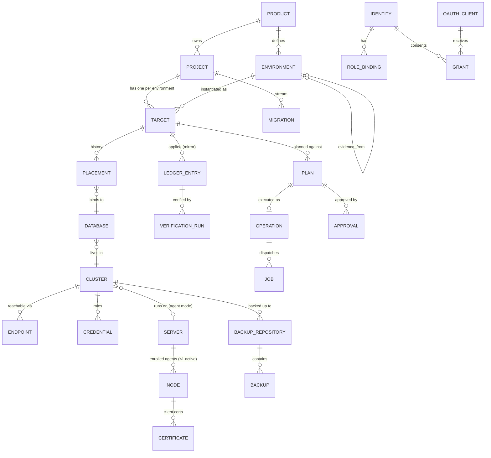

# Domain model

| | |
|---|---|
| Status | Baseline (Wave 0), awaiting owner approval |
| Applies to | Waves 2 to 11; every package that stores or exchanges domain objects |
| Read before | [`../00-product/glossary.md`](../00-product/glossary.md) |
| Related | [`../02-control-plane/registry.md`](../02-control-plane/registry.md), [`../02-control-plane/control-database.md`](../02-control-plane/control-database.md), [ADR-0004](./adr/0004-logical-targets.md) |

This document defines the entities ExponetDB reasons about, how they are
identified, how they relate, and which invariants hold between them. The
Control Store schema ([`control-database.md`](../02-control-plane/control-database.md))
implements this model; the REST resources and MCP tools expose projections of
it.

## 1. The core separation

**[DECIDED]** ExponetDB never conflates these six things:

| Concept | Example | Changes when |
|---|---|---|
| Server | `reos-db-01` (Hetzner Cloud, Falkenstein) | hardware/VM is replaced |
| Node | the enrolled `exponetdb-node` on that server | the agent is re-enrolled |
| Cluster | `postgres-main` (PostgreSQL 17, port 5432) | a new data directory is initialized |
| Database | `reosa_production` | the database is recreated or restored into a new one |
| Target | `reosa/platform/production` | never (it is the stable identity) |
| Environment | `production` (tier `prod`) of product `reosa` | rarely, by configuration |

**[DECIDED]** A client addresses a **target**. ExponetDB resolves the target to
its placement (database on a cluster), the cluster to its endpoint(s) and
credentials, and the cluster to its server and node for host capabilities
([C-4](../00-product/constitution.md#c-4-logical-targets-are-stable-identities)).

```
              target: reosa/platform/production   (tgt_…, stable)
                               │ placement (generation 3)
                               ▼
           database: reosa_production  on  cluster: postgres-main
                                              │            │
                         endpoint: 10.8.1.2:5432 (private,  │
                         TLS verify-full)                   │ runs on
                                                            ▼
                                     server: reos-db-01 ── node: nod_… (exponetdb-node)
```

## 2. Identifiers

**[DECIDED]**

- Every entity has an immutable opaque id: a type prefix plus a ULID, for
  example `tgt_01JB2Z6G8M4Q7R9T1V3W5X7Y9Z`. Prefixes make ids self-describing in
  logs, audit events and agent transcripts, and make it impossible to pass a plan
  id where a target id is expected without a type error.
- Human-facing names are **slugs** (`[a-z][a-z0-9-]{0,38}`), unique within their
  parent. Slugs of products, projects, environments and therefore target paths
  are **immutable** in V1. Renaming means registering a new target and
  decommissioning the old one. Reason: target paths are what agents, plans,
  scripts and audit events use; an alias layer would create exactly the
  target-confusion risk the model exists to prevent.
- Server, cluster and node display names (`reos-db-01`, `postgres-main`) are
  mutable labels. Nothing binds to them ([owner brief §63](../00-product/vision-and-scope.md): names may still change).

| Prefix | Entity | Prefix | Entity |
|---|---|---|---|
| `prd_` | Product | `pln_` | Plan |
| `prj_` | Project | `op_` | Operation |
| `env_` | Environment | `job_` | Node job |
| `tgt_` | Target | `apr_` | Approval |
| `plc_` | Placement | `bgl_` | Break-glass grant |
| `srv_` | Server | `evd_` | Evidence record |
| `nod_` | Node | `idn_` | Identity |
| `cls_` | Cluster | `rlb_` | Role binding |
| `dbs_` | Database | `cli_` | OAuth client |
| `end_` | Endpoint | `grt_` | OAuth grant |
| `crd_` | Credential | `key_` | API key |
| `bkr_` | Backup repository | `ses_` | Web session |
| `bkp_` | Backup | `aud_` | Audit event |
| `rst_` | Restore | `fnd_` | Finding (drift, advisor) |
| `crt_` | Certificate | `smp_` | Sample batch |

Migration ids are **not** prefixed: they are bare ULIDs because they live in
consumer repositories and in target ledgers, outside ExponetDB's id space
([ADR-0006](./adr/0006-ulid-migration-ids.md)).

## 3. Entities

### 3.1 Organization layer

**Product** (`prd_`). A namespace such as `reosa`. Owns environments and projects.
RBAC role bindings can be scoped to a product.

**Environment** (`env_`). Defined **per product** (for example `staging`,
`production`, later `preview`). Fields:

- `slug`, `display_name`
- `tier`: `prod` | `nonprod` ([C-24](../00-product/constitution.md#c-24-production-is-its-own-authorization-tier))
- `evidence_from`: the environment whose verified results count as evidence for
  this environment (nullable). For `reosa`: `production.evidence_from = staging`.
- `rank`: ordering for display and promotion views.

Why per product and not per project: environments describe how a product
promotes changes, and every project of a product follows the same promotion
chain. A project that lacks a target in the evidence environment (for example a
status database that only exists in production) must say so explicitly, see
§5 invariant I-9.

**Project** (`prj_`). A line of databases sharing one schema history:
`reosa/platform`, `reosa/status`. Fields:

- `slug`, `display_name`
- `migration_stream`: configuration of the project's migrations (managed scope,
  execution role alias, legacy import mapping, lint profile). See
  [`../04-migrations/migration-bundles.md`](../04-migrations/migration-bundles.md#6-project-configuration-exponetdbprojectyaml).
- `evidence_override`: optional per-project override of the product's evidence
  chain, including the explicit value `none` (audited, admin-only).

**Target** (`tgt_`). The pair (project, environment), path
`<product>/<project>/<environment>`. Fields:

- `path` (immutable), `project_id`, `environment_id`
- `tier` (copied from the environment at creation; changing an environment's tier
  is a registry operation that re-derives it)
- `generation`: integer, increments on placement change, restore, recreate,
  identity re-stamp
- `state`: `registered` → `active` → `suspended` | `decommissioned`
- `current_placement_id`
- `settings`: target-scoped policy settings (maintenance windows, lock timeout
  defaults, data-read permission)

### 3.2 Physical layer

**Server** (`srv_`). A machine. Fields: `display_name`, `provider`
(`hetzner_cloud`, `hetzner_robot`, `other`, `unknown`), `provider_ref`,
`location`, `labels`, `observed_facts` (OS, kernel, CPU, memory, last reported by
the node), `derived_tier`.

**Node** (`nod_`). An enrolled agent identity on exactly one server. Fields:
`server_id`, `state` (`pending_enrollment`, `active`, `degraded`, `offline`,
`revoked`, `decommissioned`), `agent_version`, `protocol_version`,
`certificate_id`, `capabilities` (last report), `last_heartbeat_at`,
`clock_skew_ms`. A server has at most one non-revoked node in V1.

**Cluster** (`cls_`). One PostgreSQL instance. Fields:

- `server_id` (nullable for external clusters)
- `management_mode`: `agent` (an active node runs on the server and reports this
  cluster) | `external` (network access only)
- `display_name` (`postgres-main`)
- `system_identifier`: the value of `pg_control_system()` / `system_identifier`,
  pinned at registration. A different value at connection time means "this is
  not the cluster we registered" and is `CLUSTER_IDENTITY_MISMATCH`.
- `pg_version` (observed), `port`, `data_directory` (observed via node)
- `derived_tier`

**Endpoint** (`end_`). A network path to a cluster: `kind` (`private`,
`public`, `local_socket`, `pooler`), `host`, `port`, `tls_mode`
(`verify-full` required for non-local endpoints), `tls_server_name`,
`ca_bundle_ref`. The registry selects endpoints by rule (prefer `private`), never
the caller.

**Database** (`dbs_`). A database inside a cluster. Fields: `cluster_id`, `name`,
`oid` (observed), `observed_owner`, `observed_encoding`, `observed_collation`.

**Placement** (`plc_`). The binding target → database, with history. Fields:
`target_id`, `database_id`, `generation`, `valid_from`, `valid_to`, `reason`
(`initial`, `move`, `restore`, `recreate`), `operation_id`.

**Credential** (`crd_`). Encrypted secret for a PostgreSQL login role. Fields:
`cluster_id`, `role_name`, `access_tier` (`observer`, `reader`, `operator`,
`migrator`), `secret_ref` (pointer into the secrets store), `version`, `state`
(`active`, `pending`, `retired`), `last_verified_at`. Never serialized to any
interface (C-20). Details:
[`../03-database-model/credentials-and-roles.md`](../03-database-model/credentials-and-roles.md).

**Certificate** (`crt_`). Metadata of certificates ExponetDB issued or observes:
node client certificates, PostgreSQL server certificates. Subject, SANs, serial,
fingerprint, `not_before`, `not_after`, issuer, purpose, `state`. Private keys of
node certificates never leave the node.

### 3.3 Migration layer

**Migration** (bundle, content-addressed). Identified by its ULID within a
project's stream. Stored in the Control Store as the exact bytes received
(manifest, `up.sql`, `verify.sql`, `down.sql`), keyed by
`(project_id, migration_id, apply_checksum)`. Two different contents for one id
are stored as two rows, and the second one is the evidence of a
`MIGRATION_CHECKSUM_MISMATCH`, never a replacement.

**Ledger entry** (inside the target, mirrored). One row per applied migration per
target database. See [`../04-migrations/ledger.md`](../04-migrations/ledger.md).

**Verification run.** One row per verification attempt of one applied migration
on one target, append-only.

**Evidence record** (`evd_`). A fact used by a decision: "migration M with checksum
C was applied and verified on target T (environment E) at time t, fingerprint
before F1, after F2, verified with verify digest V". Derived from ledger and
verification rows, stored with a reference to them.

**Schema snapshot.** A fingerprint plus its canonical document (compressed),
taken at a moment for a target. Used for drift, diff and plan binding.

**Finding** (`fnd_`). A detected condition that needs attention: drift item,
lint result on live schema, invalid index, unvalidated constraint, expiring
certificate, backup overdue. Has `kind`, `severity`, `subject`, `first_seen_at`,
`last_seen_at`, `resolved_at`, `resolution`.

### 3.4 Change layer

**Plan** (`pln_`), **Operation** (`op_`), **Job** (`job_`), **Approval** (`apr_`),
**Break-glass grant** (`bgl_`). Defined in
[`../02-control-plane/operations-engine.md`](../02-control-plane/operations-engine.md).

### 3.5 Access layer

**Identity** (`idn_`): `kind` (`human`, `service`), display name, contact (human
only), state. **External subject**: (issuer, subject) → identity. **Role**,
**Role binding** (`rlb_`: identity, role, scope = global | product | project |
target). **OAuth client** (`cli_`), **Grant** (`grt_`), **Access/refresh
tokens** (stored hashed), **API key** (`key_`, hashed), **Web session**
(`ses_`). Defined in [`../08-auth-and-security/identity.md`](../08-auth-and-security/identity.md)
and [`../08-auth-and-security/authorization.md`](../08-auth-and-security/authorization.md).

### 3.6 Backup layer

**Backup repository** (`bkr_`): where backups of a cluster go (engine, location,
encryption key reference, retention). **Backup** (`bkp_`): one backup
(kind, start/stop LSN or dump timestamp, size, state, verification result).
**Restore** (`rst_`): a restore operation record including drill results.
Defined in [`../09-backups-and-restore/architecture.md`](../09-backups-and-restore/architecture.md).

### 3.7 Observation layer

**Health sample**, **query statistics sample**, **node heartbeat**. High-volume,
time-bounded, see [`../02-control-plane/data-retention.md`](../02-control-plane/data-retention.md).

**Audit event** (`aud_`). Append-only, hash-chained, see
[`../02-control-plane/audit.md`](../02-control-plane/audit.md).

## 4. Relationship diagram



## 5. Invariants

**[DECIDED]** These invariants are enforced by the Control Store (constraints,
triggers) or by the owning package, and are covered by tests.

| Id | Invariant | Enforced by |
|---|---|---|
| I-1 | A target path is unique and immutable. | unique index; no update path for slugs |
| I-2 | A target has at most one current placement; placements of one target do not overlap in time. | exclusion constraint on `(target_id, tstzrange(valid_from, valid_to))` |
| I-3 | A database is the current placement of at most one target. | partial unique index on current placements |
| I-4 | The target identity marker inside the database matches `(target_id, generation)` of the placement before any write (C-27). | PostgreSQL adapter connection guard |
| I-5 | A cluster's `system_identifier` matches the pinned value before any operation. | PostgreSQL adapter connection guard |
| I-6 | A server has at most one node in a non-terminal state. | partial unique index |
| I-7 | Derived tier of server and cluster equals the maximum tier of targets placed on them. | recomputed on placement change; checked in policy |
| I-8 | An environment's `evidence_from` belongs to the same product and does not form a cycle. | check on write |
| I-9 | A project with a target in an environment that has `evidence_from = E` either has a target in `E`, or has an explicit, audited `evidence_override = none` for that environment. | registry validation; policy refuses production plans otherwise with `EVIDENCE_CHAIN_MISCONFIGURED` |
| I-10 | A migration id within a project maps to exactly one apply checksum *in any ledger*; additional checksums seen for the same id are mismatch evidence. | ledger primary key `(id)` in target; Control Store mirror check |
| I-11 | A plan is consumed at most once. | `UPDATE … WHERE state = 'active'` returning row; unique `operations.plan_id` |
| I-12 | At most one schema-changing operation per target is in a non-terminal state. | partial unique index on operations + target advisory lock (C-18) |
| I-13 | Credentials are only readable by the secrets package; no view or API serializes `secret_ref` contents. | DB grants on secret tables; serialization tests |
| I-14 | Audit events are never updated or deleted by application roles. | grants + trigger, see audit.md |
| I-15 | A node can only receive jobs for clusters on its own server. | job dispatch check + agent-side check |

## 6. Lifecycles

### Target

```
registered ──(identity stamped, credentials verified)──▶ active
active ──(admin suspend)──▶ suspended ──(resume)──▶ active
active/suspended ──(decommission plan/apply)──▶ decommissioned   (terminal)
```

`suspended` blocks every write operation and every new plan, keeps reads. It is
the state for "something is wrong, stop all changes" and is set automatically
on `TARGET_IDENTITY_MISMATCH` and on ledger/mirror divergence above threshold.

### Placement change (moving a target)

A move is a planned operation: it creates a new placement with
`generation + 1`, re-stamps the identity marker in the destination database,
invalidates all active plans for the target (their generation binding fails),
and records the old placement's end. How the data gets to the new database
(restore, dump/load, replication) is a separate operation that precedes the
switch. [PLANNED] Wave 9/11.

### Node

```
pending_enrollment ─enroll─▶ active ⇄ degraded ⇄ offline
active/degraded/offline ─revoke─▶ revoked (terminal)
any non-terminal ─decommission─▶ decommissioned (terminal)
```

`degraded`: heartbeats arrive but report problems (clock skew, capability
failures, certificate near expiry). `offline`: no heartbeat within the
threshold. Neither changes the health state of the targets on that server; see
[`../10-observability/health.md`](../10-observability/health.md).

## 7. External clusters

**[DECIDED]** A cluster without a node agent (`management_mode = external`) can be
registered with endpoints and non-superuser credentials. Supported: introspection,
diagnostics through SQL, schema fingerprints, ledger, legacy import, migrations
(planned, applied and verified like any other). Not supported: anything that
needs a node capability (configuration, restart, TLS rotation, packages,
physical backups, host metrics, role bootstrap, extension installation).

This is how REOSA's current hosted databases can be imported and baselined
before the move to `reos-db-01`
([OPEN: OD-7](../00-product/open-decisions.md#od-7-manage-reosas-current-hosted-databases-before-the-move)).
It is a generic capability for any PostgreSQL reachable over TLS, not a
provider integration.

## 8. What the model deliberately does not contain

- **Organizations / multi-tenancy for customers.** ExponetDB is internal; RBAC
  scopes (global, product, project, target) are enough.
- **A "connection string" entity exposed to clients.** Endpoints and credentials
  exist only server-side.
- **Schema-level targets** (one target = one schema inside a shared database).
  V1 targets are whole databases. The advisory-lock key and the fingerprint scope
  are derived so that schema-level targets remain possible later
  ([`../04-migrations/concurrency.md`](../04-migrations/concurrency.md)).
- **Read replicas as targets.** A replica is a second cluster with an endpoint;
  it can be modeled as an additional placement role later. V1 observes
  replication, it does not route to replicas.
