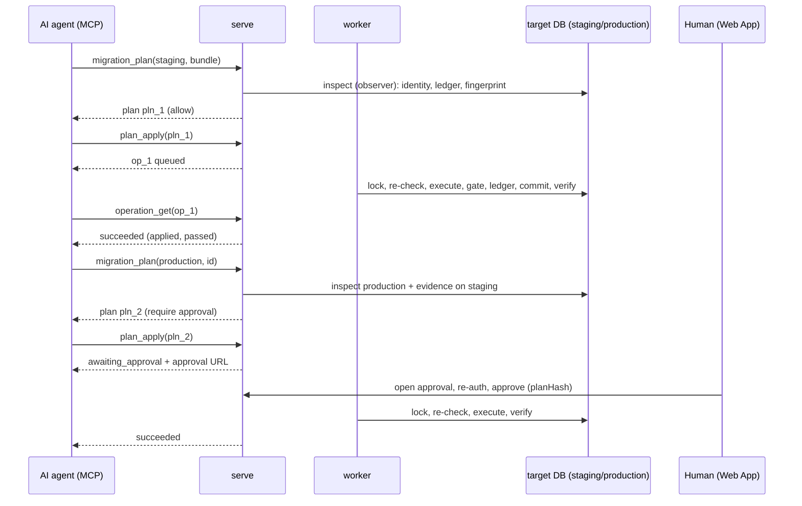

# Architecture overview

| | |
|---|---|
| Status | Baseline (Wave 0), accepted 2026-10-05; §7 (state after Wave 7) and the MCP rows of §2, §3 and §5 updated on 2026-10-13, G7 not yet accepted ([G7 record](../14-roadmap/gates/7.md)) |
| Read before | [`../00-product/constitution.md`](../00-product/constitution.md), [`../00-product/vision-and-scope.md`](../00-product/vision-and-scope.md) |
| Then read | [`control-plane-and-data-plane.md`](./control-plane-and-data-plane.md), [`domain-model.md`](./domain-model.md), [`package-architecture.md`](./package-architecture.md) |

## 1. System context

```
   People (Web App)        AI clients (MCP)          Programs (REST / SDK / CLI / CI)       Consumer backends (SDK)
   owner, engineers        Claude, Claude Code,      CI pipelines, scripts                  e.g. REOSA Admin
                           ChatGPT, Codex, …
          │                        │                              │                                  │
          └──────────────── HTTPS (TLS by Traefik) ─── https://db.exponet.cloud ─────────────────────┘
                                                   │
                         ┌─────────────────────────▼───────────────────────────────────────────┐
                         │                      ExponetDB Control Plane                          │
                         │  serve:   Web App assets · /api/v1 (REST) · /mcp · /oauth · /.well-known
                         │  worker:  Operations Engine · samplers · reconciliation · retention   │
                         │  gateway: node agent endpoint (mTLS, private network)                 │
                         │                         │                                              │
                         │                  Control Store (PostgreSQL, exponetdb_control)        │
                         └──────────┬──────────────────────────────────┬──────────────────────────┘
                                    │ SQL over TLS (private network)   │ mTLS, agent-initiated
                                    ▼                                  ▲
                ┌───────────────────────────────────────────────────────────────────┐
                │ reos-db-01 (database host)                                         │
                │   PostgreSQL 17 cluster "postgres-main"  ◀── local socket ──  exponetdb-node
                │     reosa_production   reosa_staging   (+ schema exponetdb in each)
                └───────────────────────────────────────────────────────────────────┘
                                    ▲
                                    │ SQL over TLS (private network), direct, not through ExponetDB
                            REOSA applications on reos-01
```

Key properties:

- ExponetDB is **beside** the application data path, never in it (C-1). REOSA's
  applications connect to PostgreSQL directly.
- Two channels reach a database host: **SQL** (control plane → PostgreSQL, with
  ExponetDB's least-privilege roles) and **capabilities** (node agent ← control
  plane jobs, for host-level work). Neither is a shell.
- One public hostname. Agents and people use the same API surface; the node agent
  uses a separate, private, mutually authenticated channel.

## 2. Containers (process roles)

**[DECIDED]** One server codebase (`apps/server`), one container image, three
process roles started with different commands
([ADR-0019](./adr/0019-process-roles-and-web-app.md)):

| Role | Listens | Does | Holds |
|---|---|---|---|
| `serve` | `:8080` behind Traefik (`db.exponet.cloud`) | Web App static assets; REST `/api/v1`; MCP `/mcp`; OAuth AS `/oauth/*`; discovery `/.well-known/*`; plan creation and apply acceptance (synchronous parts) | Control Store role `exdb_serve`; session/OAuth state; the **observer** credential only (read-only, `pg_monitor`; used for planning and the fast staleness check); **no** reader, operator or migrator credentials |
| `worker` | nothing public | executes operations (migrations, verifications, node job dispatch and signing), samplers (health, statement stats, drift), reconciliation, retention | `exdb_worker`; decrypts all target credentials; job-signing key; executes `data.read` queries for `serve` over an internal request lane (built in Wave 7, [ADR-0028](./adr/0028-data-read-lane.md)) |
| `gateway` | `:7443` on the private network only, mTLS (from Wave 5; in Wave 2 the role runs without an agent listener) | node agent API: enrollment, heartbeats, job claim/ack/progress/result, certificate renewal | `exdb_gateway`; agent CA (issuing intermediate); **no** target credentials, **no** job-signing key |

Why split processes: blast radius (P-7) and isolation of long-running database
work from request handling. The **gateway** is the only component reachable from
database hosts; if it is compromised, it can neither read target credentials nor
forge jobs (jobs are signed by the worker and verified by the agent). The
**serve** process faces the internet; it can decrypt only the observer credential
(statistics and catalogs, no table data), so a request-handling bug cannot leak
credentials that read data or change anything.

Why not more services: REST and MCP share one process because they are two
interfaces over the same application services (C-9); separating them would add
deployment surface without separating trust.

Plus:

| Component | Where | Notes |
|---|---|---|
| Control Store | Coolify PostgreSQL resource on `reos-01` (V1) | [`../02-control-plane/control-database.md`](../02-control-plane/control-database.md) |
| `exponetdb-node` | each database host, systemd | [`../07-node-agent/architecture.md`](../07-node-agent/architecture.md) |
| CLI `exponetdb` | developer machines, CI | uses the REST API; shares bundle/checksum code with the server |
| Web App | static SPA served by `serve` | talks only to `/api/v1`, `/auth` and `/oauth` like any client |

## 3. Layering inside the server

```
 interfaces (apps/server/src/interfaces/*)   REST handlers · MCP tools · OAuth endpoints · gateway API · Web App assets
        │  may import only ▼
 application services (packages/application) one function per use case: authorize → call domain → audit
        │
 domain packages        registry · migrations · operations · policy · nodes · backups · diagnostics · auth · secrets · audit
        │
 adapters / kernel      postgres (PostgreSQL adapter) · control-store (persistence) · observability · contracts · kernel
```

**[DECIDED]** Interfaces contain no business logic and no SQL. They translate
protocol to application calls and back. Contract tests run the same scenario
through REST and MCP and require identical outcomes (C-9).
**[OBSERVED]** (2026-10-13, Wave 7) The parity suites are
`apps/server/test/mcp.int.test.ts` and `mcp-data.int.test.ts` (each read tool
against its REST route for the same identity and grant), and
`apps/server/test/mcp-catalog.test.ts` checks that every served tool has one
use-case binding and a served REST route of the same action.

## 4. Main flows

### 4.1 Agent applies a migration to staging, then production



### 4.2 Host-level change through the node agent

`postgres.config.plan` → plan with current/proposed values, reload vs restart,
validity per PostgreSQL version → approval (prod tier) → worker creates a
**signed job** → gateway delivers it when the agent claims → agent verifies
signature, node id, expiry, journal (replay protection) → executes the capability
via local socket / helper → reports result → worker verifies (re-reads
`pg_settings`, `pending_restart`) → audit.

### 4.3 Health sampling

The worker samples each target every 15 s with the observer role (dual
simple/extended probe, activity summary, key stats) and each node via heartbeats
(every 15 s). Results are stored with timestamp and source; a failed sample is
stored as a failure, never as zeros (C-28). The health state machine distinguishes
"target unhealthy" from "ExponetDB cannot see the target" from "node offline"
from "ExponetDB degraded" (C-29).

## 5. Technology choices (summary)

| Area | Choice | Status |
|---|---|---|
| Language (control plane, Web App, CLI, SDK) | TypeScript | **[DECIDED]** |
| Runtime (server processes) | Node.js 24 LTS (no Bun-only production design) | **[DECIDED]** ([OD-3](../00-product/open-decisions.md#od-3-toolchain-and-runtime), resolved 2026-10-05) |
| Workspace tooling | Bun workspaces (package manager, workspace and development tooling) + Turborepo + Vitest + Biome | **[DECIDED]** ([OD-3](../00-product/open-decisions.md#od-3-toolchain-and-runtime)) |
| HTTP framework | Hono (`hono`, `@hono/node-server`, exactly pinned in `apps/server`); the OpenAPI document is generated from the Zod contracts of `packages/contracts`, not by Hono | **[OBSERVED]** 2026-10-13 (`apps/server/package.json`) |
| Contracts | Zod schemas in `packages/contracts` → OpenAPI 3.1, JSON Schema 2020-12, SDK, Go types | **[DECIDED]** ([ADR-0018](./adr/0018-contracts-first.md)) |
| MCP | official TypeScript SDK (`@modelcontextprotocol/server` 2.3.1, exactly pinned, only in `apps/server`), dual-era: 2026-07-28 and 2025-11-25 and 2025-06-18, stateless | **[DECIDED]** ([`../05-mcp/architecture.md`](../05-mcp/architecture.md), [ADR-0027](./adr/0027-mcp-protocol-layer.md)); **[OBSERVED]** 2026-10-13 (`apps/server/package.json`, `tooling/boundaries/graph.json`) |
| SQL parser | libpg_query | **[DECIDED]** ([ADR-0021](./adr/0021-libpg-query-parser.md)) |
| PostgreSQL driver | node-postgres (`pg`, with `pg-cursor` for bounded reads), in `packages/postgres`, `packages/control-store` and the test kit | **[OBSERVED]** 2026-10-13 (`packages/postgres/package.json`) |
| Web App | React 19.3, Vite 8.3 (`bun --bun vite build`), TanStack Router 1.170 (file-based, code-split; plain-string query parsing) + TanStack Query 5, Tailwind v4.3 (`@tailwindcss/vite`), `radix-ui`, `class-variance-authority`, `cmdk`, `react-hook-form` + zod (jitless under the CSP), TanStack Table + Virtual, `react-resizable-panels`, `lucide-react`, `recharts`, `@xyflow/react` + dagre (lazy), CodeMirror 6 for the SQL editor and diffs ([OD-40](../00-product/open-decisions.md)); exact version pins | **[OBSERVED]** 2026-10-13 (`apps/web/package.json`, `packages/ui*/package.json`; built into `apps/web/dist` and served by `serve` since Wave 8 Phase 8, [ADR-0031](./adr/0031-web-app-serving.md)); the framework-free Wave 3A app is deleted ([`../11-ui/design-system.md`](../11-ui/design-system.md), [Wave 8 order §7](../14-roadmap/orders/wave-8-order.md)) |
| Node agent | Go, single static binary + root helper | **[DECIDED]** ([OD-2](../00-product/open-decisions.md#od-2-node-agent-implementation-language), resolved 2026-10-05) |
| Control Store | PostgreSQL 17 | **[DECIDED]** |
| Queues, leases, locks | PostgreSQL (`SKIP LOCKED`, leases, advisory locks) | **[DECIDED]** (P-8) |
| Observability | OpenTelemetry (traces, metrics), structured JSON logs, optional Sentry for errors | **[PLANNED]** |

## 6. Where to go next

- Separation of planes and network paths: [`control-plane-and-data-plane.md`](./control-plane-and-data-plane.md)
- Entities and invariants: [`domain-model.md`](./domain-model.md)
- Repository layout and dependency rules: [`package-architecture.md`](./package-architecture.md)
- Failure behavior: [`failure-model.md`](./failure-model.md)
- Security: [`../08-auth-and-security/threat-model.md`](../08-auth-and-security/threat-model.md)

## 7. State after Wave 7 (MCP)

**[OBSERVED]** (2026-10-13; G7 not yet accepted, nothing deployed;
[G7 record](../14-roadmap/gates/7.md))

- `POST /mcp` is served by the `serve` role next to `/api/v1`. It is one more
  interface over `packages/application`: `apps/server/src/interfaces/mcp/`
  holds the edge (method, `Origin`, `Host`, media types, bounds, the bearer
  check for the audience `mcp`, classification of the protocol era, rate
  limits), the tool registry and the result layer. Each of the 26 served tools
  (30 in the contract, 4 planned for Wave 9) calls one application use case;
  the tools hold no business logic and no SQL
  ([`../05-mcp/tool-catalog.md`](../05-mcp/tool-catalog.md)).
- The protocol library is the official TypeScript SDK inside edges ExponetDB
  owns; the SDK never sees a token. Both protocol eras are served on the same
  path ([`../05-mcp/protocol-baseline.md`](../05-mcp/protocol-baseline.md)).
- Agent data reads take a new path: `serve` checks policy and admits the
  statement, seals the request into the Control Store lane (schema
  `dataread`), the `worker` runs it on a fresh reader session of the target and
  seals the result back; `serve` still holds no target credential beyond the
  observer's ([ADR-0028](./adr/0028-data-read-lane.md)).
- Approval stays outside MCP: `plan_apply` returns the link
  `<public origin>/approvals#operation=op_…`, and a person approves in the Web
  App ([ADR-0029](./adr/0029-approval-link-from-mcp.md)).
- Not part of this state: any MCP tool for node changes (OD-29), the Wave 9
  tools (statistics, advisors, backups, restores, session termination), the
  redesigned approval page (Wave 8), and GA of `/api/v1`
  ([`../06-rest-api/ga-readiness.md`](../06-rest-api/ga-readiness.md)).
