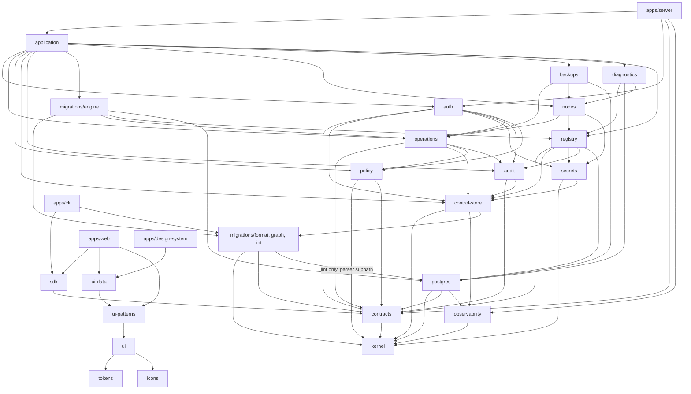

# Package architecture

| | |
|---|---|
| Status | Baseline (Wave 0), accepted 2026-10-05 |
| Applies to | Wave 1 (contracts, kernel, migration format primitives), Wave 2 (scaffold), every later wave |
| Read before | [`overview.md`](./overview.md), [`repositories-and-boundaries.md`](./repositories-and-boundaries.md) |

This is the **target** layout of the repository. Packages are created when the
wave that needs them starts; nothing is scaffolded empty "for later" (P-11). A
package can grow by subpath across waves; `packages/migrations` is the main case
(§1.1).

## 1. Layout

```
ExponetDB/
├── apps/
│   ├── server/            control plane process: roles serve | worker | gateway
│   │   └── src/{config, composition, roles, commands, interfaces/{http, rest, mcp, oauth, gateway, web-assets}}
│   ├── web/               Web App (React SPA; talks only to /api/v1 and /oauth)
│   ├── cli/               `exponetdb` CLI (bundles, lint, checksum, plan/apply via REST)
│   └── design-system/     component documentation, guidance pages, live demos
├── agent/
│   └── node/              Go module: exponetdb-node (daemon) + exponetdb-node-helper (root helper);
│                          from Wave 1: generated protocol types, internal/canon, internal/conformance
├── packages/
│   ├── kernel/            ids (prefixed ULIDs), Result, base errors, JCS canonical JSON, hashing, clock
│   ├── contracts/         Zod schemas: REST resources, error catalog, permissions/scopes, action registry,
│   │                      MCP tool I/O, node protocol, manifest schemas → generated OpenAPI / JSON Schema / Go
│   ├── observability/     redacting structured logger, OpenTelemetry setup, metrics registry
│   ├── control-store/     Control Store access: connection, transactions, leases, migration runner,
│   │                      bootstrap SQL, SCRAM verifier generation; subpath testing/ (integration harness)
│   ├── secrets/           keyring, envelope encryption (se1), consumer-separated storage, re-wrap
│   ├── audit/             audit writer, hash chain ac1, checkpoints and export, verification, retention
│   ├── auth/              identities, sessions, password/TOTP/WebAuthn, OAuth AS, tokens, API keys,
│   │                      RBAC + scope evaluation, OIDC federation (relying party)
│   ├── policy/            rule framework, decision model, fact-provider interfaces, rule catalog
│   ├── operations/        Operations Engine: plans, operations, state machine, jobs, idempotency,
│   │                      approvals, break-glass, exclusivity domains, reconciliation framework
│   ├── registry/          products, environments, projects, targets, placements, servers, nodes,
│   │                      clusters, endpoints, databases; resolution; tier derivation
│   ├── postgres/          PostgreSQL adapter: sessions, introspection, fingerprints, parser (libpg_query),
│   │                      analysis rules, executors, redaction, diagnostics SQL, live advisors
│   ├── migrations/        format/ (pure: manifest projection, c1, digests, ls1) + graph/ (DAG) +
│   │                      lint/ + engine/ (plan, apply, verify, ledger, locks, evidence, legacy import)
│   ├── nodes/             enrollment, agent CA, job signing and dispatch, capability catalog (control side)
│   ├── backups/           backup policies and catalog, restore planning, restore drills
│   ├── diagnostics/       health sampling and state model, statement statistics, findings, drift schedule
│   ├── application/       use-case services; the only layer interfaces call
│   ├── sdk/               @exponetdb/sdk (generated types + thin typed client)
│   ├── testkit/           PostgreSQL containers (16/17/18 + pgvector), fixtures, fake agent, fault injection
│   ├── tokens/            design tokens (CSS custom properties, themes, Tailwind v4 mapping)
│   ├── ui/                primitives (Radix + Tailwind), subpath exports
│   ├── ui-patterns/       composites: page layout, dialogs, forms, states, filter bar, command menu, charts
│   ├── ui-data/           heavy data UI: data table/grid, SQL editor (Monaco), diff viewer, plan viewer, schema tree
│   └── icons/             icon factory and custom glyphs
├── tooling/               boundary checks, generators (OpenAPI, JSON Schema, Go types), golden vector data
└── exponetdb-docs/
```

Count: 4 apps, 1 agent module, 23 packages. Each package has one owner domain, a
README stating its responsibility and its allowed dependencies, and tests.

### 1.1 `packages/migrations` by subpath and wave

**[DECIDED]** (2026-10-05, Wave 0 hardening review). The `c1` apply checksum,
the verify, rollback and bundle digests and the `ls1` ledger state hash are
stored and wire contracts, not implementation details: once a value such as
`sha256:c1:…` exists, the algorithm that produced it must stay reproducible for
as long as that history exists
([`../04-migrations/migration-bundles.md` §3](../04-migrations/migration-bundles.md#3-checksum-semantics)).
They are therefore built first, as production code, and frozen before anything
stores them.

| Subpath | Contents | May import | Created in |
|---|---|---|---|
| `migrations/format` | manifest parsing and validation against the manifest schema in `contracts`; canonical manifest projection with materialized defaults; `c1` lexical canonicalization of executable SQL text; apply checksum; verify, rollback, bundle and source digests; `ls1` ledger state hash (a pure function over ledger entries) | `kernel`, `contracts` | Wave 1 |
| `migrations/graph` | DAG validation, deterministic topological order, heads, pending sets | `format`, `kernel` | Wave 2 (the Control Store bootstrap runner applies its own bundles in DAG order) |
| `migrations/lint` | lint rules and analysis bindings | `format`, `graph`, `kernel`, `postgres/parser` | Wave 6 (needs the Wave 4 parser) |
| `migrations/engine` | plan, apply, verification against a database, ledger access, advisory locks, evidence, legacy import, drift wiring | the subpaths above, `operations`, `registry`, `postgres` | Wave 6 |

Rules:

- `format`, `graph` and `lint` do no I/O: no database, no network, no file
  system beyond what the caller passes in. The server, the CLI and the Control
  Store runner call the same functions, so local and server results cannot
  differ.
- `migrations/format` is the production implementation from its first commit.
  No other checksum implementation exists in TypeScript; `tooling/` holds golden
  vector data and generators, never a checksum implementation that a later wave
  replaces.
- **Frozen at G1.** Until the owner accepted G1, `c1`, `ls1` and the
  plan-hash construction could still be corrected under their names (nothing
  had stored a value); every correction is listed in the
  [G1 gate record](../14-roadmap/gates/1.md). The owner accepted G1 on
  2026-10-05 (freeze baseline `b52a6ca`); since then the output of `c1` and
  `ls1` for any input never changes, including for a bug fix. A fix or an improvement is a new
  canonicalizer (`c2`, `ls2`) introduced by an ADR; stored values keep the
  canonicalizer named in them ([`versioning.md`](./versioning.md)). Golden
  vectors are append-only.
- **Second implementation.** The Go module `agent/node` has an
  `internal/conformance` package that implements `c1`, the digests, `ls1` and the
  plan-hash construction independently from the specification; it runs the same
  golden vectors in Go tests and is never linked into the agent binaries.
  `internal/canon` (RFC 8785 canonical JSON) is shared by it and by the agent's
  job-signature verification (Wave 5).

### Why these and not fewer or more

| Question | Answer |
|---|---|
| Why is `apps/server` one app with three roles instead of three apps? | Same domain code, same contracts, same release; separation is about runtime privileges (database roles, secrets), not code ownership. One image, three commands. |
| How is `apps/server` layered? | **[DECIDED]** (Wave 2) `config` (environment, build identity) → `composition` (the composition root: the only place that wires `control-store`, `secrets`, `audit`, `policy`, `operations`) → `roles` (lifecycle, listeners, shutdown) → `commands` (argument layer); `interfaces` receive what the composition root hands them and never import the Control Store, SQL or a domain package. Each is its own component in `tooling/boundaries/graph.json`, with planted-violation tests. |
| Why are REST and MCP not separate packages? | They are thin interface adapters with no reuse outside the server; package boundaries would add ceremony. The "interfaces call only `application`" rule is enforced by the boundary checker inside `apps/server`. |
| Why `application` as a separate package? | It is the seam that makes C-9 checkable: every interface, including the CLI's server-side counterparts and tests, calls the same functions. |
| Why `audit` separate from `operations`? | Auth events (logins, grants) are audited too; audit integrity code is security-critical and small. |
| Why `secrets` separate from `registry`? | Crypto boundary: only the worker process loads it with key material; reviewable in isolation. |
| Why is `migrations` split into `format`, `graph`, `lint` and `engine`? | `format` holds stored contracts that must be frozen before anything stores them (Wave 1); `graph` is needed by the Control Store runner (Wave 2); `lint` needs the parser (Wave 4); `engine` needs the database, the Operations Engine and the registry (Wave 6). The CLI computes identical checksums and lint results without a server or a database because it uses the same pure subpaths (§1.1). |
| Why `ui-data` separate from `ui-patterns`? | Monaco and virtualized grids are heavy; isolating them keeps the design-system app and light pages fast (lesson from the Supabase reference audit). |
| Why no `core` package? | "Core" packages become dumping grounds. `kernel` is deliberately tiny (ids, errors, canonical JSON, hashing, clock) and has no domain logic. |
| Why no `utils`/`shared`/`lib` package? | Same reason. Helpers live in the package whose domain they serve. |
| Why is the agent not TypeScript? | Decided in [OD-2](../00-product/open-decisions.md#od-2-node-agent-implementation-language) (Go for a small static binary with no runtime on database hosts). |

### 1.2 State after Wave 1

**[OBSERVED]** (Wave 1) What exists; everything else in §1 is created by its
wave.

| Path | Contents |
|---|---|
| `packages/kernel` | prefixed-ULID ids with brands, bare migration ULIDs, `Result`, error classification (bug, domain, boundary), strict JSON parsing, RFC 8785 JCS, SHA-256, the plan-hash construction, injectable clock; subpath `./hash` |
| `packages/contracts` | error catalog, permissions, scopes, client kinds, action registry, REST v1 read routes and resources, MCP read tools, node protocol messages, migration manifest and project config schemas, contract versions; `generated/` (§3) |
| `packages/migrations` | the `./format` subpath only (`src/format/`) |
| `agent/node` | Go module `github.com/davdxpx/ExponetDB/agent/node`: `internal/canon`, `internal/conformance`, `internal/protocol` (generated types and fixture tests); standard library only |
| `tooling/` | `generators/` (OpenAPI, JSON Schema, Go), `golden/` (vectors and `LOCK.json`), `fixtures/` (node protocol examples), `boundaries/` (§2), `checks/` (golden lock, secret scan), `test/` |

Toolchain as pinned in the root `package.json` (OD-3): Bun 1.3.14 workspaces
with the isolated linker, Turborepo 2.11.7, TypeScript 6.0.3, Biome 2.5.15,
Vitest 5.0.3, Zod 4.6.5, dependency-cruiser 18.5.0; Node.js 24 in CI; Go 1.24.
Every dependency is pinned to an exact version; the boundary checker refuses
ranges. Workspace packages resolve to their TypeScript sources through the
export condition `@exponetdb/source` (tests, typecheck, tooling) and to `dist/`
otherwise. `bun run verify` runs every CI check locally.

### 1.3 State after Wave 2

**[OBSERVED]** (Wave 2, accepted with G2 on 2026-10-05) Added to §1.2; everything else in §1 is
still created by its wave.

| Path | Contents | Direct dependencies |
|---|---|---|
| `apps/server` | the Control Plane program: `serve`, `worker`, `gateway` and the operator commands from one build; layers `config` → `composition` → `roles` → `commands`, plus `interfaces/http` ([README](../../apps/server/README.md)) | every Wave 2 package through the composition root only; `hono` 4.13.13, `@hono/node-server` 2.1.3 |
| `packages/control-store` | bootstrap SQL with per-role logins (SCRAM verifiers), the Control Store's own bundles and runner, the ledger, transactions, heartbeats, maintenance leases ([README](../../packages/control-store/README.md)) | `kernel`, `contracts`, `migrations`, `observability`; `pg` 8.23.1 |
| `packages/audit` | `ac1` chain, writer, verification, checkpoints, export (file, S3-compatible), retention, pseudonyms ([README](../../packages/audit/README.md)) | `kernel`, `contracts`, `control-store` |
| `packages/secrets` | keyring, `se1` envelope encryption, consumer-separated stores, rotation ([README](../../packages/secrets/README.md)) | `kernel`, `control-store` |
| `packages/policy` | the evaluation framework and `pv1` (no catalog rules yet) ([README](../../packages/policy/README.md)) | `kernel`, `contracts` |
| `packages/operations` | state machine, plans, acceptance, transitions, leases, locks, idempotency, worker driver (no product kinds yet) ([README](../../packages/operations/README.md)) | `kernel`, `contracts`, `control-store`, `audit`, `policy` |
| `packages/observability` | logger with redaction, metrics, tracing, readiness ([README](../../packages/observability/README.md)) | `kernel`; OpenTelemetry |
| `packages/migrations` | adds the `./graph` subpath (`src/graph/`) | unchanged |
| `tooling/` | adds `smoke/` (image role-start test) and `dev/` (local test services); `golden/` adds `audit-chain.json`, `secret-envelope.json`, `policy-version.json` | |

`Dockerfile` builds the one release image (Bun build stage, Node.js 24
runtime, both pinned by digest); `deploy/env/` holds one example environment
per Coolify resource, placeholders only
([`../12-operations/deployment.md`](../12-operations/deployment.md)). The
boundary checker models 38 components. GitHub Actions are pinned to commit
SHAs (§2).

### 1.4 State during Wave 3A

**[OBSERVED]** (Wave 3A, in progress, G3A not accepted) Added to §1.3:

| Path | Contents | Direct dependencies |
|---|---|---|
| `packages/auth` | trusted auth configuration, opaque tokens (hash-only), credential primitives (passkeys through `@simplewebauthn/server`, Argon2id through `@node-rs/argon2`, TOTP through `otpauth`, recovery codes, the offline common-password list), identities, sessions, ceremonies, rate limits, the operator commands' services, the central authorization engine, the access fact, the access operation kinds and the approvals ([`identity.md`](../08-auth-and-security/identity.md), [`authorization.md`](../08-auth-and-security/authorization.md)); `./testing` exports a software WebAuthn authenticator for tests only | `kernel`, `contracts`, `control-store`, `secrets`, `audit`, `policy`, `operations`; `@simplewebauthn/server` 14.0.3, `@node-rs/argon2` 2.2.1, `otpauth` 9.5.2, `qrcode-generator` 2.0.4, `@zxcvbn-ts/language-common` 4.1.3 |
| `packages/policy` | adds `catalog/access.ts`: the access and approval rules and the `access` fact name | unchanged |
| `packages/application` | the use-case layer every interface calls ([README](../../packages/application/README.md)): each ceremony and each read or change authorizes through the central engine first; access changes become plans (idempotent per identity) or, for the inline ones (invite, re-issue, disable), one audited transaction; apply, withdraw, approve and reject plans; the plan and operation views of the REST contract | `auth`, `contracts`, `control-store`, `kernel`, `operations`, `policy` |
| `apps/server` | adds the Wave 3A composition (`composition/access.ts`), the `/auth` and `/api/v1` handlers (`interfaces/http/api.ts`), the static Web App (`interfaces/http/web.ts`), the operator commands `bootstrap owner` and `auth recover-owner`, and the configuration `EXPONETDB_PUBLIC_URL` (required for `serve`), `EXPONETDB_WEBAUTHN_RP_ID`, `EXPONETDB_TRUSTED_PROXIES` | adds `application`, `auth` |
| `apps/web` | the minimal Web App of Wave 3A ([README](../../apps/web/README.md)): sign-in, setup, invitation and recovery links, own account, approvals; vanilla TypeScript, one bundled module, strict CSP, no third-party script at run time; the image carries the build under `web/` | `contracts` (types only); `@simplewebauthn/browser` 14.0.0 |

**[DECIDED]** (Wave 3A) These arrows are added to §2 and are the only
loosening:

- `auth → policy` and `auth → operations`: the authorization engine
  evaluates through the `pv1` framework, and the access operation kinds
  (`access.role_binding.create`, `access.role_binding.delete`,
  `access.policy_settings.update`, `access.identity.enable`,
  `access.identity.erase`) are registered with the Operations Engine like
  every other kind. `operations` never imports `auth`; an operation carries
  the already-authorized actor.
- `application → operations`, `policy`, `control-store`, `audit`: a use case
  runs authorization, the domain change and its audit record in one
  Control Store transaction, so `application` opens that transaction and
  hands it to the domain packages. Interfaces still import only
  `application`, `auth`, `contracts` and `observability`.

## 2. Dependency rules

**[DECIDED]** Allowed dependencies (arrows point from consumer to dependency).
Everything not listed is forbidden and checked in CI.



Key prohibitions:

- `apps/server/src/interfaces/**` imports only `@exponetdb/application`,
  `@exponetdb/auth` (request authentication middleware), `@exponetdb/contracts`,
  `@exponetdb/observability`. No domain package, no `postgres`, no
  `control-store`.
- `postgres` never imports `control-store`, `registry` or any domain package: it
  is an adapter that receives resolved connection parameters and returns data.
- Domain packages never import `application` or anything in `apps/`.
- `policy` defines fact-provider **interfaces**; domain packages implement them
  (dependency inversion), so `policy` stays independent of migrations, backups and
  registry.
- UI packages (`tokens`, `icons`, `ui`, `ui-patterns`, `ui-data`) never import
  `sdk`, `contracts` or any server package. They are data-agnostic; the Web App
  connects data to components.
- `migrations/format` imports only `kernel` and `contracts`; `migrations/graph`
  adds `migrations/format`; `migrations/lint` adds `migrations/graph` and
  `postgres/parser` (subpath, pure WASM/native parser wrapper). Only
  `migrations/engine` imports `operations`, `registry` and the rest of
  `postgres`, so the CLI and the Control Store runner stay light (§1.1).
- Nothing imports from REOSA or the Supabase repository (C-2).

Enforcement: a dependency-boundary checker (dependency-cruiser or an equivalent)
runs in CI with this graph as configuration; the generated graph is committed and
diffed.

**[DECIDED]** (Wave 1 clarification) How the checker reads this graph
(`tooling/boundaries/`, `bun run boundaries`):

- `graph.json` transcribes the arrows above, one component per package or
  subpath, including components that do not exist yet, so the rules apply
  from their first commit.
- The foundations `kernel` and `contracts` may also be imported directly by
  every component that reaches them through allowed arrows (for example
  `auth → kernel` through `contracts`). Re-exporting a foundation to avoid a
  direct import would hide the dependency instead of removing it. The UI
  packages reach no foundation and import none.
- A package's tests may import what the package may import, plus the
  package itself (the tests of `migrations` may import all of its
  subpaths); product code never imports tests, `tooling/` or `generated/`.
- Checked at import level (dependency-cruiser, by path and by package name):
  the allowed graph, no cycles, no unresolvable import, no REOSA or Supabase
  module, no Node.js builtins in browser-safe code, no runtime import of a
  dev dependency. Checked at manifest level: no REOSA or Supabase package,
  exact versions, no git, URL or file sources, workspace edges inside the
  graph, and no Wave 1 runtime dependency on a server, database, MCP,
  WebSocket or UI library (denylist in `graph.json`); `bun.lock` holds no
  REOSA or Supabase package; `agent/node/go.mod` has no `require` (standard
  library only in Wave 1). Checked at repository level: no `.gitmodules`, no
  `vendor/`, `supabase/` or `reosa/` directory; every GitHub Actions `uses:`
  is pinned to a full commit SHA of the official repository (Wave 2
  supply-chain hardening, G1 A10).
- `tooling/boundaries/package-graph.md` is generated from the manifests and
  diffed in CI.
- Planted-violation tests (`tooling/test/boundaries.test.ts`) prove each rule
  fails when broken.

## 3. Generated artifacts

| Artifact | Generated from | Committed | Check |
|---|---|---|---|
| `packages/contracts/generated/openapi.json` (OpenAPI 3.1) | Zod route schemas | yes | CI regenerates and diffs |
| `packages/contracts/generated/catalog.json` | error catalog, permissions, scopes, client kinds, action registry, contract versions | yes | same |
| `packages/contracts/generated/jsonschema/*.json` | `migration-manifest.v1`, `project-config.v1`, `mcp-tools.v1`, `node-protocol.v1`; the role manifest follows with roles (Wave 3A) | yes | same |
| `agent/node/internal/protocol/types_gen.go` | `node-protocol.v1.json` (contracts → JSON Schema → Go) | yes | same, plus `gofmt` |
| `packages/sdk/src/generated/*` | `openapi.json` | yes | same (from the wave that creates the SDK) |
| Golden vectors (`tooling/golden/…`, data only) | hand-curated + reviewed; append-only since the owner accepted G1 (2026-10-05); `LOCK.json` pins each vector's hash and `bun run golden:check` fails on a changed or removed vector in the current tree; `bun run golden:history <base>` fails when a vector, file member or lock entry of a base commit changed or disappeared ([`tooling/golden/README.md`](../../tooling/golden/README.md)) | yes | consumed by the TypeScript tests of `kernel` and `migrations/format` and by the Go tests of `agent/node/internal/conformance` |
| Protocol fixtures (`tooling/fixtures/node-protocol/`, data only) | hand-written synthetic examples | yes | validated against the JSON Schema (Ajv) and decoded strictly by the generated Go types |

**[DECIDED]** (Wave 1) Generation is a pure function of `packages/contracts`
(`tooling/generators/artifacts.ts`): JSON members sorted, two-space
indentation, LF, no timestamps, paths or tool versions. `bun run
verify:generated` generates twice, fails if the two runs differ, and fails if
a committed file differs or a stray file exists in `generated/`.

OpenAPI **3.1** is chosen over 3.2.1 (published 2026-09-10) for V1 because the
TypeScript generators' 3.2 support is unverified; moving to 3.2 is a minor,
non-breaking documentation change later.

## 4. Build and release units

| Unit | Released as | Versioned |
|---|---|---|
| Server (`apps/server` + `apps/web` assets) | one OCI image `exponetdb-server` | SemVer; image tag = version |
| Node agent | `.deb` package + static binaries (amd64, arm64) | SemVer; protocol version declared separately |
| CLI | npm package + single binary | SemVer |
| SDK | npm package `@exponetdb/sdk` (private registry or GitHub Packages) | SemVer, tied to REST API major |
| Design system app | internal static site | not versioned separately |

See [`versioning.md`](./versioning.md).
