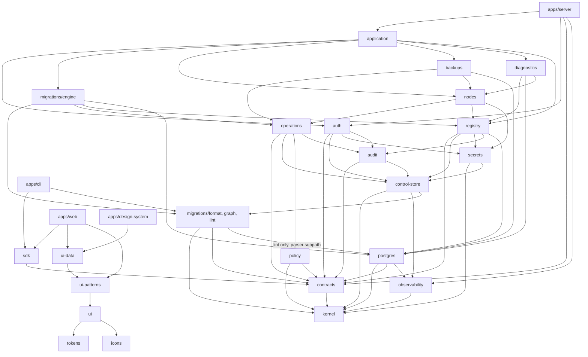

# Package architecture

| | |
|---|---|
| Status | Baseline (Wave 0), accepted 2026-10-05 |
| Applies to | Wave 1 (contracts, kernel, migration format primitives), Wave 2 (scaffold), every later wave |
| Read before | [`overview.md`](./overview.md), [`repositories-and-boundaries.md`](./repositories-and-boundaries.md) |

This is the **target** layout of the repository. Packages are created when the
wave that needs them starts; nothing is scaffolded empty "for later" (P-11). A
package can grow by subpath across waves; `packages/migrations` is the main case
(§1.1).

## 1. Layout

```
ExponetDB/
├── apps/
│   ├── server/            control plane process: roles serve | worker | gateway
│   │   └── src/interfaces/{rest, mcp, oauth, gateway, web-assets}
│   ├── web/               Web App (React SPA; talks only to /api/v1 and /oauth)
│   ├── cli/               `exponetdb` CLI (bundles, lint, checksum, plan/apply via REST)
│   └── design-system/     component documentation, guidance pages, live demos
├── agent/
│   └── node/              Go module: exponetdb-node (daemon) + exponetdb-node-helper (root helper);
│                          from Wave 1: generated protocol types, internal/canon, internal/conformance
├── packages/
│   ├── kernel/            ids (prefixed ULIDs), Result, base errors, JCS canonical JSON, hashing, clock
│   ├── contracts/         Zod schemas: REST resources, error catalog, permissions/scopes, action registry,
│   │                      MCP tool I/O, node protocol, manifest schemas → generated OpenAPI / JSON Schema / Go
│   ├── observability/     redacting structured logger, OpenTelemetry setup, metrics registry
│   ├── control-store/     Control Store access: connection, transactions, leases, migration runner
│   ├── secrets/           envelope encryption, keyring, credential storage, SCRAM verifier generation
│   ├── audit/             audit writer, hash chain, checkpoints, verification
│   ├── auth/              identities, sessions, password/TOTP/WebAuthn, OAuth AS, tokens, API keys,
│   │                      RBAC + scope evaluation, OIDC federation (relying party)
│   ├── policy/            rule framework, decision model, fact-provider interfaces, rule catalog
│   ├── operations/        Operations Engine: plans, operations, state machine, jobs, idempotency,
│   │                      approvals, break-glass, exclusivity domains, reconciliation framework
│   ├── registry/          products, environments, projects, targets, placements, servers, nodes,
│   │                      clusters, endpoints, databases; resolution; tier derivation
│   ├── postgres/          PostgreSQL adapter: sessions, introspection, fingerprints, parser (libpg_query),
│   │                      analysis rules, executors, redaction, diagnostics SQL, live advisors
│   ├── migrations/        format/ (pure: manifest projection, c1, digests, ls1) + graph/ (DAG) +
│   │                      lint/ + engine/ (plan, apply, verify, ledger, locks, evidence, legacy import)
│   ├── nodes/             enrollment, agent CA, job signing and dispatch, capability catalog (control side)
│   ├── backups/           backup policies and catalog, restore planning, restore drills
│   ├── diagnostics/       health sampling and state model, statement statistics, findings, drift schedule
│   ├── application/       use-case services; the only layer interfaces call
│   ├── sdk/               @exponetdb/sdk (generated types + thin typed client)
│   ├── testkit/           PostgreSQL containers (16/17/18 + pgvector), fixtures, fake agent, fault injection
│   ├── tokens/            design tokens (CSS custom properties, themes, Tailwind v4 mapping)
│   ├── ui/                primitives (Radix + Tailwind), subpath exports
│   ├── ui-patterns/       composites: page layout, dialogs, forms, states, filter bar, command menu, charts
│   ├── ui-data/           heavy data UI: data table/grid, SQL editor (Monaco), diff viewer, plan viewer, schema tree
│   └── icons/             icon factory and custom glyphs
├── tooling/               boundary checks, generators (OpenAPI, JSON Schema, Go types), golden vector data
└── exponetdb-docs/
```

Count: 4 apps, 1 agent module, 23 packages. Each package has one owner domain, a
README stating its responsibility and its allowed dependencies, and tests.

### 1.1 `packages/migrations` by subpath and wave

**[DECIDED]** (2026-10-05, Wave 0 hardening review). The `c1` apply checksum,
the verify, rollback and bundle digests and the `ls1` ledger state hash are
stored and wire contracts, not implementation details: once a value such as
`sha256:c1:…` exists, the algorithm that produced it must stay reproducible for
as long as that history exists
([`../04-migrations/migration-bundles.md` §3](../04-migrations/migration-bundles.md#3-checksum-semantics)).
They are therefore built first, as production code, and frozen before anything
stores them.

| Subpath | Contents | May import | Created in |
|---|---|---|---|
| `migrations/format` | manifest parsing and validation against the manifest schema in `contracts`; canonical manifest projection with materialized defaults; `c1` lexical canonicalization of executable SQL text; apply checksum; verify, rollback, bundle and source digests; `ls1` ledger state hash (a pure function over ledger entries) | `kernel`, `contracts` | Wave 1 |
| `migrations/graph` | DAG validation, deterministic topological order, heads, pending sets | `format`, `kernel` | Wave 2 (the Control Store bootstrap runner applies its own bundles in DAG order) |
| `migrations/lint` | lint rules and analysis bindings | `format`, `graph`, `kernel`, `postgres/parser` | Wave 6 (needs the Wave 4 parser) |
| `migrations/engine` | plan, apply, verification against a database, ledger access, advisory locks, evidence, legacy import, drift wiring | the subpaths above, `operations`, `registry`, `postgres` | Wave 6 |

Rules:

- `format`, `graph` and `lint` do no I/O: no database, no network, no file
  system beyond what the caller passes in. The server, the CLI and the Control
  Store runner call the same functions, so local and server results cannot
  differ.
- `migrations/format` is the production implementation from its first commit.
  No other checksum implementation exists in TypeScript; `tooling/` holds golden
  vector data and generators, never a checksum implementation that a later wave
  replaces.
- **Frozen at G1.** From the Wave 1 gate on, the output of `c1` and `ls1` for any
  input never changes, including for a bug fix. A fix or an improvement is a new
  canonicalizer (`c2`, `ls2`) introduced by an ADR; stored values keep the
  canonicalizer named in them ([`versioning.md`](./versioning.md)). Golden
  vectors are append-only.
- **Second implementation.** The Go module `agent/node` has an
  `internal/conformance` package that implements `c1`, the digests, `ls1` and the
  plan-hash construction independently from the specification; it runs the same
  golden vectors in Go tests and is never linked into the agent binaries.
  `internal/canon` (RFC 8785 canonical JSON) is shared by it and by the agent's
  job-signature verification (Wave 5).

### Why these and not fewer or more

| Question | Answer |
|---|---|
| Why is `apps/server` one app with three roles instead of three apps? | Same domain code, same contracts, same release; separation is about runtime privileges (database roles, secrets), not code ownership. One image, three commands. |
| Why are REST and MCP not separate packages? | They are thin interface adapters with no reuse outside the server; package boundaries would add ceremony. The "interfaces call only `application`" rule is enforced by the boundary checker inside `apps/server`. |
| Why `application` as a separate package? | It is the seam that makes C-9 checkable: every interface, including the CLI's server-side counterparts and tests, calls the same functions. |
| Why `audit` separate from `operations`? | Auth events (logins, grants) are audited too; audit integrity code is security-critical and small. |
| Why `secrets` separate from `registry`? | Crypto boundary: only the worker process loads it with key material; reviewable in isolation. |
| Why is `migrations` split into `format`, `graph`, `lint` and `engine`? | `format` holds stored contracts that must be frozen before anything stores them (Wave 1); `graph` is needed by the Control Store runner (Wave 2); `lint` needs the parser (Wave 4); `engine` needs the database, the Operations Engine and the registry (Wave 6). The CLI computes identical checksums and lint results without a server or a database because it uses the same pure subpaths (§1.1). |
| Why `ui-data` separate from `ui-patterns`? | Monaco and virtualized grids are heavy; isolating them keeps the design-system app and light pages fast (lesson from the Supabase reference audit). |
| Why no `core` package? | "Core" packages become dumping grounds. `kernel` is deliberately tiny (ids, errors, canonical JSON, hashing, clock) and has no domain logic. |
| Why no `utils`/`shared`/`lib` package? | Same reason. Helpers live in the package whose domain they serve. |
| Why is the agent not TypeScript? | Decided in [OD-2](../00-product/open-decisions.md#od-2-node-agent-implementation-language) (Go for a small static binary with no runtime on database hosts). |

## 2. Dependency rules

**[DECIDED]** Allowed dependencies (arrows point from consumer to dependency).
Everything not listed is forbidden and checked in CI.



Key prohibitions:

- `apps/server/src/interfaces/**` imports only `@exponetdb/application`,
  `@exponetdb/auth` (request authentication middleware), `@exponetdb/contracts`,
  `@exponetdb/observability`. No domain package, no `postgres`, no
  `control-store`.
- `postgres` never imports `control-store`, `registry` or any domain package: it
  is an adapter that receives resolved connection parameters and returns data.
- Domain packages never import `application` or anything in `apps/`.
- `policy` defines fact-provider **interfaces**; domain packages implement them
  (dependency inversion), so `policy` stays independent of migrations, backups and
  registry.
- UI packages (`tokens`, `icons`, `ui`, `ui-patterns`, `ui-data`) never import
  `sdk`, `contracts` or any server package. They are data-agnostic; the Web App
  connects data to components.
- `migrations/format` imports only `kernel` and `contracts`; `migrations/graph`
  adds `migrations/format`; `migrations/lint` adds `migrations/graph` and
  `postgres/parser` (subpath, pure WASM/native parser wrapper). Only
  `migrations/engine` imports `operations`, `registry` and the rest of
  `postgres`, so the CLI and the Control Store runner stay light (§1.1).
- Nothing imports from REOSA or the Supabase repository (C-2).

Enforcement: a dependency-boundary checker (dependency-cruiser or an equivalent)
runs in CI with this graph as configuration; the generated graph is committed and
diffed.

## 3. Generated artifacts

| Artifact | Generated from | Committed | Check |
|---|---|---|---|
| `packages/contracts/generated/openapi.json` (OpenAPI 3.1) | Zod route schemas | yes | CI regenerates and diffs |
| `packages/contracts/generated/jsonschema/*.json` | manifest, role manifest, MCP tool I/O, node protocol | yes | same |
| `agent/node/internal/protocol/types_gen.go` | node protocol JSON Schema | yes | same |
| `packages/sdk/src/generated/*` | `openapi.json` | yes | same |
| Golden vectors (`tooling/golden/…`, data only) | hand-curated + reviewed; append-only after G1 | yes | consumed by the TypeScript tests of `kernel` and `migrations/format` and by the Go tests of `agent/node/internal/conformance` |

OpenAPI **3.1** is chosen over 3.2.1 (published 2026-09-10) for V1 because the
TypeScript generators' 3.2 support is unverified; moving to 3.2 is a minor,
non-breaking documentation change later.

## 4. Build and release units

| Unit | Released as | Versioned |
|---|---|---|
| Server (`apps/server` + `apps/web` assets) | one OCI image `exponetdb-server` | SemVer; image tag = version |
| Node agent | `.deb` package + static binaries (amd64, arm64) | SemVer; protocol version declared separately |
| CLI | npm package + single binary | SemVer |
| SDK | npm package `@exponetdb/sdk` (private registry or GitHub Packages) | SemVer, tied to REST API major |
| Design system app | internal static site | not versioned separately |

See [`versioning.md`](./versioning.md).
