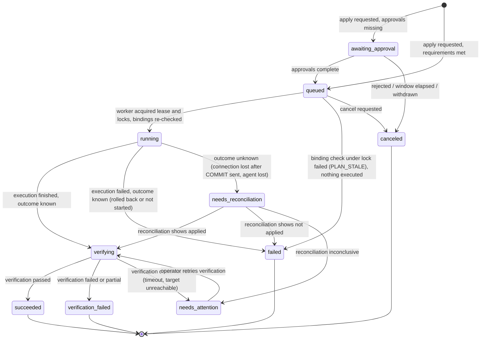

# Operations Engine

| | |
|---|---|
| Status | Baseline (Wave 0), accepted 2026-10-05; Wave 2 skeleton (§11) accepted with G2 on 2026-10-05 |
| Applies to | Wave 2 (framework), every later wave that adds an operation kind |
| Read before | [`../00-product/constitution.md`](../00-product/constitution.md) Part II, [`policy-engine.md`](./policy-engine.md), [`error-model.md`](./error-model.md) |
| Decision | [ADR-0011](../01-architecture/adr/0011-plan-apply-operations-engine.md) |

The Operations Engine is the single path through which every consequential
mutation happens, whichever interface requested it. It implements
Inspect → Plan → Validate → Authorize → Apply → Verify → Audit
([C-6](../00-product/constitution.md#c-6-consequential-mutations-follow-inspect-plan-validate-authorize-apply-verify-audit)).

**[DECIDED]** There is one engine with pluggable *operation kinds*, not one
plan/apply implementation per domain. Migrations, configuration changes, TLS
rotation, restores, restarts, package updates, terminations, credential
rotations and registry changes are all operation kinds. Reason: plan binding,
staleness, idempotency, approvals, break-glass, leases, reconciliation and audit
are the same problem every time; implementing them once is the only way they
stay correct.

## 1. Action classification

Every action exposed by any interface is registered in the contracts with one of
these classes. The class is a property of the action kind, not of the caller.

| Class | Meaning | Mechanism | Examples |
|---|---|---|---|
| `read` | No state change in any managed system | none (authorization + audit of sensitive reads only) | list targets, inspect schema, list locks, read migration status |
| `low` | Small, reversible or self-limiting effect on one object | **inline plan**: request carries precondition tokens; authorized, executed, verified, audited in one call | cancel one query, trigger a health re-sample, re-run verification |
| `standard` | Changes structure, configuration or availability of one target or cluster | **stored plan**, then apply | migration on a non-production target, `postgres.config.apply` reload-only, backup run |
| `high` | Production-tier structural change, restart, credential rotation, terminate backend on production | stored plan; policy may require approval and re-authentication | migration on production, restart, TLS rotation, terminate on production |
| `critical` | Replaces or destroys data or identity | stored plan, approval, re-authentication; human actor only in V1 | restore execute (recovery), target decommission, `down.sql` on production when the rollback is `lossy` or `unsafe`, placement move |

The registry of action kinds is code in `packages/contracts` (names, class, input
schema, required permission, scope per tier, exclusivity domain). A contract test
fails if an interface exposes a mutating handler that is not registered.

## 2. Operation kinds

**[DECIDED]** An operation kind is a module that provides:

```ts
interface OperationKind<Input, PlanContent, Result> {
  kind: string                     // "migration.apply", "postgres.config.apply"
  version: number                  // bumped when plan content shape changes
  actionClass: "low" | "standard" | "high" | "critical"
  subject(input): SubjectRef       // target | cluster | node | server | registry
  permission: Permission           // e.g. "migrations.apply"
  scope(tier): OAuthScope          // e.g. "migrations.apply:prod"
  exclusivity: ExclusivityDomain[] // see §7

  inspect(ctx, input): Promise<InspectedState>
  plan(ctx, input, state): Promise<PlanDraft<PlanContent>>   // content + analysis + bindings
  bindings(plan): BindingCheck[]   // re-validated at apply time and under lock
  execute(ctx, plan, op): Promise<ExecutionOutcome>          // may dispatch node jobs
  verify(ctx, plan, op): Promise<VerificationOutcome>
  reconcile(ctx, plan, op): Promise<ReconciliationOutcome>   // when outcome is unknown
}
```

Initial kinds (owning wave in brackets):

| Kind | Class | Wave |
|---|---|---|
| `target.register`, `target.suspend`, `target.resume`, `target.decommission` | standard / critical | 4 |
| `target.identity.stamp` (Wave 4: a step of `target.register`, no plan of its own) | standard | 4 |
| `registry.product.create`, `registry.environment.create`, `registry.project.create`, `registry.server.create`, `registry.cluster.register`, `registry.cluster.confirm`, `registry.database.register` | standard | 4 |
| `registry.environment.update`, `registry.project.update` | standard / high | 4 |
| `registry.endpoint.add`, `registry.endpoint.retire` | standard / high (derived tier of the cluster) | 4 |
| `registry.credential.submit` (inline: encrypted and recorded pending by `serve`; the worker's verification activates it) | low | 4 |
| `credential.rotate` | high | 4/5 |
| `migration.apply` (one or more bundles in DAG order) | standard / high | 6 |
| `migration.verify` (re-run verification only) | low | 6 |
| `migration.rollback` (execute `down.sql`) | high / critical | 6 |
| `migration.baseline` (legacy import) | high | 6 |
| `migration.import.replay` (replay legacy files on an explicit, empty scratch target and write the import report) | standard | 6 |
| `connections.cancel` | low | 9 |
| `connections.terminate` | standard / high | 9 |
| `postgres.config.apply`, `postgres.reload`, `postgres.restart` | standard / high | 5 |
| `postgres.tls.rotate` | high | 5 |
| `postgres.roles.apply`, `postgres.extensions.apply`, `postgres.hba.apply` | high | 5 |
| `packages.apply_update` | high | after 9 (Wave 5 ships audit and planning only) |
| `backup.run`, `backup.verify` | standard / low | 9 |
| `restore.execute` | standard (drill into scratch) / high (clone into a new nonprod target) / critical (recovery, unmasked production clone) | 9 |
| `node.enroll`, `node.revoke` | high | 5 |
| `access.*` (role bindings, clients, keys) | standard / high | 3 |
| `ledger.initialize` (part of `target.register`) | standard / high | 4 |
| `ledger.reconcile` | high | 6 |
| `migration.resume` (continue or clean up an incomplete non-transactional bundle) | high | 6 |
| `migration.rebaseline` (legacy import correction) | high | 6 |
| `drift.accept` | standard / high | 6 |
| `operation.force_release` (release a lock domain held by a lost worker) | high | 6 |
| `node.decommission` | high | 5 |
| `node.config.update` (job-signing key rotation through the node's `config.update@1`; the gateway address is OD-27) | high | 5 |
| `node.inspect` (one read or plan capability through a node; its node-signed result becomes an observation, [`../07-node-agent/control-plane.md` §9.2](../07-node-agent/control-plane.md#92-observations-nodeinspect)) | low | 5 |

**[DECIDED]** (pre-G1, 2026-10-05) `operation.force_release` needs its own
permission and scope, `operations.recover`: human only, never MCP-grantable or
service-account-grantable, Web App or first-party CLI with a human session and
re-authentication. It acts at the tier of the operation that owns the lock (the
tier of that operation's plan), so releasing a production lock is a production
action ([`../08-auth-and-security/authorization.md`](../08-auth-and-security/authorization.md#2-permissions)).

**[DECIDED]** (Wave 3A, `packages/auth/src/access/operations.ts`.) The access
kinds of Wave 3A, each a stored plan with exact content, an analysis
(before and after, granted permissions, owner impact, escalation), the
policy decision with the `access` fact, application by its human actor
(Web App or CLI, 5-minute re-authentication), execution by the worker,
verification and audit:

| Kind | Class | Content | Verification | Reconciliation |
|---|---|---|---|---|
| `access.role_binding.create` | high (any binding may cover production until the registry can tell) | identity, role, scope, the new binding id | the binding is active and carries the operation id | a binding with this operation id exists |
| `access.role_binding.delete` | high | binding id | revoked by this operation | a binding revoked by this operation exists |
| `access.policy_settings.update` | high | rule, parameters, next revision (installation scope in Wave 3A) | the revision exists with this operation id | the same |
| `access.identity.enable` | standard | identity | the identity is active | the operation's step event |
| `access.identity.erase` | critical | identity | erased, no factors, bindings or live sessions | the identity is erased |

Serve plans and accepts; only the worker writes role bindings, policy
settings and these identity transitions (Control Store grants). A
refusal of a Control Store guard during execution (the last-owner
invariant) means nothing was applied: the operation fails with
`not_applied`. Invitations, disabling and credential changes are inline
plans (C-6): current state, a precondition, re-authentication, the exact
mutation and its audit in one transaction.

## 3. Plans

### 3.1 Content

**[DECIDED]** A plan is a row in the Control Store plus a canonical JSON body. It
contains everything needed to decide and everything that will be executed:

```yaml
id: pln_01JB…
kind: migration.apply
kindVersion: 1
createdAt: 2026-10-04T12:00:00Z
expiresAt: 2026-10-04T12:15:00Z          # server clock, see §3.3
actor:   { identityId: idn_…, kind: human|service, via: web|rest|mcp|cli }
client:  { clientId: cli_…, grantId: grt_… | sessionId: ses_… }
subject: { targetId: tgt_…, targetPath: reosa/platform/production, generation: 3, tier: prod }
content:                                   # what will be executed, exact bytes
  …                                        # kind-specific, e.g. bundles with SQL
contentChecksum: sha256:…
expectedState:                             # bindings to live state
  schemaFingerprint: fp1:17:…
  ledgerStateHash: sha256:ls1:…
  clusterSystemIdentifier: "7291…"
  pgVersionNum: 170006
analysis: { … }                            # kind-specific, e.g. compatibility, locks
evidence: [ { evidenceId: evd_…, kind: staging_verified, … } ]
policy:
  decision: allow | require | deny        # PolicyDecision, see policy-engine.md §3
  rules: [ { id: "migration.staging-evidence", result: pass, … }, … ]
  policyVersion: sha256:…                  # hash of rule code version + effective config
  requirements:                            # empty unless decision = require
    - { kind: approval, count: 1, permission: plans.approve }
    - { kind: reauth, withinSeconds: 300 }
    - { kind: backup, newerThan: "PT24H", verified: true }
planHash: sha256:…                         # hash of everything above (canonical JSON)
state: active
```

`planHash` is shown to humans (shortened) in approvals and returned to agents,
so that "the plan I reviewed" and "the plan that ran" are provably the same.

**[DECIDED]** Plan-hash construction (Wave 1 clarification; implemented in
`packages/kernel`, independently in the Go conformance implementation, and
pinned by golden vectors):

- The hashed object `B` has exactly the binding members listed above `planHash`:
  `id`, `kind`, `kindVersion`, `createdAt`, `expiresAt`, `actor`, `client`,
  `subject`, `content`, `contentChecksum`, `policy` (always present) and
  `expectedState`, `analysis`, `evidence` (present when the kind or the plan
  uses them). `planHash` itself and `state` are never part of `B`; neither are
  lifecycle, display or approval fields of the plan row.
- `planHash = "sha256:" + lowercase hex(SHA-256(UTF-8(JCS(B))))` with JCS as in
  RFC 8785.
- The function refuses an object with any other top-level member
  (`unknown_member`), a missing required member (`missing_member`) or an `id`
  that is not a canonical `pln_` id (`invalid_plan_id`), checked in this order,
  so a new binding field cannot silently stay outside the hash: adding one is a
  contract change.
- The construction itself is not versioned in the value; changing it would need
  a new prefix through an ADR. Plan *content* changes are versioned by
  `kindVersion`.

### 3.2 Bindings

**[DECIDED]** At apply time, and again under the exclusivity lock right before
execution, every binding is checked. A failing binding produces `PLAN_STALE`
with `details.changedBindings[]`, for example:

```json
{ "code": "PLAN_STALE",
  "message": "The plan no longer matches the target. Create a new plan.",
  "details": { "planId": "pln_…",
               "changedBindings": [
                 { "binding": "schemaFingerprint", "expected": "fp1:17:ab…", "actual": "fp1:17:9c…" },
                 { "binding": "ledgerStateHash", "expected": "…", "actual": "…",
                   "hint": "Migration 01JB… was applied at 12:07 by idn_…" } ] } }
```

Generic bindings checked for every kind:

| Binding | Fails when |
|---|---|
| `expiry` | server time > `expiresAt` (code `PLAN_EXPIRED`, a specialization of stale) |
| `state` | plan not `active` (consumed, withdrawn, invalidated) → `PLAN_ALREADY_USED` or `PLAN_STALE` |
| `actor` | caller identity ≠ plan actor |
| `client` | caller OAuth client ≠ plan client (or session-based plan applied with a token, and vice versa) |
| `authorization` | identity lost the permission, token lost the scope, grant revoked, target removed from grant |
| `subject` | target generation changed, target suspended/decommissioned, cluster `system_identifier` changed |
| `policy` | re-evaluated decision is stricter than the planned one, or policy version changed and the result differs |
| `content` | stored content no longer hashes to `contentChecksum` (storage corruption or tampering) |

Kind-specific bindings (examples): schema fingerprint and ledger state hash for
migrations; current configuration version and PostgreSQL version for config
changes; certificate fingerprint for TLS rotation; backup id and repository
state for restore; `pid` + `backend_start` for terminate.

**[DECIDED]** A stale plan is never refreshed, partially applied or
reinterpreted ([C-7](../00-product/constitution.md#c-7-plans-are-immutable-short-lived-single-use-and-bound)).

### 3.3 Expiry

**[DECIDED]** Default plan lifetimes, configurable per policy only downward
(stricter), with an absolute maximum:

| Class | Default | Maximum | Reason |
|---|---|---|---|
| low | 5 min | 15 min | **[DECIDED]** (Wave 5 Phase 5) an inline plan that is stored, such as `node.inspect`, is accepted in the request that makes it; the lifetime only bounds the window between the two writes |
| standard | 30 min | 2 h | enough for an agent to show the plan and apply; short enough that state rarely drifts |
| high | 15 min | 1 h | narrower replay window for stolen plan ids |
| critical | 15 min | 1 h | same |

When a plan requires approval, the *apply request* may wait in
`awaiting_approval` for up to the **approval window** (default 4 h, maximum 24 h).
All live bindings are re-checked when execution actually starts, so a late
approval of a now-stale plan ends in `PLAN_STALE` without executing anything.

### 3.4 Plan states

```
active ──apply accepted──▶ consumed            (terminal)
active ──expiresAt passed──▶ expired           (terminal)
active ──binding failure detected──▶ invalidated (terminal; e.g. another migration applied)
active ──policy deny at plan time──▶ denied    (terminal, plan exists for audit)
active ──actor withdraws──▶ withdrawn          (terminal)
```

A plan is created even when the policy decision is `deny`: the caller gets the
full explanation and the denial is auditable. A denied plan can never be applied.

## 4. Operations

### 4.1 State machine

**[DECIDED]**



Two outcome fields are recorded separately from the state
([C-13](../00-product/constitution.md#c-13-applied-is-not-verified)):

| Field | Values |
|---|---|
| `applyOutcome` | `not_started`, `applied`, `not_applied` (rolled back or refused), `partially_applied` (non-transactional work stopped mid-way), `unknown` |
| `verificationOutcome` | `not_applicable`, `pending`, `passed`, `failed`, `partial`, `error` |

`verification_failed` and `needs_attention` are terminal or semi-terminal states
that **never** trigger re-execution
([C-16](../00-product/constitution.md#c-16-failures-never-trigger-automatic-re-execution-or-rollback)).
From `verification_failed`, the only follow-ups are: a new `migration.verify`
(after fixing a broken `verify.sql`, see
[`../04-migrations/verification.md`](../04-migrations/verification.md#retrying-verification)),
a forward-fix plan, or a rollback plan.

### 4.2 Workers and leases

**[DECIDED]** Operations are executed by the `worker` process role. A worker
claims a queued operation with `SELECT … FOR UPDATE SKIP LOCKED` and writes a
lease (`lease_owner`, `lease_expires_at`, default 30 s, renewed every 10 s).
Each step is recorded as an `operation_event` row before and after it runs.

If a worker dies, its lease expires. Another worker takes the operation over and
**does not resume blindly**: it calls the kind's `reconcile` with the recorded
steps. For a migration, reconciliation reads the target ledger (was the ledger
row for this operation committed?) and the target's `pg_stat_activity` (is the
old session still running?). See
[`../04-migrations/failure-and-recovery.md`](../04-migrations/failure-and-recovery.md).

**[DECIDED]** (Wave 5 correction F2) **Dispatch admission.** Before a
`queued` operation starts, under its exclusivity locks and after the kind's
own bindings, the worker asks the composition whether what authorized the
operation still holds (`DriverOptions.admit`). For the node and cluster kinds
it evaluates the policy again with the tier the registry derives now and
compares the decision with the plan's (`recheckDecision`: stricter is
stale), and counts the approvals the plan requires again: an approval counts
only when it names the plan's hash, its cooling period is over, its approver
still is an active human holding `plans.approve` at a scope covering the
plan's subject, and, for a self-approval, the policy still allows one; a
rejection counts against it. A changed binding (`policy`, `approval`) fails
the operation as `PLAN_STALE` with `apply_outcome = not_started`; nothing
runs and the immutable plan is not rewritten: the person plans again. An
operation accepted before a rule existed (its decision lacks the
requirement) is stale the same way. The admission is consulted only for a
`queued` operation: one that already started is reconciled or verified,
never started again. It reuses the policy engine, the rules and the
approval evidence of acceptance; there is no second authorization engine.
(Correction review) The same admission runs again in the transaction that
creates an operation's apply job (`ExecutionContext.readmit`, next to
`leaseHeld`): an apply job starts minutes after its operation (after its
reads), and a cluster that became production, or an approval revoked, in
between ends the operation `not_applied` with `PLAN_STALE` before the job
exists. A kind that prepares what the apply job carries (a TLS rotation's
server certificate) runs the same check before it prepares it (round 2);
the changed bindings are named as a list (`changedBindings`) wherever an
operation becomes stale.

**[DECIDED]** (Wave 5 correction F3) **Fenced writes.** A kind's step
that writes a change or starts work outside the Control Store checks, in the
transaction that writes it, that the operation is not aborted and that its
worker still holds the lease (`leaseHeld`, `FOR SHARE`, so a takeover waits
for the transaction). The node lifecycle kinds (`node.enroll`,
`node.revoke`, `node.decommission`) do it before their write, as job
creation, credential preparation and the recording of a node's trusted keys
do: a worker that lost its lease writes nothing and no audit event says it
did, and its successor reconciles from what is there. The execution
context always carries the lease owner; a missing one is never a pass.
The fence covers those writes; a credential rotation's later decisions
(writing the pending credential, failing or activating it) are not fenced
but compare and set on locked rows instead: the pending credential is
written once (`nodes.credential_rotations` locked, `credential_id` still
empty), and a decision applies only to a still-pending credential in place
of exactly the credential the plan replaced (correction review).

### 4.3 Node jobs

Operations that need host capabilities dispatch **jobs** to the node agent. A job
is a row with: `id`, `operation_id`, `node_id`, `capability`,
`capability_version`, canonical `args`, `args_hash`, `not_before`,
`expires_at`, `attempt`, `state`, and a detached signature by the worker's
job-signing key. Job execution, leases, acknowledgements and replay protection
are specified in [`../07-node-agent/protocol.md`](../07-node-agent/protocol.md).

## 5. Idempotency

**[DECIDED]** Three mechanisms, chosen by action class:

1. **Plan id** (stored plans). `apply(planId)` is idempotent: the first accepted
   request consumes the plan and creates the operation (`operations.plan_id` is
   unique). A repeated request with the same plan id by the same actor and client
   returns the existing operation with HTTP 200 / tool result `alreadyAccepted:
   true`. Any other caller gets `PLAN_ALREADY_USED`.
2. **Precondition tokens** (inline plans). The request carries the observed
   identity of the object (for a cancel: `pid` + `backend_start` + `query_start`, so
   that a newer query of the same backend is never canceled; or a backup id
   and its state). Repeating a completed request finds the object gone or changed
   and returns `result: already_done` or `PRECONDITION_FAILED`, never a second
   effect on a different object.
3. **Idempotency keys** (other REST mutations: registry writes, access
   management, plan creation). Header `Idempotency-Key` (1 to 255 visible ASCII
   characters). Stored per principal for 24 h with a hash of the request. Same
   key, same request hash: the stored response is replayed. Same key, different
   hash: `IDEMPOTENCY_KEY_REUSED`. MCP tools that create plans accept an optional
   `idempotencyKey` argument with the same semantics.

Node jobs are idempotent by job id; the agent keeps a local journal so that a
restarted agent never executes a job twice (see protocol document).

## 6. Approvals and re-authentication

**[DECIDED]**

- Policy can require `approvals: n` for a plan. An approval is given by a human
  identity holding `plans.approve` at the plan's scope, through the Web App, with
  re-authentication, after the plan content and analysis were displayed. An
  approval records `planHash`, so it approves exactly that plan.
- The approver must differ from the plan's actor **unless** the actor is an AI
  agent client acting for that human, in which case the human approving in the Web
  App *is* the intended second party (agent proposes, human approves: P-14).
- **[DECIDED]** One-person organizations
  ([OD-9](../00-product/open-decisions.md#od-9-approval-model-for-a-one-person-organization),
  resolved 2026-10-05, option a), enforced by policy rules, never by a
  handler:
  - an agent-initiated plan is approved by a human in the Web App (Web App
    session, `plans.approve` at the plan's scope, fresh re-authentication);
    the human may be the person the agent works for; an agent client can
    never approve;
  - a human-initiated plan may be approved by its own actor when the policy
    allows it (`selfApproval: true` is recorded, the request must
    acknowledge it explicitly), always with a fresh re-authentication;
  - a `critical` self-approval also starts a **cooling period** (V1 default
    10 minutes, a policy parameter that may only be raised by non-owners)
    measured on the database clock from the approval of the unchanged plan
    hash; the operation stays `awaiting_approval` until the actor applies
    again after the cooling period with a fresh re-authentication (the
    5-minute `critical` apply window), so the sequence is approve, wait,
    re-authenticate, apply;
  - a different plan hash is a different plan: no approval or cooling period
    carries over;
  - when several trusted approvers exist, a policy setting can require a
    distinct human; it is never switched by counting accounts.
- Re-authentication (`reauthWithinSeconds`) means the human proved presence with
  a passkey or TOTP within the window. It is checked at approval time and, for
  `critical` kinds, at apply time.
- Approvals never override `deny`. They satisfy `approval` requirements of a
  `require` decision.
- **[DECIDED]** (Wave 5 correction F2) For node and cluster kinds the
  approvals are counted again before the operation starts (§4.2, dispatch
  admission); an approval that no longer holds then stops it.

## 7. Exclusivity domains

**[DECIDED]** Operations declare which domains they hold exclusively while
`running`/`verifying`. The worker acquires them in a fixed global order to avoid
deadlocks, first as Control Store rows (`operation_locks`, unique on domain key),
then, for target domains, as PostgreSQL advisory locks in the target
([`../04-migrations/concurrency.md`](../04-migrations/concurrency.md)).

| Domain key | Held by | Conflicts with |
|---|---|---|
| `target:<id>:schema` | migration apply/rollback/baseline, any DDL operation | itself, `target:<id>:maintenance` |
| `target:<id>:maintenance` | restore, placement move, decommission | everything on that target |
| `cluster:<id>:config` | config apply, reload, restart, TLS rotate, roles, extensions, hba | itself, `node:<id>:packages`, cluster restart affects all targets: restart also takes `target:*:schema` of placed targets |
| `cluster:<id>:backup` | backup run on that cluster | itself |
| `node:<id>:packages` | package update; the node's job-key changes (`node.config.update`, [control-plane.md §9.8](../07-node-agent/control-plane.md#98-job-key-rotation-nodeconfigupdate)) | itself, `cluster:*:config` on that node |

Reads never take exclusivity domains.

## 8. Break-glass

**[DECIDED]** Break-glass is the only way to override a policy rule. It is
deliberately inconvenient.

- **Who:** a human identity with the `breakglass.activate` permission at the
  target's scope, in the Web App or CLI, never through MCP and never by a
  service account.
- **How:** re-authentication with a passkey or TOTP; a written reason (minimum 20
  characters, stored verbatim, shown in every related audit event); selection of
  the specific rule ids to override (no "override all"); the target(s); a
  duration (default 30 min, maximum 2 h); optionally a maximum number of uses.
- **What it can override:** staging evidence, fingerprint-match requirements,
  maintenance windows, backup-freshness requirements, compatibility gating,
  approval requirements.
- **What it can never override:** checksum mismatch (history immutability),
  dependency cycles or missing dependencies, target identity mismatch, cluster
  identity mismatch, plan staleness, authentication, tier separation for the
  token of an AI client, the node capability allowlist, secret handling.
- **Effects:** the grant is recorded (`bgl_`), an audit event
  `breakglass.activated` is written and an out-of-band notification is sent
  (Wave 3A decides channel; e-mail as minimum). Every plan created under the grant
  carries `policy.overriddenRules[]` and a banner in every interface. Every
  operation executed under it is flagged for post-incident review; the review
  (`breakglass.reviewed`, with a note) is listed as an open finding until done.
- **Expiry:** at expiry, unused plans created under the grant become invalid
  (their policy binding no longer holds).

**[DECIDED]** Wave 6 implementation:

- **Activation** `POST /targets/{target}/break-glass-grants`
  (`breakglass.activate`, human-only, a Web App session re-authenticated
  within 120 s; the central engine enforces both): the rules must exist and
  be marked overridable (`BREAK_GLASS_UNAVAILABLE`, `rule_not_overridable`
  otherwise), the reason has 20 to 2000 characters, the duration 1 to 120
  minutes (default 30), optionally a maximum of uses. The grant
  (`breakglass.grants`), a `breakglass.activated` notification to the person
  and to every active owner, and the audit event (with the reason verbatim)
  are recorded in one transaction; delivery follows after commit and its
  outcome is reported (`notifications.recorded/sent/failed`).
- **No silent break-glass:** without a configured notification channel the
  activation is refused (`BREAK_GLASS_UNAVAILABLE`,
  `notification_channel_not_configured`). No channel is decided yet
  ([OD-21](../00-product/open-decisions.md#od-21-delivery-channel-for-invitations-and-security-notifications)),
  so on a real installation break-glass is unavailable until the owner
  decides OD-21; the path is proven with a test channel.
- **Use:** a migration plan request names `breakGlassGrantId`. Planning
  refuses a grant that is not the caller's own, not on this target, expired,
  revoked or used up, and any grant from an agent (MCP) or a service account
  (`grant_not_usable`). The plan's content binds `{grantId, rules}`; the
  engine overrides exactly the named rules that are overridable, lists them in
  `overriddenRules` and as a `break_glass` requirement; everything else still
  applies (an unknown lineage still needs an approval). The policy re-check
  at acceptance and at dispatch evaluates with the same grant.
- **Acceptance** checks the grant again (the acceptor's own, same target,
  every overridden rule named, usable now) and counts one use in the same
  transaction once the plan is accepted; a use that can no longer be counted
  undoes the acceptance. An expired grant leaves its unused plans
  unacceptable (`BREAK_GLASS_REQUIRED`).
- **Not yet in Wave 6:** the review (`breakglass.reviewed`) and the banner are
  Web App work; unreviewed grants stay queryable (`reviewed_at IS NULL`).

## 9. Audit integration

Every transition of a plan, approval, operation and job writes an audit event
through the same transaction as the state change (or, for target-side effects,
immediately after with the outcome). See [`audit.md`](./audit.md) for event
shapes. The audit event of an apply contains the `planHash`, never the SQL text
of a migration in full (the plan holds it); it contains the migration ids and
checksums.

## 10. Edge cases

| Case | Behavior |
|---|---|
| Same plan applied twice concurrently by the same caller | One `UPDATE plans SET state='consumed' WHERE id=… AND state='active'` wins; the other returns the created operation (`alreadyAccepted`). |
| Apply request arrives 1 s before expiry, worker starts 5 s later | Expiry is checked at acceptance. Live bindings are checked again under lock. Expiry is not re-checked at execution (the plan was accepted in time). |
| Token expires between plan and apply | The apply request must carry a valid token; the client refreshes. Plan binding is to client and grant, not to the token. |
| Grant revoked while operation is `awaiting_approval` | Execution start re-checks authorization; operation is canceled with `GRANT_REVOKED`. |
| Grant revoked while operation is `running` | Running work is not interrupted mid-transaction (that could leave partial state). The audit event records the revocation; no further steps start. |
| Control Plane restarts during `running` | Lease expires, another worker reconciles (§4.2). |
| Policy configuration changed after plan creation | Policy binding re-evaluates; stricter result → `PLAN_STALE` (`policy`). |
| Approver approves an outdated plan view | Approval binds `planHash`; a different plan cannot be approved by that click. |
| Operation waits for a lock held by a long-running operation | `queued` with `waitingFor` details; the caller sees it. Lock wait has no automatic timeout in the queue; approval windows and operator cancellation bound it. |

## 11. Implementation (Wave 2)

**[DECIDED]** (Wave 2, `packages/operations` and the Control Store bundle
`01M46KJ34887CQ6GFEX3SXMC2G_operations-engine`.) Wave 2 builds the engine
without product kinds; tests drive it with synthetic kinds.

- **Records.** `operations.plans` (binding columns immutable; one move out of
  `active`; a denied plan is stored `denied`), `operations.plan_bodies` (the
  canonical body `B`; the database refuses a body whose SHA-256 is not the
  plan hash, `EXO03`), `operations.operations` (`plan_id` unique),
  `operations.operation_events` (append-only), `operations.operation_locks`,
  `operations.idempotency_keys`. Nothing is ever deleted except released
  locks and expired idempotency keys.
- **One state machine, enforced twice.** `transitionOperation` is the only
  transition API (§4.1 table, outcomes per state, lease check for worker
  transitions, event, lock release when finished, audit event, all in the
  caller's transaction). The database guard (`operations.operation_guard`)
  refuses any other transition, an outcome pair a state does not admit, a
  change to a finished operation, a working state without a lease (`EXO01`),
  and lets `exdb_serve` only approve or cancel an operation that has not
  started (`EXO02`). Tests check that code and database agree for every
  input.
- **Outcomes per state.** `succeeded` requires `applyOutcome = applied` and
  verification `passed` (or `not_applicable` for kinds without a verification
  step); `failed` requires `not_started` or `not_applied`;
  `needs_reconciliation` requires `unknown`; `verification_failed` requires an
  applied or partially applied change with verification `failed` or
  `partial`; `needs_attention` holds an unknown or applied change with
  verification `pending` or `error`.
- **Acceptance** (§5.1) locks the plan row, so concurrent requests serialize;
  the same caller gets `alreadyAccepted`, others `PLAN_ALREADY_USED` or
  `PLAN_BINDING_ACTOR`; expiry is checked against the database clock; a
  failing kind binding or a stricter policy re-evaluation invalidates the
  plan (persisted, audited) and refuses with `PLAN_STALE`. An `approval`
  requirement starts the operation in `awaiting_approval`; every other
  requirement must be met by the request (re-authentication, a break-glass
  grant, a backup), else the request is refused with the requirement's
  error code. Wave 2 has no source for them, so they stay unmet (fail
  closed).
- **Audit.** `plan.created` (phase `denied` for a denied plan),
  `plan.expired`, `plan.withdrawn`, `plan.invalidated`, `operation.accepted`
  and `operation.state_changed` (`changes: {kind, from, to}`, both outcomes
  in `result`) are appended in the transaction of the change; if the append
  fails, the change does not happen (tested by revoking the audit grant).
- **Leases** (§4.2): claim with `FOR UPDATE SKIP LOCKED`, 30 s, renewed every
  10 s while a step runs; a lost lease aborts the step's signal and makes
  every further transition fail (`operation_lease_lost`). A takeover of a
  `running` operation moves it to `needs_reconciliation` (`applyOutcome =
  unknown`) in the takeover transaction; the kind's `reconcile` decides,
  `execute` is never called again for that operation. `verifying` may be
  verified again after a takeover (verification is read-only).
  `needs_attention` is never claimed; it waits for an operator.
- **Exclusivity** (§7): domain keys follow the §7 grammar; all of an
  operation's domains are taken in one transaction, in UTF-8 byte order of
  the key (no deadlock cycles; tested with concurrent random overlapping
  sets), all or nothing (savepoint); `target:<id>:maintenance` also takes the
  target's schema domain; other cross-object conflicts are listed by the
  kind. A blocked operation stays `queued`, gives its lease back and records
  `locks_waiting` with the holder. Locks are released only with the
  operation's final transition; row-level security refuses to delete a live
  operation's lock, so there is no force-release shortcut
  (`operation.force_release` remains its own planned kind).
- **Idempotency keys** (§5.3): per principal key (`<kind>:<id>`), the primary
  key serializes concurrent requests with the same key (the second waits for
  the first to commit and replays its stored response; after a rollback it
  proceeds); a different request hash is `IDEMPOTENCY_KEY_REUSED`; expired
  keys (24 h) are reusable and pruned by the worker (at most 10,000 per run).
- **Worker loop** (`processNextOperation`): claim, locks, bindings under the
  locks (stale: `failed` without executing), `running`, execute once, record
  the reported outcome (`applied`/`partially_applied` → `verifying`,
  `not_applied` → `failed`, `unknown` or an exception → `needs_reconciliation`),
  verify (`passed` → `succeeded`, `failed`/`partial` → `verification_failed`,
  `error` → `needs_attention`). Every step is an event before and after it
  runs. Approvals, re-authentication, break-glass grants and node jobs are
  later waves.

