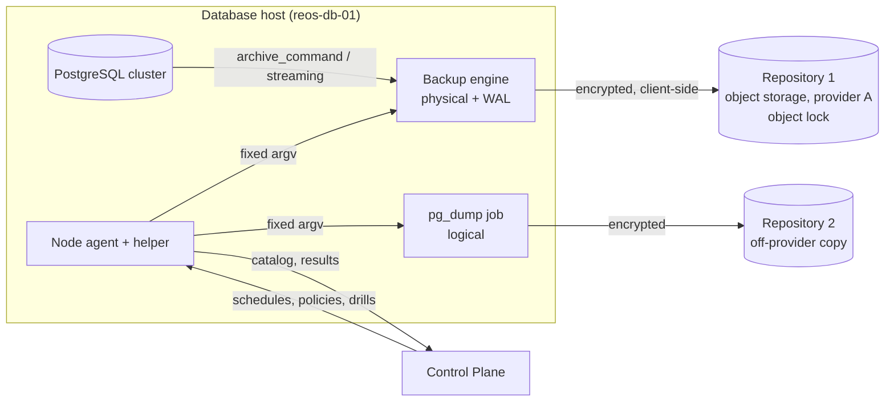

# Backup architecture

| | |
|---|---|
| Status | Baseline (Wave 0), awaiting owner approval |
| Applies to | Wave 9 (backups, restore, drills); Wave 5 (WAL status capabilities) |
| Read before | [`../00-product/constitution.md` C-35](../00-product/constitution.md#c-35-backups-are-restorable-without-exponetdb), [`../07-node-agent/capabilities.md`](../07-node-agent/capabilities.md), [`backup-engines.md`](./backup-engines.md) |

ExponetDB **orchestrates and proves** backups. The backup engine moves the bytes;
the node agent runs the engine with fixed arguments; the Control Plane decides
schedules, records the catalog, measures freshness and runs restore drills. A
backup is only counted as protection once a restore from it has been shown to
work.

## 1. What REOSA taught us

**[OBSERVED]** in REOSA at `f09a302e` (details in
[`../13-integrations/reosa-current-state.md`](../13-integrations/reosa-current-state.md)):

| Observation | Consequence for ExponetDB |
|---|---|
| Two documents promise different targets: RPO 1 h / RTO 4 h, and RPO 5 min / RTO 30 min | One RPO/RTO per environment, stored as data, shown next to the **measured** value |
| The planned self-hosted setup (daily machine snapshots + daily `pg_dump` + WAL archive on the same host) gives about 24 h RPO if the host is lost | RPO is computed from the off-host WAL archive and the last off-host backup, never from intentions |
| The weekly dump script would fail (pooler URL for `pg_dump`, client 16 against server 17) and only log the failure | Every backup run has a measured outcome (exit code, size floor, catalog entry, verification); failure is a finding, not a log line |
| "RTO documented, never exercised"; no recorded drill | Drills are first-class operations with evidence; a cluster without a passed drill shows "unproven" |
| The REOSA console has a careful drill *checklist* (throwaway-target confirmation, disposal confirmation) but cannot execute anything | ExponetDB adopts the checklist model and adds execution and measurement through the node agent |

## 2. Layers

**[DECIDED]** shape; engine choice is **[OPEN: OD-4](../00-product/open-decisions.md#od-4-backup-engine)**.

| Layer | Purpose | RPO contribution | V1 |
|---|---|---|---|
| **L1 Physical base backups + continuous WAL archive** | point-in-time recovery of the whole cluster | minutes (bounded by `archive_timeout`) | yes |
| **L2 Logical dumps** (`pg_dump -Fc` per database + `pg_dumpall --globals-only`) | engine-independent, version-portable copy; protects against engine bugs and repository corruption; table-level recovery | 24 h | yes |
| **L3 Off-provider copy** | survives loss of the primary storage provider or account | 24 h | yes (L2 output, and optionally a periodic L1 copy) |
| Host snapshots (Hetzner Cloud backups) | fast host rebuild | 24 h, crash-consistent only | allowed as an extra; **never counted** as a database backup |

Rules:

- **Off-host from the first byte.** Repositories live off the database host. A
  local WAL spool is a buffer, not a backup.
- **Client-side encryption** for every repository, with keys the storage
  provider never sees ([`../08-auth-and-security/secrets.md`](../08-auth-and-security/secrets.md)).
- **Immutability**: repository 1 uses object lock (or the provider's equivalent)
  with a retention at least as long as the shortest restore window promised, so
  that a compromised database host cannot delete history (threat T18 in
  [`../08-auth-and-security/threat-model.md`](../08-auth-and-security/threat-model.md)).
- **Separate credentials** per repository; the host's credentials can write and
  read, not delete before lock expiry.

## 3. Catalog

**[DECIDED]** The backup engine's own catalog is the truth for what exists
(C-32). The Control Store keeps a **mirror** with ExponetDB metadata.

| Entity | Fields (summary) |
|---|---|
| `backup_repositories` (`bkr_`) | cluster, engine, engine version, location (bucket/path, provider), encryption key reference (never the key), lock retention, credentials reference, health (`ok`/`degraded`/`failed` + checked_at) |
| `backup_policies` | cluster, schedule per kind (full, incremental/differential, logical), retention per kind, `archive_timeout`, RPO/RTO objectives per environment, drill cadence |
| `backups` (`bkp_`) | repository, engine label, kind, started/finished, LSN start/stop, timeline, size, PostgreSQL major, `system_identifier`, databases contained (logical), verification state + time, source operation |
| `wal_coverage` | repository, timeline, earliest and latest archived LSN and time, gaps |
| `restores` (`rst_`) | source (backup or point in time), destination, purpose (`drill`, `recovery`, `clone`), plan, timings per phase, verification results, disposal |

The mirror is refreshed by `backup.list@1` after every backup job and on a
schedule. A mirror entry without an engine catalog entry is a finding
(`backup.catalog-divergence`), never silently trusted.

## 4. Freshness, RPO and RTO as measured values

**[DECIDED]**

| Metric | Computed from | Shown as |
|---|---|---|
| **Achievable RPO now** | `now − latest archived WAL time` (L1); without a healthy archive: `now − latest verified off-host backup` | duration, green/amber/red against the environment's objective |
| **Last verified backup** | newest backup with `verification = passed` per kind | age |
| **PITR window** | oldest base backup with continuous WAL from it to now | from–to |
| **Measured RTO** | last passed drill's restore + recovery + verification duration, scaled by data size growth since | duration, with drill date |
| **Proven** | a drill passed within the drill cadence | yes / overdue / never |

If any input is missing or stale, the value is `unknown`, never a guess (C-28,
C-30). A cluster whose last drill is older than its cadence shows "unproven"
next to its backup status.

Objectives are per **environment** (production may promise RPO 15 min / RTO
4 h; staging may promise nothing). V1 recommendation for REOSA production:
RPO ≤ 15 min, RTO ≤ 4 h, drill monthly for the first quarter, then quarterly.
REOSA's own documents must then point to ExponetDB's numbers instead of stating
their own ([`../13-integrations/reosa-integration.md`](../13-integrations/reosa-integration.md)).

## 5. Operations

| Action | Class | Who | Notes |
|---|---|---|---|
| Scheduled backup | `standard`, pre-approved by the backup policy | system (scheduler) | policy change is the reviewed step |
| `backup.run` (manual) | `standard` | human or agent with `backups.run` | non-destructive; exclusivity domain `cluster:<id>:backup` |
| `backup.verify` | `low` | human or agent | engine verify + checksum + size floor |
| Retention expiry | `standard`, part of the policy | system | never deletes the last verified backup of a kind; never deletes inside the lock window |
| Ad-hoc deletion of a backup | `high`, approval | human | refused while it is the newest verified backup or inside the lock window |
| Repository or policy change | `high` | human with `registry.manage` | shows the effect on RPO, PITR window and retention |
| Restore (any) | see [`restore.md`](./restore.md) | | |

Policy hooks that depend on backups (`migration.destructive-backup`,
`backup.repository-healthy`, see
[`../02-control-plane/policy-engine.md`](../02-control-plane/policy-engine.md))
read the catalog mirror **after** a refresh younger than 10 minutes; a stale
mirror counts as "no backup" for policy purposes.

## 6. Backup run outcome

A run is `succeeded` only if **all** hold:

1. engine exit code 0;
2. the engine catalog lists the new backup with the expected label;
3. size is above a floor (configured per cluster, default 50 % of the previous
   backup of the same kind; the floor catches "empty dump" failures);
4. for physical backups: the WAL needed to make it consistent is archived;
5. for logical backups: `pg_restore --list` reads the archive;
6. the copy reached its repository (object exists with the expected size and
   lock).

Verification (`backup.verify@1`) is separate and scheduled: engine `verify`,
`pg_verifybackup` where applicable, and the restore drills in
[`restore.md`](./restore.md). "Backed up" and "verified" are separate fields.

## 7. Exponet-wide rules

- **Restorable without ExponetDB (C-35).** Each repository has a runbook in
  plain shell that restores with the engine's CLI and offline-held keys; the
  runbook is generated from the repository configuration and kept with the
  owner's offline material. A drill without the Control Plane is part of the
  Wave 9 gate ([`../14-roadmap/acceptance-gates.md`](../14-roadmap/acceptance-gates.md)).
- **The Control Store is backed up like any other cluster**, but its restore
  must not need ExponetDB (it runs on a different PostgreSQL instance in V1,
  [`../12-operations/deployment.md`](../12-operations/deployment.md)).
- **No backup of secrets inside database backups beyond what PostgreSQL holds.**
  ExponetDB's keyring backup is separate ([`../08-auth-and-security/secrets.md` §5](../08-auth-and-security/secrets.md#5-bootstrap-secrets-and-coolify)).

## 8. Non-goals in V1

- Backups of clusters ExponetDB does not run an agent on (external clusters):
  ExponetDB shows what the provider reports where an API exists, nothing more.
- Replica-based backups, backup from standby.
- Cross-region replication of repositories beyond the off-provider copy.
- Table-level PITR (recover one table to a point in time). A logical dump or a
  scratch restore plus manual extraction covers the need.
