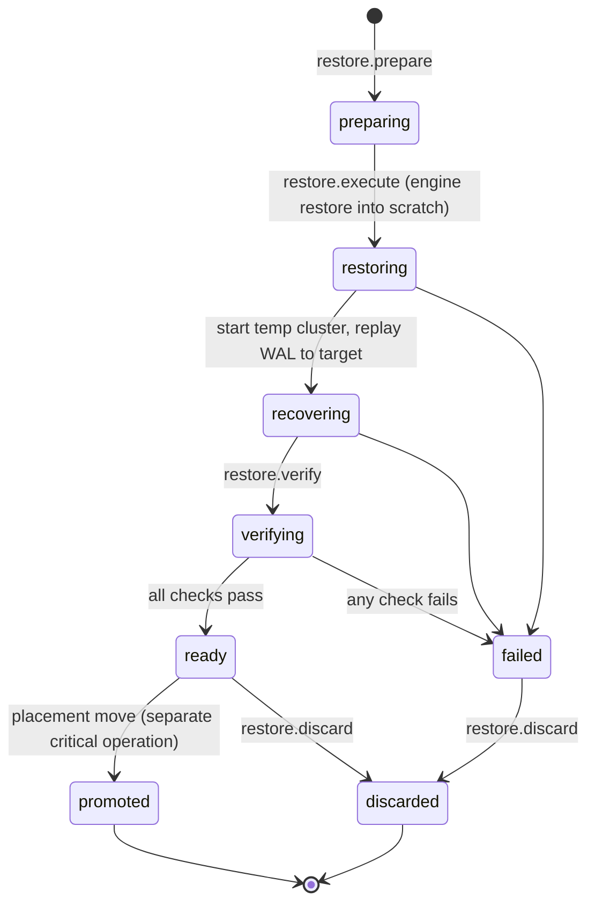

# Restore and restore drills

| | |
|---|---|
| Status | Baseline (Wave 0), accepted 2026-10-05 |
| Applies to | Wave 9 |
| Read before | [`architecture.md`](./architecture.md), [`../02-control-plane/operations-engine.md`](../02-control-plane/operations-engine.md), [`../08-auth-and-security/threat-model.md`](../08-auth-and-security/threat-model.md) (T19) |

A restore is the most dangerous thing ExponetDB does: it replaces data or
creates a second copy of it. The design therefore makes the **destination**
explicit, refuses to restore over anything running, and treats every restore as
evidence.

## 1. Restore purposes

| Purpose | Destination | Class | Who |
|---|---|---|---|
| **Drill** | scratch cluster on a node (temporary, localhost-only, non-default port), discarded afterwards | `standard` (scratch only, no target is touched) | human or scheduler; agents may *plan* |
| **Clone** | a new nonprod target (for example "staging refreshed from production") | `high`; `critical` if the source is prod-tier and the destination is not masked | human |
| **Recovery** | a new cluster or scratch directory, then a **placement move** of the affected target onto it | `critical`, human-only, re-auth, approval | human |

**[DECIDED]** There is no in-place restore over the data directory of a running,
registered cluster in V1 (`restore.execute@1` refuses). Recovery always builds a
new copy next to the old one; switching the target to it is a separate,
explicit placement move. The old cluster stays (stopped or read-only) until the
operator discards it in a later operation.

## 2. Restore plan

`POST /restores/plans` / MCP `restore_plan` produce a stored plan:

```yaml
restorePlan:
  source:
    repository: bkr_01K…
    backup: bkp_01K…          # or
    pointInTime: "2026-10-04T21:15:00Z"   # resolved to base backup + WAL range
    resolved:
      baseBackup: bkp_01K…
      walFrom: 0/5A000028
      walTo:   0/5F3C1A80     # covers the requested time
      timeline: 1
      engineVersion: "<pinned engine version>"
  destination:
    kind: scratch | new_target | new_cluster
    node: nod_01K…
    path: /var/lib/exponetdb/scratch/rst_01K…   # agent-chosen, never user-supplied
    port: 55432
    target: null              # or the explicit new target path for clones
    tier: nonprod
  checks:
    spaceRequired: 41 GiB
    spaceAvailable: 180 GiB
    engineCanRead: true
    walContinuous: true
    sourceVerified: true      # backup verification passed
  afterRestore:
    verify: [recovery_target_reached, amcheck_indexes, fingerprint, ledger_head, row_counts]
    masking: none | profile:<id>   # required for prod → nonprod clones (§4)
    dispose: after_drill | keep_until:<time> | never
  confirmation:
    typed: "reosa/platform/production → scratch rst_01K…"
```

Rules:

- The destination is **chosen and shown**, never inferred. For anything that
  is not scratch, the human types the destination's path (and for recovery the
  affected target's path) in the Web App before approval (T19).
- `restore.prepare@1` validates space, engine compatibility and WAL continuity
  for the requested point in time on the node **during planning**. A plan with a
  failed check cannot be applied.
- Bindings: backup id and its verification digest, WAL range, destination node
  and path, the destination target's identity (or "does not exist yet").

## 3. Execution phases



Each phase records start, end and outcome; these timings are the measured RTO
inputs ([`architecture.md` §4](./architecture.md#4-freshness-rpo-and-rto-as-measured-values)).

Verification of a restored cluster (`restore.verify@1`):

| Check | Passes when |
|---|---|
| Recovery target reached | `pg_last_wal_replay_lsn()` / recovery end time matches the plan |
| Cluster starts and accepts connections | simple **and** extended-protocol probe succeed ([`../10-observability/health.md`](../10-observability/health.md)) |
| Index integrity | `amcheck` (`bt_index_check`) on all B-tree indexes of configured databases (sampled for very large databases, sample size recorded) |
| Schema | fingerprint equals the source target's fingerprint at that time (if the history has one), otherwise recorded as the new baseline evidence |
| Ledger | `exponetdb` ledger head matches the Control Store's mirror for that time |
| Data | row counts of configured tables within configured bounds; consumer-defined probe queries (read-only, reviewed like `verify.sql`) |
| RLS posture | for consumers that require it (REOSA): number of tables with RLS enabled equals the expected number; the restore does not silently drop policies |

## 4. Clones from production into nonprod

**[DECIDED]** A clone of production data into a nonprod target is allowed only
with a **masking profile** (column-level transformations run on the scratch
copy before the target is registered) or an explicit human decision to keep
real data, recorded with a reason and an expiry for the clone. Default policy:
deny unmasked clones of production into nonprod. Reason: nonprod is where agents
work with broader scopes ([`../08-auth-and-security/ai-agent-safety.md` §3](../08-auth-and-security/ai-agent-safety.md#3-prompt-injection-what-exponetdb-can-and-cannot-do)).

## 5. Recovery runbook (production)

1. Incident declared ([`../12-operations/incident-model.md`](../12-operations/incident-model.md)).
2. Plan recovery: choose point in time; plan shows data loss window
   (`now − recovery target`), space, duration estimate from the last drill.
3. Approve (second human if available, [OD-9](../00-product/open-decisions.md#od-9-approval-model-for-a-one-person-organization)),
   re-auth, typed confirmation.
4. Restore into a new cluster directory on the database host (or a new host).
5. Verify (§3). Consumer-specific probes (for REOSA: the HB4 acceptance probes
   as machine checks).
6. Writers frozen on the consumer side (REOSA: workers and cron stopped); the
   placement move switches the target to the new cluster, bumps the target
   generation and stamps the identity marker.
7. Consumers reconnect; health and migration status green; old cluster kept
   stopped until discarded explicitly.

The same steps, minus 6 and 7, are what a drill does.

## 6. Drills

**[DECIDED]** Model adopted from REOSA's console drill (frozen checklist,
throwaway-target confirmation, disposal confirmation) and extended with
execution and measurement.

| Aspect | Rule |
|---|---|
| Cadence | per environment in the backup policy; default production monthly for the first quarter, then quarterly; at least one drill per repository per cadence |
| Source selection | rotates: latest backup, an older backup within retention, and a PITR to a random point inside the window |
| Destination | always scratch on the database host or a dedicated drill host; never a registered target |
| Evidence | phase timings, verification results, backup and WAL identifiers, engine version, sizes, operator, deviations |
| Outcome | `passed`, `failed`, `aborted`; a failed drill is a critical finding until a later drill passes |
| Findings | drill overdue (warning at cadence, critical at 2× cadence), drill failed, drill never run |
| Without ExponetDB | once per quarter (and in the Wave 9 gate) the drill is run from the generated shell runbook with offline keys and the Control Plane stopped; the result is recorded afterwards (C-35) |

A drill that leaves a scratch cluster behind is not `passed` until
`restore.discard@1` has run; a scratch cluster older than 24 hours is a finding.

## 7. Failure handling

| Failure | Behavior |
|---|---|
| Space insufficient during restore | job fails, scratch removed by `restore.discard` (automatic for drills, planned for recovery) |
| WAL gap discovered during recovery | restore stops at the last consistent point; outcome `failed` with the reached LSN; never silently "good enough" |
| Verification fails | outcome `failed`; for recovery the target stays on the old placement (or `suspended` if the old cluster is gone); never auto-promoted |
| Agent or host lost mid-restore | operation `needs_attention`; scratch state is inspected by `restore.prepare` on re-plan |
| Engine cannot read the backup (version) | caught at planning by `engineCanRead` |

## 8. MCP and agents

**[OBSERVED]** (2026-10-13, Wave 7; `packages/contracts/src/mcp/tools.ts`,
[`../05-mcp/tool-catalog.md`](../05-mcp/tool-catalog.md) §8) The restore tools
are Wave 9 work. In the Wave 7 MCP endpoint `restore_plan` has no tool
contract yet, `backups_list` is `planned` (never listed) and `backup_run` has
no contract; no MCP tool plans or applies a restore, and the policy rule
`restore.human-only` is not built yet. Restore execution stays human-only in
V1 (a restore is never agent-applicable). The text below is the Wave 9 design.

Agents may plan restores and drills and read results (`restore_plan`,
`backups_list`) **[PLANNED]** (Wave 9). Applying any restore plan is human-only in V1 (policy
`restore.human-only`, [`../02-control-plane/policy-engine.md`](../02-control-plane/policy-engine.md)).
An agent can therefore prepare a full recovery plan during an incident: the
agent's plan is stored with decision `deny` (rule `restore.human-only`) but
contains the complete analysis. Plans are bound to their creator, so a human uses
"Re-plan as me" in the Web App, which creates a new plan from the same inputs,
reviews it and applies it.
