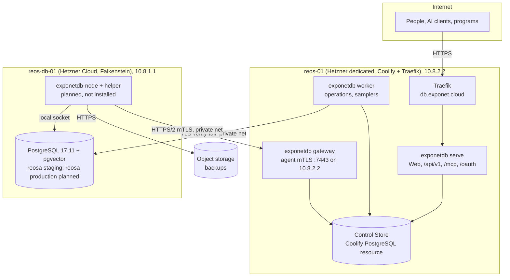

# Deployment (V1)

| | |
|---|---|
| Status | Baseline (Wave 0), accepted 2026-10-05; Wave 2 accepted with G2; first rollout running 2026-10-06, off-host evidence open ([record](./deployments/2026-10-06-reos-01.md)) |
| Applies to | Wave 2 (first deployable skeleton), Wave 5 (gateway, agent on `reos-db-01`), every release |
| Read before | [`../01-architecture/control-plane-and-data-plane.md`](../01-architecture/control-plane-and-data-plane.md), [`../01-architecture/overview.md`](../01-architecture/overview.md) |

## 1. Topology

**[DECIDED]**

| Item | V1 value |
|---|---|
| Public domain | `db.exponet.cloud` (Traefik on `reos-01`, Let's Encrypt certificate) |
| Paths | `/` Web App, `/api/v1` REST, `/mcp` MCP, `/oauth/*` and `/.well-known/*` authorization server and discovery, `/healthz/*` probes |
| Image | one container image `exponetdb`, three Coolify resources from it: `serve`, `worker`, `gateway` (command argument selects the role) |
| Control Store | dedicated Coolify PostgreSQL resource (PostgreSQL 17) on `reos-01`, database `exponetdb_control`, not published outside the Docker network |
| Gateway | from Wave 5: listens on the private address `10.8.2.2:7443` only, mTLS; not routed through Traefik ([OD-18](../00-product/open-decisions.md#od-18-agent-gateway-exposure)). Wave 2: process role without an agent listener |
| Node agent | `exponetdb-node` + `exponetdb-node-helper` as systemd units on `reos-db-01`, installed from a signed package or a release binary with checksum. **[OBSERVED]** (owner's Wave 9 order §6, 2026-10-21) not installed: the host runs without an agent (an external cluster); installing it waits for the G5 waiver's expiry condition and [OD-54](../00-product/open-decisions.md#od-54-how-an-external-cluster-gains-the-node-agent) |
| Managed PostgreSQL | on `reos-db-01`, PostgreSQL 17.11 installed from PGDG, systemd-managed, on the private address `10.8.1.1`; TLS name `reosdb01.exponet.cloud` with the host's own name-constrained CA (`DNS:exponet.cloud`, `IP:10.8.0.0/16`), `hostssl` with SCRAM only (**[OBSERVED]** owner's Wave 9 order §6, 2026-10-21) |

**Why three resources and not one** ([ADR-0019](../01-architecture/adr/0019-process-roles-and-web-app.md)):
the roles hold different secrets (only `worker` decrypts target credentials and
signs jobs; only `gateway` holds the issuing CA key; `serve` faces the
internet). A remote-code-execution bug in `serve` must not hand out database
credentials. Separate containers give separate environment secrets and
separate Control Store roles. Same image, same release.

**Why not two instances of `serve`** in V1: one instance is enough for the load;
the design is stateless (sessions in the Control Store), so scaling out later is
configuration.

**[DECIDED]** (Wave 7, owner decision 9) The rate limits and concurrency
bounds of `/mcp` are **per process**: token buckets per grant, per identity
and tool class, and the large-body slots live in the memory of `serve`; a
restart resets them, and a second instance would double them. Nothing of
them is stored in the Control Store. Scaling `serve` out therefore needs an
edge limiter in front (Traefik, keyed on the grant), recorded as a
condition of that change ([ADR-0027 §3](../01-architecture/adr/0027-mcp-protocol-layer.md)).

## 2. Configuration

**[DECIDED]** (Wave 2) Each Coolify resource has its own environment; the
program validates it strictly at startup: an `EXPONETDB_*` variable that is
unknown, or known but not used by the role or command being started, fails
startup; problems name the variable and a reason, never a value.

| Variable | Used by | Notes |
|---|---|---|
| `EXPONETDB_CONTROL_STORE_URL` | every role and command, **each with its own login** | `exdb_serve`, `exdb_worker`, `exdb_gateway`; `exdb_migrate` for `control-store migrate`; `exdb_audit_maint` for `audit prune`; secret |
| `EXPONETDB_INSTALLATION_ID` | serve, worker, gateway | printed by the first `control-store migrate`; must match the Control Store marker (else the role refuses to start) |
| `EXPONETDB_KEYRING` or `EXPONETDB_KEYRING_FILE` | serve, worker, gateway, `keyring status`, `keyring rotate-mcp-key` (serve login), `node-pki init` | exactly one; the file must not be readable by group or others ([`../08-auth-and-security/secrets.md` §2.2](../08-auth-and-security/secrets.md#22-keyring)); secret |
| `EXPONETDB_ROLE` | serve, worker, gateway (optional) | if set, must equal the command's role |
| `EXPONETDB_LISTEN` | serve | default `0.0.0.0:8080`; probes only in Wave 2 |
| `EXPONETDB_PUBLIC_URL` | serve (**required since Wave 3A**), `bootstrap owner`, `auth recover-owner` | the public origin only (`https://db.exponet.cloud`, no path): the Web App, the exact `Origin` check of every mutating request, the WebAuthn origin and the setup and recovery links; `http:` only on a loopback host; also the OAuth issuer from Wave 3B |
| `EXPONETDB_WEBAUTHN_RP_ID` | serve, `bootstrap owner`, `auth recover-owner` (optional) | the WebAuthn relying-party ID: the host of `EXPONETDB_PUBLIC_URL` (default) or a parent domain of it; never taken from a request. Changing it later makes every registered passkey unusable |
| `EXPONETDB_EGRESS_ADDRESSES` | serve (optional; needed before a `pg_hba` plan on an agent-managed cluster with active credentials) | up to 8 single IP addresses (comma separated, lowercase) from which `serve` and the worker connect to managed clusters; a `pg_hba` plan protects ExponetDB's own access from them ([control-plane.md §9.6](../07-node-agent/control-plane.md#96-verification-by-kind)). On `reos-01` that is the private address `10.8.2.2` (an owner setting; **[OBSERVED]** by the owner's Wave 9 order §6, 2026-10-21: containers on `reos-01` reach `reos-db-01` SNAT'ed from it) |
| `EXPONETDB_TRUSTED_PROXIES` | serve (optional) | up to 16 addresses or CIDRs (comma separated) of the reverse proxies whose `X-Forwarded-For` is believed; the client address is the right-most hop that is not a trusted proxy. Empty (default): the peer address is the client address. On `reos-01` this is the Traefik network of Coolify (an owner setting) |
| `EXPONETDB_MCP_ALLOWED_ORIGINS` | serve (optional, Wave 7) | up to 8 exact HTTPS origins (comma separated; `http:` only on a loopback host; no path, no wildcard, never `null`) of browser-based MCP clients allowed to call `/mcp` besides the public origin. A request without `Origin` (a native client) is not affected; a request with any other `Origin` is `403`. Empty (default): only the public origin ([`../05-mcp/protocol-baseline.md` §5](../05-mcp/protocol-baseline.md#5-situation-http-status-json-rpc-code-body)) |
| `EXPONETDB_OAUTH_CLIENT_REGISTRATION` | serve (optional, owner decision 2026-10-13) | `open` (default): new MCP clients (CIMD, DCR) are approved automatically and every person still consents; `review`: an administrator approves each new client on Admin → Clients first ([`../05-mcp/oauth.md` §3](../05-mcp/oauth.md#3-client-registration)) |
| `EXPONETDB_BACKUP_EXECUTION`, `EXPONETDB_RESTORE_EXECUTION` | serve, worker (optional, Wave 9 Part B) | whether engine runs may execute ([`../09-backups-and-restore/adoption.md` §5](../09-backups-and-restore/adoption.md#5-activation)): backups `disabled` (default), `nonprod` or `all`; restores `disabled` (default), `scratch` (drills only) or `all` (also recovery into a new cluster). Set both processes to the same value; an unknown value refuses the start. Catalog reads need neither |
| `EXPONETDB_INTERNAL_LISTEN` | serve, worker, gateway | default `127.0.0.1:9464`: `/healthz/detail`, `/metrics`; the container health probe asks it |
| `EXPONETDB_SHUTDOWN_TIMEOUT_MS` | serve, worker, gateway | default 25000 |
| `EXPONETDB_AUDIT_EXPORT_DIR` or `EXPONETDB_AUDIT_S3_*` | worker | checkpoint export sink: a directory (development) or S3-compatible storage (`ENDPOINT`, `REGION`, `BUCKET`, optional `PREFIX`, `ACCESS_KEY_ID`, `SECRET_ACCESS_KEY`, optional `OBJECT_LOCK_MODE` and `OBJECT_LOCK_DAYS`); without one, worker readiness is degraded |
| `EXPONETDB_LOG_LEVEL`, `EXPONETDB_OTLP_ENDPOINT` | all (OTLP: roles, migrate, prune) | |
| `EXPONETDB_GATEWAY_LISTEN` | gateway (optional, Wave 5) | the private agent listener, e.g. `10.8.2.2:7443`: HTTP/2 over TLS 1.3 with client certificates ([`../07-node-agent/control-plane.md` §5](../07-node-agent/control-plane.md#5-gateway)). Unset: no agent listener. Set: the gateway opens it once the agent PKI exists (`exponetdb node-pki init`) and is not ready until then (check `agent_listener`). Never on a public interface |

Coolify holds the values; the repository holds an `.env.example` per role
(`deploy/env/`), with placeholders only.

**[DECIDED]** (Wave 5) `exponetdb node-pki init --gateway-url <https://host:port>
--server-name <dns name> --root-key-out <new file>` runs once per
installation with the worker's login and the keyring
([`../07-node-agent/control-plane.md` §3](../07-node-agent/control-plane.md#3-pki-bootstrap-exponetdb-node-pki-init)).
It writes the agent root's private key to the new file (mode `0600`) and
nowhere else; the owner moves it offline. A second run is refused.

**[DECIDED]** (Wave 5 Phase 5) `exponetdb node-pki postgres-ca` (worker
login, keyring) creates the installation's PostgreSQL CA once (P-256, its
key a worker-consumer secret) and prints its certificate as JSON
(`certificatePem`, `fingerprint`, `created`); run again, it prints the same
CA. Put that certificate into the CA bundle of every cluster whose server
certificate ExponetDB will issue **when the cluster is registered**: the
bundle never changes afterwards, and `postgres.tls.rotate` is refused for a
cluster whose bundle does not trust this CA
([`../07-node-agent/control-plane.md` §9.5](../07-node-agent/control-plane.md#95-tls-the-postgresql-ca-od-17)).

**[OBSERVED]** (first rollout, Coolify 4.3.23) Docker Image applications do
not pass `start_command` to the container. Set Custom Docker Options to
`--entrypoint "node /app/bin/exponetdb.mjs serve"` (or `worker`, `gateway`)
to select the role while keeping one image digest. **[DECIDED]** (follow-up
2, F4) Since the release with §2a the option is `--entrypoint "node
--liftoff-only /app/bin/exponetdb.mjs serve"`. The migration is a separate
one-shot Compose service with `command: ["control-store", "migrate"]` and
`restart: "no"`. The release is stored in a private registry bound to server
loopback, so Coolify can pull the exact digest. The effective configuration
and evidence are in the [deployment record](./deployments/2026-10-06-reos-01.md).

## 2a. Memory

**[OBSERVED]** (follow-up 2, F4, 2026-10-22) The first real legacy import
(556 files, about 2.7 MB of SQL) had `serve` restarted during `migration
import analyze` at a 512 MiB limit; at 1 536 MiB the same request passed.
Measured here with `packages/migrations-engine/scripts/measure-analyze-memory.ts`
(a history of 600 files, 3 MB, in the shape of a Supabase-origin product:
`largeLegacyHistory` of the test kit) on Node 24.22 in a container limited
to 512 MiB with swap equal, against PostgreSQL 17:

| Step | With `--liftoff-only` | Without |
|---|---|---|
| process start, world ready | 116, 130 MiB | 128, 139 MiB |
| the analysis planned as `serve` plans it (digests, every file parsed for the replay summary, 600 rows written) | peak 164 MiB | **killed** (exit 137) |
| replayed and classified as the worker runs it | peak 250 MiB | (not reached) |
| one legacy file of 3.6 MiB parsed (the per-file bound is 4 MiB) | peak 156 MiB | **killed** at 518 MiB |

**[OBSERVED]** (the verification review of follow-up 2, P1-1, 2026-10-22)
The 3.6 MiB file above is body-heavy: its bulk is function bodies, one
token each to the SQL parser. The parser's memory grows with the tokens it
is given, not with the bytes, and it is WebAssembly memory, which never
shrinks. With `--liftoff-only`, on Node 24, one process with the parsers
loaded (75 MiB):

| One parse of | Before the token bound | With it |
|---|---|---|
| 4 MiB of `SELECT 1;` (1.4 million tokens) | 930 MiB | refused before parsing, 99 MiB |
| a 4 MiB `DO` block of `PERFORM 1;` | 1 144 MiB | refused before parsing, 134 MiB |
| 4 MiB of dump-like DDL (900 000 tokens) | 392 to 486 MiB | refused before parsing |
| the worst shapes just below the bound (199 000 tokens) | | 165 to 233 MiB |

The numbers are of the measuring process, which holds both roles' pools;
each role adds its own baseline. **Cause:** V8 tiers up hot WebAssembly
functions with its optimizing compiler, and the PostgreSQL parser's grammar
is one very large function. On Node 24 that compilation takes hundreds of
MiB **outside** the JavaScript heap; the heap limit Node derives from the
container's limit (259 MiB under 512 MiB) does not cover it, so the kernel
kills the process without a log line. The same parse on Node 22 stayed
bounded. With `--liftoff-only` (WebAssembly runs on V8's baseline compiler
only) memory stays flat and parsing is as fast (1 200 parses of a 2 KiB file:
1.36 s against 1.23 s).

**[DECIDED]** (follow-up 2, F4)

- The image starts every role as `node --liftoff-only /app/bin/exponetdb.mjs`.
  **On `reos-01` the Coolify resources override the entrypoint** (§2): their
  Custom Docker Options become `--entrypoint "node --liftoff-only
  /app/bin/exponetdb.mjs serve"` (`worker`, `gateway` likewise) with the
  release that carries this change. `NODE_OPTIONS` cannot carry the flag
  (Node refuses it there). A role started without it logs
  `process.wasm_tier_up_enabled` once at startup.
- A legacy history is bounded per request: at most 8 MiB of SQL (UTF-8) in
  all and 4 MiB per file, in a JSON body of at most 16 MiB; above that the
  request is `422 VALIDATION_FAILED` (`/files`, `too_large`) before anything
  is parsed. The first real history used a third of it.
- One parse is given at most **200 000 tokens** (`MAX_PARSE_TOKENS`, other
  than space and comments) on every path: migration files, legacy files,
  `DO` and function bodies, data reads, verify checks, statement
  redaction. That keeps one parse below about 160 MiB above the parsers,
  whatever the text (about 900 KB of dump-like DDL; the 600-file history's
  largest file has 2 000). **[DECIDED]** (the verification review of
  follow-up 2, P1-1) A legacy file, or a body in it, above the bound is
  refused before any work, `422 VALIDATION_FAILED` (`/files/<i>/text`,
  `too_large`, "split it into several files"); a migration file above it
  does not parse (`parse_error`, `too_large`); a statement above it is
  redacted by the lexer (statement-redaction.md §2). The 4 MiB file bound
  of a bundle stays; above about 900 KB of dense SQL the tokens decide.
  **[DECIDED]** (test campaign TC-003, Part A P1 no. 1) A body is read
  whatever its quoting: the dollar-quoted literal, and the single-quoted
  string after `DO` (optionally `LANGUAGE x`) or `AS` or before `LANGUAGE`,
  decoded as PostgreSQL reads it (`''`, the `E''` escapes, continuation
  lines) and counted on its own. Any other string is data and counts as one
  token: a 1 MB JSON literal in an `INSERT` stays legal. A 4 MiB
  `DO '…'` took 1 114 MiB before this; it is refused with the rest.
  **[DECIDED]** (test campaign TC-021, Part A P1 no. 2) The files of one request
  are also bounded **together**: at most **1 000 000 tokens**, counted with the
  bodies of `DO` blocks and functions (`MAX_TOTAL_PARSE_TOKENS`); the file that
  crosses it is refused, `422 VALIDATION_FAILED` (`/files/<i>/text`, `too_large`,
  "import the history in several parts"). The per-file bound limits one parse, not
  the sum, and the retained memory adds up (about 15 KiB per file; 565 MiB peak for
  nine files of 190 000 tokens, 1.7 million in all). The campaign proposed 600 000;
  the 600-file, 3 MB history of the size of the first real import holds 623 009
  tokens, so 1 000 000 lets the real import through with margin and refuses the
  dense case. The chain step `survivingExpectations` is linear (one pass for the
  last statement that touches each key, one lookup per expectation; 30 000
  statements take well under a second; it took 3.1 s for 1 000 files and 196 s for
  5 000), and the chain analysis groups survivors by file once. **Not done:** keeping
  only compact facts per file after the replay, a byte cap or cursor on the legacy
  ledger read (it has no `LIMIT`: 289 MiB at 26 MB of statements), and the
  measurement in a 512 MiB container (`scripts/measure-analyze-memory.ts` with nine
  dense files) that would confirm the peak under the budget; the figure for the
  budget is an extrapolation from the measured nine-file peak, not a measurement.
- At most **two** requests that carry a legacy history at once
  (`LEGACY_REQUESTS_IN_FLIGHT`); a third is `429 RATE_LIMITED` with
  `Retry-After: 5`. **[DECIDED]** (the verification review of follow-up 2,
  P3-7) The parse is synchronous and never runs twice at once, so this
  does not bound the parse: it bounds the histories held across their
  target connections (a body of up to 16 MiB and its files, each), which a
  slow target would otherwise let add up. (A first slot of one, around the
  parse only, was removed after the security review; this one replaces it.)
  The reference scan of the scratch preflight follows bodies two levels
  deep, and trees 1 000 levels deep, and stops there (`too_complex`).
- Memory limits: `serve` and `worker` **512 MiB** each with the flag (the
  measured peaks leave about half of it free); the limit of 1 536 MiB set
  after the restart can stay until the flag is deployed. `gateway` parses
  no SQL: its limit is unchanged (**[ASSUMPTION]**, not measured).
- **[OBSERVED]** (owner, 2026-10-22) Coolify refuses to start a container
  whose memory limit is above its swap limit (`Minimum memoryswap limit
  should be larger than memory limit`) and has removed the old container by
  then: change the memory and the swap limit together, in one save.

## 3. Startup and readiness

1. Load and validate configuration; load keyring.
2. Connect to the Control Store with the role's login; check installation
   marker.
3. Check the Control Store schema version equals the binary's expected version.
   **[DECIDED]** (Wave 2) `exponetdb control-store migrate` runs as its own
   one-shot resource with the `exdb_migrate` login, before the roles are
   rolled out, instead of a pre-deploy step of the `worker` resource: the
   worker then never holds the DDL credential
   ([`../02-control-plane/control-database.md` §5](../02-control-plane/control-database.md#5-the-control-stores-own-migrations)).
   A newer schema or a checksum mismatch refuses the start; a pending or
   unverified schema leaves the role running and not ready.
4. Role-specific: `serve` binds HTTP; `worker` registers its heartbeat and
   resumes reconciliation; `gateway` registers its heartbeat. **[PLANNED]
   Wave 5:** `gateway` loads the issuing CA and binds the private mTLS
   listener. **[DECIDED]** (2026-10-05) Until Wave 5 builds the agent CA, mTLS
   and the protocol runtime, the gateway opens **no** agent listener: an
   agent endpoint without mutual TLS would be an unauthenticated management
   endpoint, and security comes before an early feature. Its readiness never
   claims that the CA or mTLS is ready.
5. `/healthz/ready` turns green only after all steps succeed.

## 4. Network rules

| Rule | Where |
|---|---|
| `reos-db-01` accepts PostgreSQL only from `10.8.2.2` (and loopback) | `pg_hba.conf` (managed by `postgres.hba.apply` on an agent-managed cluster; today by the owner's scripts, the cluster being external: [credentials-and-roles.md §8.2](../03-database-model/credentials-and-roles.md#82-pg_hba-and-network-for-an-external-cluster)) + host firewall. **[OBSERVED]** (owner's Wave 9 order §6) containers on `reos-01` arrive SNAT'ed from `10.8.2.2`, ExponetDB's and REOSA's alike |
| `reos-01` accepts `:7443` only from `10.8.1.0/24` | host firewall |
| Gateway is not reachable from the internet | listener bound to the private address |
| MTU 1400 on the private path | as-built (REOSA handbook); the agent's `system.health` checks path MTU with a do-not-fragment probe |
| Outbound from `reos-db-01` | apt/PGDG mirrors, object storage, NTP; nothing else required by ExponetDB |

**[DECIDED]** (Wave 4; architecture and configuration only, nothing was
deployed and no real target was registered) What the target registry adds
to a deployment:

- **No new variable.** Targets, clusters, endpoints, CA bundles and
  credentials are registry data, written through `/api/v1` plans and the
  write-only credential endpoint, never configuration.
- **Egress from `serve` and the worker to managed clusters.** Both open
  TLS `verify-full` sessions to the endpoints in the registry: `serve` for
  live reads with the observer credential only, the worker for health
  samples, drift checks, credential verification and registry operations.
  On `reos-01` that is the private path to `reos-db-01`
  (from `10.8.2.2` to `10.8.1.1:5432`, TLS name `reosdb01.exponet.cloud`); `pg_hba` must allow the ExponetDB roles from
  that source only (owner action with the deployment).
- **Connections per cluster:** `serve` at most 3, the worker at most 5
  (one budget per process, postgres-adapter.md §3); a cluster's
  `max_connections` must leave room for them.
- **The image** carries the SQL parser for PostgreSQL 16, 17 and 18
  (`libpg-query`, WebAssembly, in `/app/node_modules`); the three-role smoke
  test (`bun run smoke:image`) checks that serve answers Wave 4 routes with
  401 and a later wave's with 404.
- **Role bootstrap on a managed cluster** is a person's step: `GET
  /api/v1/clusters/{id}/bootstrap-sql` (`exponetdb cluster bootstrap-sql`)
  gives the script (never a password), run with psql by an administrator
  of that cluster, and again whenever a database or an execution role is
  added (it is idempotent, Wave 9); then each password is submitted once
  through the write-only endpoint and verified by the worker
  ([`onboard-external-cluster.md`](./onboard-external-cluster.md)).

## 5. Data plane host baseline (`reos-db-01`)

**[OBSERVED]** (owner's Wave 9 order §6, 2026-10-21; measured by the owner,
ExponetDB has not connected to the host) The host runs: Hetzner Cloud in
Falkenstein, PostgreSQL 17.11 from PGDG, private address `10.8.1.1`, TLS
name `reosdb01.exponet.cloud` with its own name-constrained CA, `hostssl`
with SCRAM only; external management (no node agent; configuration and
backups by shell scripts and systemd timers); database `reosa_staging`;
pgBackRest 2.59.3 with repository 1 on Cloudflare R2 (EU) and a monthly
bundle as repository 2, `aes-256-cbc`, `archive_mode on`,
`archive_timeout 300`, timers for differential (Monday to Saturday), full
(Sunday) and monthly backups. pgBackRest 2.60.0 was released on 2026-10-18.
REOSA production still runs on the hosted provider and gets its own role
set on this cluster when it moves (Wave 11). The size: the owner brief
names CX43 with 16 GB RAM while the REOSA handbook planned 8 GB; ExponetDB
makes no assumption about the size and none about production and staging
sharing one host ([`../01-architecture/control-plane-and-data-plane.md`](../01-architecture/control-plane-and-data-plane.md)).

ExponetDB's responsibilities on the host, in order of introduction:

| Wave | What ExponetDB does on `reos-db-01` |
|---|---|
| 5 | agent enrolled; read capabilities (status, config inspect, disk/memory/CPU, service status, log inspect, WAL status); role and hba desired state; TLS inspect, plan and rotate |
| 6 | migration engine exercised against test databases on the host (never REOSA's), via SQL from `worker` (not via the agent) |
| 9 | WAL archiving and backups through the engine; restore drills into scratch |
| after 9 Part A | the owner registers REOSA staging (already on this host) and its scratch database as an external cluster, imports the history and lets sessions apply staging migrations (OD-7a) |
| 10 | REOSA's side of the integration (bundle roots, REOSA Admin, runtime schema contract); REOSA production on the hosted provider at most read-only (OD-7b) |
| 11 | REOSA production moves onto this host with its own role set; from then on its migrations run here |
| after 9 | package updates, PostgreSQL minor upgrades as planned operations |

**[OBSERVED]** (2026-10-21) The rows for Waves 5, 6 and 9 have not happened on
this host: no agent is installed or enrolled (G5 items 2 and 4 are waived
until "before a node agent is installed on, or enrolled for, any real
host"; a cluster registered external stays external as built, OD-54), and
ExponetDB has not registered or connected to it. Its backups are the
owner's pgBackRest setup, adopted then owned in Part B of Wave 9 (OD-52).

## 6. Releases

- Versioned releases (SemVer, [`../01-architecture/versioning.md`](../01-architecture/versioning.md));
  the image tag is the version, never `latest`.
- Run the separate Control Store migration resource once, as `exdb_migrate`,
  then deploy `worker`, `serve` and `gateway` from the same image digest.
  No runtime resource receives the migration credential (§3).
- Agent releases are separate artifacts with their own version and a
  compatibility range with the server ([`upgrades.md`](./upgrades.md)).

## 6a. Rolling out `/mcp` (Wave 7)

**[OBSERVED]** Rolled out on `reos-01` on 2026-10-13
([record](./deployments/2026-10-13-reos-01-wave7.md)). Coolify reads an
image tag `sha256-<id>` as a digest: check that the `image:` line of the
`exponetdb-migrate` Compose keeps `:` before the tag (an `@` there starts
no container), and that a role's description has no `;` (Coolify refuses
it on save).

**[DECIDED]** `/mcp` is served by `serve` from the same image; nothing new
runs. What changes on `reos-01`:

1. **Variables.** Only `EXPONETDB_MCP_ALLOWED_ORIGINS` is new and optional
   (§2; empty is right for native clients such as Claude Code, Codex, Cursor
   and VS Code). Every other Wave 7 number is a code default.
2. **Control Store.** The additive Wave 7 bundles (`mcp-keys`,
   `grant-last-use`, `data-read-lane`) run with the one-shot migration
   resource first (§6). An image built after the follow-up of 2026-10-13
   also carries `audit-client-grant-index` (two indexes, additive); it runs
   the same way.
3. **Traefik router for the public host.** The application router already
   carries `/mcp`. No path rewrite and no redirect to another host (a
   redirect loses the `Authorization` header of Claude's cloud clients).
   **[OBSERVED]** (Wave 7, Traefik 3.3.7) A compress middleware gzips the
   event stream of `/mcp` and still delivers each event when it is sent; no
   exclusion is needed for correctness. Keep the proxy's response timeouts
   above 90 s (the server ends a request at 90 s with `504`) and do not
   buffer responses.
4. **Pre-checks from a public network** (the owner, after the rollout;
   [`../05-mcp/owner-test-package.md`](../05-mcp/owner-test-package.md) §F):
   `dig +short db.exponet.cloud A` names a routable IPv4 address;
   `curl -sI https://db.exponet.cloud/mcp` is `405` with `Allow: POST` and no
   `3xx`; an anonymous `POST /mcp` is `401` with `resource_metadata`; both
   `/.well-known/oauth-protected-resource/mcp` and
   `/.well-known/oauth-authorization-server` answer `200`; the MCP
   Inspector lists the tools with a token.
5. **Clients.** No third-party client is trusted at installation: each is
   approved once by an administrator on **Access → OAuth clients**
   (`/access/oauth-clients`); see [`../05-mcp/client-matrix.md`](../05-mcp/client-matrix.md).
6. **Keys.** The MCP keys are created on first use; rotation is
   `exponetdb keyring rotate-mcp-key` (§2, runbook RB-15).

## 7. Later

Moving to `exponet-01` / `exponet-db-01` changes only §1 and §2: new Coolify
resources, Control Store dump/restore, new gateway address announced to agents
by a signed `config.update` before the old gateway stops (not sent by the
Control Plane in Wave 5, **[OPEN: OD-27]**), DNS switch for
`db.exponet.cloud`. No data-model or API change.
