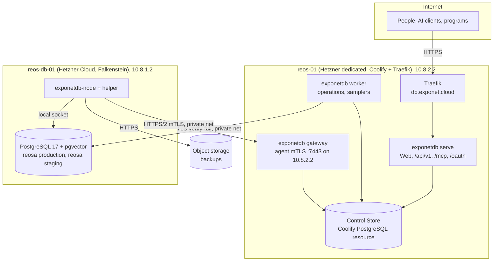

# Deployment (V1)

| | |
|---|---|
| Status | Baseline (Wave 0), accepted 2026-10-05 |
| Applies to | Wave 2 (first deployable skeleton), Wave 5 (gateway, agent on `reos-db-01`), every release |
| Read before | [`../01-architecture/control-plane-and-data-plane.md`](../01-architecture/control-plane-and-data-plane.md), [`../01-architecture/overview.md`](../01-architecture/overview.md) |

## 1. Topology

**[DECIDED]**

| Item | V1 value |
|---|---|
| Public domain | `db.exponet.cloud` (Traefik on `reos-01`, Let's Encrypt certificate) |
| Paths | `/` Web App, `/api/v1` REST, `/mcp` MCP, `/oauth/*` and `/.well-known/*` authorization server and discovery, `/healthz/*` probes |
| Image | one container image `exponetdb`, three Coolify resources from it: `serve`, `worker`, `gateway` (command argument selects the role) |
| Control Store | dedicated Coolify PostgreSQL resource (PostgreSQL 17) on `reos-01`, database `exponetdb_control`, not published outside the Docker network |
| Gateway | listens on the private address `10.8.2.2:7443` only; not routed through Traefik ([OD-18](../00-product/open-decisions.md#od-18-agent-gateway-exposure)) |
| Node agent | `exponetdb-node` + `exponetdb-node-helper` as systemd units on `reos-db-01`, installed from a signed package or a release binary with checksum |
| Managed PostgreSQL | on `reos-db-01`, installed from PGDG, systemd-managed, listening on `10.8.1.2` and loopback |

**Why three resources and not one** ([ADR-0019](../01-architecture/adr/0019-process-roles-and-web-app.md)):
the roles hold different secrets (only `worker` decrypts target credentials and
signs jobs; only `gateway` holds the issuing CA key; `serve` faces the
internet). A remote-code-execution bug in `serve` must not hand out database
credentials. Separate containers give separate environment secrets and
separate Control Store roles. Same image, same release.

**Why not two instances of `serve`** in V1: one instance is enough for the load;
the design is stateless (sessions in the Control Store), so scaling out later is
configuration.

## 2. Configuration

| Variable (illustrative names) | Roles | Notes |
|---|---|---|
| `EXPONETDB_ROLE` | all | `serve` / `worker` / `gateway` |
| `EXPONETDB_CONTROL_STORE_URL` | all, **each with its own login role** | `exdb_serve`, `exdb_worker`, `exdb_gateway` |
| `EXPONETDB_KEYRING` | worker, gateway, serve (subset of keys) | [`../08-auth-and-security/secrets.md`](../08-auth-and-security/secrets.md) |
| `EXPONETDB_PUBLIC_URL` | serve | `https://db.exponet.cloud`; also the OAuth issuer |
| `EXPONETDB_GATEWAY_LISTEN` | gateway | `10.8.2.2:7443` |
| `EXPONETDB_INSTALLATION_ID` | all | set at bootstrap; must match the Control Store marker |
| `EXPONETDB_OTLP_ENDPOINT` | all, optional | telemetry |

Configuration is validated at startup with a schema; unknown variables with the
`EXPONETDB_` prefix fail startup (typos must not silently disable features).
Coolify holds the values; the repository holds an `.env.example` per role and a
generated compose description.

## 3. Startup and readiness

1. Load and validate configuration; load keyring.
2. Connect to the Control Store with the role's login; check installation
   marker.
3. Check the Control Store schema version equals the binary's expected version
   (`exponetdb control-store migrate` runs as a pre-deploy step of the `worker`
   resource, [`../02-control-plane/control-database.md` §5](../02-control-plane/control-database.md#5-the-control-stores-own-migrations)).
4. Role-specific: `serve` binds HTTP; `worker` registers its heartbeat and
   resumes reconciliation; `gateway` loads the issuing CA and binds the private
   listener.
5. `/healthz/ready` turns green only after all steps succeed.

## 4. Network rules

| Rule | Where |
|---|---|
| `reos-db-01` accepts PostgreSQL only from `10.8.2.2` (and loopback) | `pg_hba.conf` (managed by `postgres.hba.apply`) + host firewall |
| `reos-01` accepts `:7443` only from `10.8.1.0/24` | host firewall |
| Gateway is not reachable from the internet | listener bound to the private address |
| MTU 1400 on the private path | as-built (REOSA handbook); the agent's `system.health` checks path MTU with a do-not-fragment probe |
| Outbound from `reos-db-01` | apt/PGDG mirrors, object storage, NTP; nothing else required by ExponetDB |

## 5. Data plane host baseline (`reos-db-01`)

Facts as planned in the REOSA handbook (not yet measured on the device): Hetzner
Cloud in Falkenstein, PostgreSQL 17, pgvector; the owner brief names CX43 with
16 GB RAM while the REOSA handbook plans a smaller instance with 8 GB. ExponetDB
makes no assumption about the size and none about production and staging sharing
one host ([`../01-architecture/control-plane-and-data-plane.md`](../01-architecture/control-plane-and-data-plane.md)).

ExponetDB's responsibilities on the host, in order of introduction:

| Wave | What ExponetDB does on `reos-db-01` |
|---|---|
| 5 | agent enrolled; read capabilities (status, config inspect, disk/memory/CPU, service status, log inspect, WAL status); role and hba desired state; TLS inspect, plan and rotate |
| 6 | migration engine exercised against test databases on the host (never REOSA's), via SQL from `worker` (not via the agent) |
| 9 | WAL archiving and backups through the engine; restore drills into scratch |
| 10 | REOSA migrations through ExponetDB start, on REOSA's current hosted databases |
| 11 | REOSA staging and production move onto this host; from then on REOSA migrations run here |
| after 9 | package updates, PostgreSQL minor upgrades as planned operations |

## 6. Releases

- Versioned releases (SemVer, [`../01-architecture/versioning.md`](../01-architecture/versioning.md));
  the image tag is the version, never `latest`.
- Coolify deploys the three resources from the same tag; the `worker`
  pre-deploy step runs Control Store migrations; `serve` and `gateway` wait for
  readiness of the schema version.
- Agent releases are separate artifacts with their own version and a
  compatibility range with the server ([`upgrades.md`](./upgrades.md)).

## 7. Later

Moving to `exponet-01` / `exponet-db-01` changes only §1 and §2: new Coolify
resources, Control Store dump/restore, new gateway address announced to agents
by a signed `config.update` before the old gateway stops, DNS switch for
`db.exponet.cloud`. No data-model or API change.
