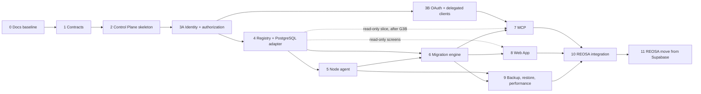

# Implementation waves

| | |
|---|---|
| Status | Baseline (Wave 0), accepted 2026-10-05 |
| Read before | [`acceptance-gates.md`](./acceptance-gates.md), [`test-strategy.md`](./test-strategy.md), [`../00-product/open-decisions.md`](../00-product/open-decisions.md) |

Twelve numbered waves, from documentation to REOSA running on ExponetDB-managed
PostgreSQL; Wave 3 is split into 3A (identity and authorization) and 3B (OAuth
and delegated clients). Each wave is sized so that one focused series of
sessions can complete it; each ends at a gate that the owner checks. A wave
does not start before the gates it depends on passed, except where "may
overlap" is stated.

## Overview

| Wave | Goal in one line | Blocking decisions |
|---|---|---|
| 0 | Approved architecture and constitution | none (G0 accepted 2026-10-05, [gate record](./gates/0.md)) |
| 1 | Contracts that every later wave implements | none (G1 accepted 2026-10-05, [gate record](./gates/1.md)) |
| 2 | Deployable skeleton with Control Store, audit, keyring, boundaries | none: authorized 2026-10-05; the OD-8 design for Wave 2 is settled, the legal retention setting stays open for Wave 9. G2 accepted 2026-10-05, deployment not proven yet ([gate record](./gates/2.md)) |
| 3A | People sign in securely and the server decides who may do what to which subject | none: authorized 2026-10-05 with OD-9 resolved (option a); G3A accepted 2026-10-06 ([gate record](./gates/3a.md)) |
| 3B | Delegated clients (OAuth, MCP clients, CLI, service accounts, API keys) get scoped access | none: authorized 2026-10-06 with OD-5 resolved (option a); in progress ([gate record](./gates/3b.md)) |
| 4 | Targets are registered and observed truthfully | none (external-cluster support is generic; using it for REOSA is OD-7, Wave 10) |
| 5 | Node agent with capabilities, no shell | none: OD-17, OD-18 and OD-20 resolved 2026-10-07; starts only after G4 is accepted and frozen |
| 6 | Migrations planned, applied, verified, with staging evidence | OD-6 (production provenance), OD-14, OD-15, OD-16 (OD-9, approvals, resolved 2026-10-05) |
| 7 | AI agents work through MCP with the same engine | OD-13 |
| 8 | Web App on the design system | OD-1, OD-11 |
| 9 | Backups proven by restores; diagnostics and advisors | OD-4, OD-8 (final legal retention setting) |
| 10 | REOSA uses ExponetDB for its current databases | OD-7 |
| 11 | REOSA production runs on ExponetDB-managed PostgreSQL | OD-12 (HA stance), all product gates |

---

## Wave 0: Repository, constitution, documentation

| | |
|---|---|
| Goal | An approved baseline: constitution, domain model, architecture, audits, roadmap, gates, open decisions |
| Non-goals | any production code, scaffolding, infrastructure change, REOSA change |
| Dependencies | none |
| Architecture docs | everything under `exponetdb-docs/` |
| Deliverables | `README.md`, `CLAUDE.md`, `exponetdb-docs/**`, ADR-0001 to ADR-0022 |
| Acceptance gate | G0 in [`acceptance-gates.md`](./acceptance-gates.md#wave-gates) |
| Security gate | threat model reviewed; no secrets or internal credentials in the repository |
| Tests | link and anchor check over the docs; every `OD-n` and ADR reference resolves |
| Docs requirement | this wave is the docs |
| Abort criteria | owner rejects a foundational decision (control/data plane split, own Control Store, plan/apply model): revise the affected ADRs before Wave 1 |

## Wave 1: Architecture contracts

| | |
|---|---|
| Goal | Machine-checkable contracts that make "one engine, many interfaces" enforceable |
| Non-goals | HTTP server, database access, UI; every migration-engine part (Wave 6): PostgreSQL connections, planning, apply, verification against a database, ledger access, advisory locks, evidence, legacy import and lint; the DAG (`migrations/graph`, Wave 2); node agent daemon, helper and capabilities (Wave 5) |
| Dependencies | Wave 0; resolved OD-3 (toolchain), OD-19 (license) and OD-2 (Go for the second golden-vector implementation) |
| Architecture docs | [`../01-architecture/package-architecture.md`](../01-architecture/package-architecture.md), [`../02-control-plane/error-model.md`](../02-control-plane/error-model.md), [`../02-control-plane/operations-engine.md`](../02-control-plane/operations-engine.md), [`../04-migrations/migration-bundles.md`](../04-migrations/migration-bundles.md), [`../04-migrations/ledger.md` §3](../04-migrations/ledger.md#3-derived-values), [`../05-mcp/tool-catalog.md`](../05-mcp/tool-catalog.md), [`../06-rest-api/resources.md`](../06-rest-api/resources.md), [`../07-node-agent/protocol.md`](../07-node-agent/protocol.md) |
| Deliverables | workspace tooling; `packages/kernel` (ids, Result, canonical JSON, hashing, the plan-hash construction); `packages/contracts`: error catalog, permissions and scopes, action registry with classes, REST resource schemas for read endpoints, MCP tool I/O for read tools, node protocol envelopes, migration manifest schema; **`packages/migrations/format`**, the pure migration-format primitives as production code (manifest parsing and validation, canonical manifest projection, `c1` executable-text canonicalization, apply checksum, verify, rollback, bundle and source digests, `ls1` ledger state hash; [`package-architecture.md` §1.1](../01-architecture/package-architecture.md#11-packagesmigrations-by-subpath-and-wave)); `agent/node` Go module limited to generated protocol types, `internal/canon` and `internal/conformance` (the independent second implementation); generators (OpenAPI 3.1, JSON Schema, Go types); **golden vectors** for canonical JSON, `c1` checksums and digests, `ls1` and plan hashes; boundary checker |
| Acceptance gate | G1 |
| Security gate | MCP-ineligible scopes are encoded in contracts and tested; no wildcard permissions |
| Tests | contract snapshot tests; generator determinism; golden vectors (including the adversarial `c1` cases of `migration-bundles.md` §3) pass against the production TypeScript code and the Go conformance implementation |
| Docs requirement | contracts README; `packages/migrations` README pointing to the `c1` and `ls1` specifications; changes to any contract update the matching doc in the same PR |
| Abort criteria | contracts cannot express a documented behavior: fix the doc or the design before Wave 2. The TypeScript and Go implementations disagree on a vector: fix the specification in `migration-bundles.md` §3 before G1, because no `c1` value may be stored before the canonicalizer is frozen |

## Wave 2: Control Plane skeleton

| | |
|---|---|
| Goal | A deployable, observable server with three process roles, its own Control Store and the safety foundations |
| Non-goals | authentication of any kind, including the first-owner bootstrap (`exponetdb bootstrap owner`, Wave 3A) and every auth-owned table; Passkeys, login, TOTP, Web sessions, OAuth, API keys, service accounts; MCP runtime; managed PostgreSQL targets, introspection, fingerprints, registration; node agent, helper and the gateway's agent listener with its CA and mTLS (Wave 5); migration execution against managed databases; Web App; backups of managed databases; any unprotected management API |
| Dependencies | Wave 1 |
| Architecture docs | [`../02-control-plane/control-database.md`](../02-control-plane/control-database.md), [`../02-control-plane/audit.md`](../02-control-plane/audit.md), [`../08-auth-and-security/secrets.md`](../08-auth-and-security/secrets.md), [`../10-observability/self-observability.md`](../10-observability/self-observability.md), [`../12-operations/deployment.md`](../12-operations/deployment.md), [`../12-operations/bootstrap.md`](../12-operations/bootstrap.md) |
| Deliverables | `apps/server` with `serve`/`worker`/`gateway` roles; `packages/control-store` with bootstrap runner and the Control Store's own bundles; `packages/audit` (append-only, hash chain, checkpoints); `packages/secrets` (keyring, envelope encryption); `packages/observability`; `packages/policy` framework; `packages/migrations/graph` (DAG order for the bootstrap runner); `packages/operations` skeleton (registry, state machine, idempotency, leases); installation bootstrap (Control Store bootstrap SQL with per-role logins, `exponetdb keyring generate`, `exponetdb control-store migrate` writing the installation marker); one release image; deployment on `reos-01` behind `db.exponet.cloud` with readiness only |
| Acceptance gate | G2 |
| Security gate | per-role Control Store logins with least privilege; audit `UPDATE`/`DELETE` rejected for every role; keyring never in the Control Store; logs pass the redaction tests |
| Tests | Control Store migrations apply and verify from empty; audit immutability; envelope encryption with AAD substitution test; operation state machine property tests; boundary lint in CI |
| Docs requirement | operations runbook for Control Store restore (RB-10) drafted |
| Abort criteria | Coolify cannot provide separate secrets per resource: revisit process separation (ADR-0019) before Wave 3A |
| State | **[OBSERVED]** (2026-10-05) implemented in `davdxpx/ExponetDB#5`; **G2 accepted by the owner on 2026-10-05**; the deployment on `reos-01` is not proven yet (not done) and stays an owner action ([gate record](./gates/2.md)) |

## Wave 3A: Identity and authorization foundation

| | |
|---|---|
| Goal | A person signs in to ExponetDB securely, and the server decides for every request who may do what to which subject |
| Non-goals | OAuth authorization server, delegated clients, API keys, service accounts (all Wave 3B); federation with an Exponet identity service (data model only); custom roles |
| Dependencies | Wave 2; OD-9 (approval model, resolved 2026-10-05: option a) |
| Architecture docs | [`../08-auth-and-security/identity.md`](../08-auth-and-security/identity.md), [`../08-auth-and-security/authorization.md`](../08-auth-and-security/authorization.md), [`../02-control-plane/policy-engine.md`](../02-control-plane/policy-engine.md), [`../08-auth-and-security/federation.md`](../08-auth-and-security/federation.md) (data model only) |
| Deliverables | `packages/auth` (identity part): local identities, first owner bootstrap (`exponetdb bootstrap owner`, its identity, setup token and first login, moved here from Wave 2 on 2026-10-05), invitations, Web sessions with CSRF protection, passkeys, password + TOTP fallback, re-authentication (step-up), last-owner recovery; core RBAC (roles, permissions, bindings at global, product, project, environment and target scope), tier model, client-kind concept, server-side authorization evaluation integrated with the policy engine for first-party Web App sessions and internal development; minimal login pages |
| Acceptance gate | G3A |
| Security gate | session security (fixation, CSRF, cookie flags); no wildcard permission; human-only actions enforced by client kind; tier separation for sessions; re-authentication windows enforced server-side |
| Tests | authorization matrix for sessions (permission × binding scope × tier × client kind × policy); escalation tests; session fixation and CSRF tests |
| Docs requirement | identity and authorization documents updated to what was built |
| Abort criteria | passkey support cannot be delivered for the first-party Web App: stop and decide with the owner; password + TOTP is a fallback, never the only factor for owners |
| State | **[OBSERVED]** (2026-10-06) authorized by the owner on 2026-10-05 together with the resolution of OD-9 (option a); implemented in `davdxpx/ExponetDB#6` (merge `06613bc`); **G3A accepted by the owner on 2026-10-06** ([gate record](./gates/3a.md) §8). The Wave 3A Control Store bundles are frozen since then. G2 deployment evidence outstanding: the deployment on `reos-01` must be proven before real production logins on `db.exponet.cloud` |

## Wave 3B: OAuth and delegated clients

| | |
|---|---|
| Goal | Delegated clients (MCP clients, the CLI, CI, REST/SDK integrations) get scoped, revocable, tier-aware access through ExponetDB's own authorization server |
| Non-goals | MCP tools (Wave 7); federation with an Exponet identity service |
| Dependencies | G3A (accepted 2026-10-06); OD-5 (client registration, resolved 2026-10-06: option a). May run in parallel with parts of Waves 4, 5 and 6 |
| Architecture docs | [`../05-mcp/oauth.md`](../05-mcp/oauth.md), [`../08-auth-and-security/authorization.md`](../08-auth-and-security/authorization.md), [`../08-auth-and-security/identity.md` §5](../08-auth-and-security/identity.md#5-service-accounts), [`../08-auth-and-security/ai-agent-safety.md`](../08-auth-and-security/ai-agent-safety.md) |
| Deliverables | `packages/auth` (delegation part): OAuth authorization server (authorization code + PKCE S256, resource indicators, `iss`), consent screens with scopes and tiers, scopes and grants with target and tier restrictions, opaque access tokens and rotating refresh tokens with reuse detection, service accounts with `private_key_jwt`, API keys, CIMD fetcher with allowlist, approval-gated DCR, MCP client registration policy, connected-applications page |
| Acceptance gate | G3B |
| Security gate | OAuth conformance suite; SSRF tests for the metadata fetcher; refresh reuse revokes the grant; MCP-ineligible scopes never issued to `mcp` clients; nonprod grants cannot act on prod subjects |
| Tests | authorization matrix extended with scope × grant restriction; token lifecycle tests; consent and DCR approval tests |
| Docs requirement | connected-applications and consent copy reviewed |
| Abort criteria | a required MCP client cannot complete the flow with CIMD or approved DCR: document the gap, decide per client (OD-5) |
| State | **[OBSERVED]** (2026-10-06) authorized by the owner on 2026-10-06 together with the resolution of OD-5 (option a); implemented in `davdxpx/ExponetDB#7` (merge `4752055`) and finally hardened in `548c9a7`; **G3B accepted by the owner on 2026-10-06** on the baseline `548c9a7` ([gate record](./gates/3b.md) §8, §9). The Wave 3B Control Store bundle is frozen since then. Wave 7 may start after G3B but is not authorized by the Wave 4 order. Nothing was deployed. G2 deployment evidence outstanding |

Ordering rules between 3A, 3B and later waves:

- Wave 4 may start after G3A. Its protected product flows (Web App sessions,
  internal development) use the 3A authorization evaluation.
- Every external REST or SDK machine authorization, the CLI's server-side
  commands and CI access wait for G3B.
- **Wave 7 (MCP) does not start before G3B is accepted**, including its
  read-only tool slice.

## Wave 4: Target registry and PostgreSQL adapter

| | |
|---|---|
| Goal | Targets are registered, identified and observed truthfully, read-only |
| Non-goals | any write to managed databases other than `target.register` (identity marker and the empty `exponetdb` ledger schema); node agent; machine (token) access to the new REST endpoints before G3B |
| Dependencies | G3A; the Wave 4 order also required G3B to be accepted and frozen first (done 2026-10-06), so the new REST reads take API-audience tokens and API keys from the start |
| Architecture docs | [`../02-control-plane/registry.md`](../02-control-plane/registry.md), [`../03-database-model/postgres-adapter.md`](../03-database-model/postgres-adapter.md), [`../03-database-model/schema-fingerprints.md`](../03-database-model/schema-fingerprints.md), [`../03-database-model/credentials-and-roles.md`](../03-database-model/credentials-and-roles.md), [`../03-database-model/sql-execution-security.md`](../03-database-model/sql-execution-security.md), [`../03-database-model/statement-redaction.md`](../03-database-model/statement-redaction.md), [`../03-database-model/drift-detection.md`](../03-database-model/drift-detection.md), [`../10-observability/health.md`](../10-observability/health.md) |
| Deliverables | `packages/registry`; `packages/postgres` (sessions with TLS `verify-full`, catalog, fingerprints, libpg_query integration, redaction, diagnostics SQL, data-read admission); `packages/diagnostics` (samplers, health model, findings); credential store; identity marker stamping; read REST endpoints; driver spike result recorded |
| Acceptance gate | G4 |
| Security gate | observer and reader roles cannot write (tested against real PostgreSQL); `data.read` admission refuses every non-read class; no connection material in any API response; redaction corpus passes |
| Tests | fingerprint determinism across runs, sessions and PostgreSQL 16/17/18; plan-guard budget on a large catalog; hostile identifier fixtures; health failed-read tests; drift detection against fixtures |
| Docs requirement | adapter coverage table per PostgreSQL version |
| Abort criteria | fingerprints not deterministic across minor versions: narrow the canonical document before migrations depend on it |
| State | **[OBSERVED]** (2026-10-06) authorized by the owner on 2026-10-06 together with the acceptance of G3B; **implementation complete, G4 evidence complete, awaiting owner acceptance** ([gate record](./gates/4.md), `davdxpx/ExponetDB#8`): spikes, version matrix, fingerprint measurements, adversarial review, deviations D1 to D12 and residuals there. The adapter coverage per major is the recorded differences of [`schema-fingerprints.md`](../03-database-model/schema-fingerprints.md) and the gate record §4a. `fp1` freezes with the acceptance. G2 deployment evidence outstanding; Waves 5 to 8 not started |

## Wave 5: Node agent

| | |
|---|---|
| Goal | Host-level capabilities through a signed, allowlisted protocol; no shell |
| Non-goals | backups and restore capabilities (Wave 9), agent self-update, package updates beyond audit and planning |
| Dependencies | Wave 4 (G4 accepted and frozen); OD-17 (PostgreSQL server CA), OD-18 (gateway exposure), OD-20 (configuration ownership), all resolved 2026-10-07; language decided (Go, OD-2) |
| Architecture docs | [`../07-node-agent/architecture.md`](../07-node-agent/architecture.md), [`../07-node-agent/enrollment.md`](../07-node-agent/enrollment.md), [`../07-node-agent/protocol.md`](../07-node-agent/protocol.md), [`../07-node-agent/capabilities.md`](../07-node-agent/capabilities.md), [`../07-node-agent/security.md`](../07-node-agent/security.md) |
| Deliverables | `agent/node` (daemon + root helper); `packages/nodes` (enrollment, CA, job signing, dispatch); gateway role; capabilities: status, config inspect/plan/apply, roles inspect/plan/apply, hba, TLS inspect/plan/rotate, extensions, health and stats, log inspect, WAL status; node health in the Web App data model |
| Acceptance gate | G5 |
| Security gate | capability allowlist test (no command execution path); helper accepts only typed operations over its socket; job signature, expiry, node binding and replay protection; certificate renewal and revocation; `pg_hba` change refuses to lock out the agent |
| Tests | protocol contract tests (TS ↔ Go); mTLS tests; failure injection (agent crash mid-job, network partition, clock skew); real PostgreSQL on a VM for config/roles/hba/TLS |
| Docs requirement | host installation and enrollment runbook; RB-13 |
| Abort criteria | the helper needs broader privileges than documented: stop and revise the capability design |

## Wave 6: Migration engine

| | |
|---|---|
| Goal | Migrations are planned, applied and verified with plan binding, staging evidence, approvals and an in-target ledger |
| Non-goals | verified provenance from Git (later), automatic rollback, multi-target fan-out writes |
| Dependencies | Waves 4 and 5 (roles via desired state); G3B for the CLI's server-side commands and CI access (local CLI commands do not need it); OD-6, OD-14, OD-15, OD-16; OD-9 resolved 2026-10-05 |
| Architecture docs | all of [`../04-migrations/`](../04-migrations/README.md), [`../02-control-plane/operations-engine.md`](../02-control-plane/operations-engine.md), [`../02-control-plane/policy-engine.md`](../02-control-plane/policy-engine.md) |
| Deliverables | `packages/migrations/lint` (lint rules on the Wave 4 parser) and `packages/migrations/engine` (plan, apply, verification against the database, ledger access, advisory locks, evidence, legacy import, drift wiring), built on the `format` primitives frozen at G1 and the `graph` from Wave 2; `apps/cli` (`exponetdb migration new`, `lint`, `checksum`, `graph`, `plan`, `apply`, `status`, `verify`); approvals and break-glass in the Operations Engine; REST endpoints for migrations, plans, operations |
| Acceptance gate | G6 |
| Security gate | `verify.sql` admission (statement forms, function allowlist, declared consumer checks with approval) and execution layers (verifier role without write privileges, read-only transaction, timeouts, limits) tested as defined, without a sandbox claim; plan substitution and replay tests; production apply impossible without staging evidence or break-glass |
| Tests | the G1 golden vectors still pass unchanged (append-only; new corpus cases are added as vectors); DAG property tests; advisory-lock concurrency tests; stale plan tests; failure catalog E1 to E30; legacy import against the REOSA-shaped fixture; non-transactional bundles |
| Docs requirement | authoring guide for humans and agents; RB-05 |
| Abort criteria | lexical checksum normalization misclassifies a corpus case: `c1` stays frozen (it is a stored contract since G1); introduce `c2` via ADR before Wave 7 |

## Wave 7: MCP

| | |
|---|---|
| Goal | AI agents use ExponetDB through MCP with the same engine, scopes and policies as humans |
| Non-goals | any tool that executes arbitrary SQL, approves plans or activates break-glass |
| Dependencies | G3B and Wave 6 (a read-only tool slice may ship after Wave 4, but never before G3B); OD-13 |
| Architecture docs | [`../05-mcp/architecture.md`](../05-mcp/architecture.md), [`../05-mcp/tool-catalog.md`](../05-mcp/tool-catalog.md), [`../05-mcp/oauth.md`](../05-mcp/oauth.md), [`../08-auth-and-security/ai-agent-safety.md`](../08-auth-and-security/ai-agent-safety.md) |
| Deliverables | `/mcp` endpoint (Streamable HTTP, both protocol eras), tool catalog with output schemas and untrusted labels, URL elicitation for approvals, resource metadata, tested client configurations (Claude Code, Claude, Cursor, Codex, VS Code) |
| Acceptance gate | G7 |
| Security gate | Origin validation; adversarial prompt-injection suite (every goal in ai-agent-safety §3 with every grant shape); output caps; no tool reachable without the scope |
| Tests | MCP contract tests per protocol version; tool I/O schema tests; replay of recorded agent sessions |
| Docs requirement | per-client setup guides |
| Abort criteria | a protocol version change breaks both eras: pin, document, fix before Wave 10 |

## Wave 8: Web App and Supabase-reference adoption

| | |
|---|---|
| Goal | People manage the fleet through a Web App built on ExponetDB's design system |
| Non-goals | row editing, SQL execution with writes, marketing site |
| Dependencies | Wave 6 (read-only screens may start after Wave 4); OD-1, OD-11 |
| Architecture docs | [`../11-ui/information-architecture.md`](../11-ui/information-architecture.md), [`../11-ui/design-system.md`](../11-ui/design-system.md), [`../11-ui/supabase-reference-audit.md`](../11-ui/supabase-reference-audit.md) |
| Deliverables | `packages/tokens`, `ui`, `ui-patterns`, `ui-data`, `icons`; `apps/design-system`; `apps/web` with global and target levels, plan review, approvals, SQL query and drafting, schema browser, migrations timeline, connections and locks, infrastructure, access, audit |
| Acceptance gate | G8 |
| Security gate | CSP without inline scripts; session cookies `Secure`, `HttpOnly`, `SameSite`; CSRF tests; no connection material or tokens rendered; untrusted content never rendered as HTML |
| Tests | component and render tests (truthful states), visual regression, accessibility checks, E2E against the local stack |
| Docs requirement | design-system guidance pages; for any direct copy of third-party source (an exception), the file-specific license review recorded in that change |
| Abort criteria | a file-specific license review finds copied code without a clear license, or with obligations the owner does not accept: replace it with a native rewrite before release |

## Wave 9: Backup, restore, performance

| | |
|---|---|
| Goal | Backups that are proven by restores; diagnostics actions; advisors |
| Non-goals | in-place restore over running clusters; HA failover |
| Dependencies | Waves 5 and 6; OD-4, OD-8 (final legal retention setting, decided before Wave 9 starts) |
| Architecture docs | [`../09-backups-and-restore/`](../09-backups-and-restore/architecture.md), [`../10-observability/performance.md`](../10-observability/performance.md) |
| Deliverables | backup capabilities and policies; catalog mirror; RPO/RTO measurement; restore planning and drills; generated restore runbooks; cancel/terminate plans; statement statistics; advisors and findings |
| Acceptance gate | G9 |
| Security gate | client-side encryption; object lock verified by a deletion attempt that fails; restore destination identity checks; restore human-only |
| Tests | end-to-end backup, verify and restore against the chosen storage; PITR to random points; drill without the Control Plane; failure injection (archive blocked, storage unreachable) |
| Docs requirement | RB-06, RB-07, RB-08 complete |
| Abort criteria | the chosen engine fails the end-to-end test on the chosen storage: switch engine (OD-4 alternative) before any production data depends on it |

## Wave 10: REOSA integration

| | |
|---|---|
| Goal | REOSA's databases are observed, imported and migrated through ExponetDB; REOSA Admin reads ExponetDB |
| Non-goals | moving REOSA off Supabase; changing REOSA's auth |
| Dependencies | Waves 7, 8, 9; OD-7 |
| Architecture docs | [`../13-integrations/reosa-integration.md`](../13-integrations/reosa-integration.md), [`../13-integrations/reosa-current-state.md`](../13-integrations/reosa-current-state.md), [`../04-migrations/legacy-import.md`](../04-migrations/legacy-import.md), [`../13-integrations/sdk.md`](../13-integrations/sdk.md) |
| Deliverables | REOSA registry entries; legacy import and baseline with resolved review items; REOSA bundle roots and CI checks (in REOSA's repository, by REOSA); staging-first migrations through ExponetDB; runtime schema contract in REOSA health; SDK in REOSA Admin `/database` |
| Acceptance gate | G10 |
| Security gate | REOSA service account read-only; production applies only with evidence and approval; drift finding on any out-of-band change |
| Tests | import result reproducible from the same inputs; staging → production evidence chain on real migrations |
| Docs requirement | REOSA's own rules updated by REOSA; ExponetDB docs record the integration state |
| Abort criteria | the hosted provider prevents the migrator design: keep read-only mode until Wave 11 |

## Wave 11: REOSA move from Supabase to ExponetDB-managed PostgreSQL

| | |
|---|---|
| Goal | REOSA production and staging run on `reos-db-01`, managed by ExponetDB |
| Non-goals | HA failover (OD-12), REOSA application changes beyond configuration |
| Dependencies | Wave 10; all product gates |
| Architecture docs | [`../13-integrations/reosa-integration.md` §4](../13-integrations/reosa-integration.md#4-wave-11-moving-reosa-from-supabase-to-exponetdb-managed-postgresql), [`../09-backups-and-restore/restore.md`](../09-backups-and-restore/restore.md) |
| Deliverables | prepared cluster with role desired state and extensions; rehearsal evidence; cutover plan with dependents and rollback plan; executed cutover; backups and first drill on the new cluster |
| Acceptance gate | G11 + every product gate in [`acceptance-gates.md`](./acceptance-gates.md#product-gates-before-reosa-production-moves) |
| Security gate | `hostssl` only; no superuser over the network; ACL and RLS invariants equal to the source |
| Tests | rehearsal restores with fingerprint and ACL comparison; isolation probe as non-superuser; rollback rehearsed |
| Docs requirement | cutover record; REOSA documents point to ExponetDB for database facts |
| Abort criteria | any acceptance check fails during the window: roll back to the old project per the rollback plan; no partial switch |
