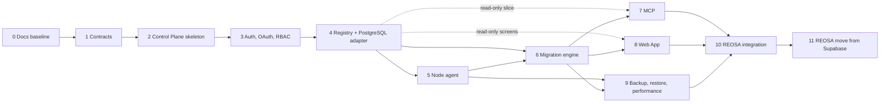

# Implementation waves

| | |
|---|---|
| Status | Baseline (Wave 0), awaiting owner approval |
| Read before | [`acceptance-gates.md`](./acceptance-gates.md), [`test-strategy.md`](./test-strategy.md), [`../00-product/open-decisions.md`](../00-product/open-decisions.md) |

Twelve waves, from documentation to REOSA running on ExponetDB-managed
PostgreSQL. Each wave is sized so that one focused series of sessions can
complete it; each ends at a gate that the owner checks. A wave does not start
before the previous wave's gate passed, except where "may overlap" is stated.

## Overview

| Wave | Goal in one line | Blocking decisions |
|---|---|---|
| 0 | Approved architecture and constitution | owner review of this baseline |
| 1 | Contracts that every later wave implements | OD-3, OD-19 |
| 2 | Deployable skeleton with Control Store, audit, keyring, boundaries | OD-3 |
| 3 | People and clients can authenticate; permissions and scopes are enforced | OD-5, OD-9 |
| 4 | Targets are registered and observed truthfully | OD-7 (only for external clusters) |
| 5 | Node agent with capabilities, no shell | OD-2, OD-17, OD-18 |
| 6 | Migrations planned, applied, verified, with staging evidence | OD-6 (production provenance), OD-14, OD-15, OD-16 |
| 7 | AI agents work through MCP with the same engine | OD-13 |
| 8 | Web App on the design system | OD-1, OD-11 |
| 9 | Backups proven by restores; diagnostics and advisors | OD-4, OD-8 |
| 10 | REOSA uses ExponetDB for its current databases | OD-7 |
| 11 | REOSA production runs on ExponetDB-managed PostgreSQL | OD-12 (HA stance), all product gates |

---

## Wave 0: Repository, constitution, documentation

| | |
|---|---|
| Goal | An approved baseline: constitution, domain model, architecture, audits, roadmap, gates, open decisions |
| Non-goals | any production code, scaffolding, infrastructure change, REOSA change |
| Dependencies | none |
| Architecture docs | everything under `exponetdb-docs/` |
| Deliverables | `README.md`, `CLAUDE.md`, `exponetdb-docs/**`, ADR-0001 to ADR-0022 |
| Acceptance gate | G0 in [`acceptance-gates.md`](./acceptance-gates.md#wave-gates) |
| Security gate | threat model reviewed; no secrets or internal credentials in the repository |
| Tests | link and anchor check over the docs; every `OD-n` and ADR reference resolves |
| Docs requirement | this wave is the docs |
| Abort criteria | owner rejects a foundational decision (control/data plane split, own Control Store, plan/apply model): revise the affected ADRs before Wave 1 |

## Wave 1: Architecture contracts

| | |
|---|---|
| Goal | Machine-checkable contracts that make "one engine, many interfaces" enforceable |
| Non-goals | HTTP server, database access, UI |
| Dependencies | Wave 0; OD-3 (toolchain), OD-19 (license header) |
| Architecture docs | [`../01-architecture/package-architecture.md`](../01-architecture/package-architecture.md), [`../02-control-plane/error-model.md`](../02-control-plane/error-model.md), [`../02-control-plane/operations-engine.md`](../02-control-plane/operations-engine.md), [`../04-migrations/migration-bundles.md`](../04-migrations/migration-bundles.md), [`../05-mcp/tool-catalog.md`](../05-mcp/tool-catalog.md), [`../06-rest-api/resources.md`](../06-rest-api/resources.md), [`../07-node-agent/protocol.md`](../07-node-agent/protocol.md) |
| Deliverables | workspace tooling; `packages/kernel` (ids, Result, canonical JSON, hashing); `packages/contracts`: error catalog, permissions and scopes, action registry with classes, REST resource schemas for read endpoints, MCP tool I/O for read tools, node protocol envelopes, migration manifest schema; generators (OpenAPI 3.1, JSON Schema, Go types); **golden vectors** for checksums, plan hashes and canonical JSON; boundary checker |
| Acceptance gate | G1 |
| Security gate | MCP-ineligible scopes are encoded in contracts and tested; no wildcard permissions |
| Tests | contract snapshot tests; generator determinism; golden vectors verified by an independent implementation (Go) |
| Docs requirement | contracts README; changes to any contract update the matching doc in the same PR |
| Abort criteria | contracts cannot express a documented behavior: fix the doc or the design before Wave 2 |

## Wave 2: Control Plane skeleton

| | |
|---|---|
| Goal | A deployable, observable server with three process roles, its own Control Store and the safety foundations |
| Non-goals | authentication flows (beyond bootstrap owner record), managed databases, agent |
| Dependencies | Wave 1 |
| Architecture docs | [`../02-control-plane/control-database.md`](../02-control-plane/control-database.md), [`../02-control-plane/audit.md`](../02-control-plane/audit.md), [`../08-auth-and-security/secrets.md`](../08-auth-and-security/secrets.md), [`../10-observability/self-observability.md`](../10-observability/self-observability.md), [`../12-operations/deployment.md`](../12-operations/deployment.md), [`../12-operations/bootstrap.md`](../12-operations/bootstrap.md) |
| Deliverables | `apps/server` with `serve`/`worker`/`gateway` roles; `packages/control-store` with bootstrap runner and the Control Store's own bundles; `packages/audit` (append-only, hash chain, checkpoints); `packages/secrets` (keyring, envelope encryption); `packages/observability`; `packages/policy` framework; `packages/operations` skeleton (registry, state machine, idempotency, leases); `exponetdb bootstrap owner`; deployment on `reos-01` behind `db.exponet.cloud` with readiness only |
| Acceptance gate | G2 |
| Security gate | per-role Control Store logins with least privilege; audit `UPDATE`/`DELETE` rejected for every role; keyring never in the Control Store; logs pass the redaction tests |
| Tests | Control Store migrations apply and verify from empty; audit immutability; envelope encryption with AAD substitution test; operation state machine property tests; boundary lint in CI |
| Docs requirement | operations runbook for Control Store restore (RB-10) drafted |
| Abort criteria | Coolify cannot provide separate secrets per resource: revisit process separation (ADR-0019) before Wave 3 |

## Wave 3: Auth, OAuth, RBAC

| | |
|---|---|
| Goal | Humans and clients authenticate; every request is authorized by permission, scope, tier, grant restriction, client kind and policy |
| Non-goals | federation with an Exponet identity service (data model only), custom roles |
| Dependencies | Wave 2; OD-5 (client registration), OD-9 (approval model) |
| Architecture docs | [`../08-auth-and-security/identity.md`](../08-auth-and-security/identity.md), [`../08-auth-and-security/authorization.md`](../08-auth-and-security/authorization.md), [`../05-mcp/oauth.md`](../05-mcp/oauth.md), [`../08-auth-and-security/federation.md`](../08-auth-and-security/federation.md) |
| Deliverables | `packages/auth`: identities, passkeys + TOTP, sessions with re-auth, invitations, OAuth authorization server (PKCE S256, resource indicators, `iss`), opaque tokens with rotating refresh tokens, CIMD fetcher with allowlist, approval-gated DCR, API keys, service accounts with `private_key_jwt`, RBAC with bindings at scopes, consent screens; minimal login/consent pages |
| Acceptance gate | G3 |
| Security gate | OAuth conformance suite; SSRF tests for the metadata fetcher; refresh reuse revokes the grant; MCP-ineligible scopes never issued to `mcp` clients; tier matrix tests |
| Tests | authorization matrix (permission × scope × tier × grant × client kind); escalation tests; session fixation and CSRF tests |
| Docs requirement | connected-applications and consent copy reviewed |
| Abort criteria | a required MCP client cannot complete the flow with CIMD or approved DCR: document the gap, decide per client (OD-5) |

## Wave 4: Target registry and PostgreSQL adapter

| | |
|---|---|
| Goal | Targets are registered, identified and observed truthfully, read-only |
| Non-goals | any write to managed databases other than stamping the identity marker; node agent |
| Dependencies | Wave 3 |
| Architecture docs | [`../02-control-plane/registry.md`](../02-control-plane/registry.md), [`../03-database-model/postgres-adapter.md`](../03-database-model/postgres-adapter.md), [`../03-database-model/schema-fingerprints.md`](../03-database-model/schema-fingerprints.md), [`../03-database-model/credentials-and-roles.md`](../03-database-model/credentials-and-roles.md), [`../03-database-model/sql-execution-security.md`](../03-database-model/sql-execution-security.md), [`../03-database-model/statement-redaction.md`](../03-database-model/statement-redaction.md), [`../03-database-model/drift-detection.md`](../03-database-model/drift-detection.md), [`../10-observability/health.md`](../10-observability/health.md) |
| Deliverables | `packages/registry`; `packages/postgres` (sessions with TLS `verify-full`, catalog, fingerprints, libpg_query integration, redaction, diagnostics SQL, data-read admission); `packages/diagnostics` (samplers, health model, findings); credential store; identity marker stamping; read REST endpoints; driver spike result recorded |
| Acceptance gate | G4 |
| Security gate | observer and reader roles cannot write (tested against real PostgreSQL); `data.read` admission refuses every non-read class; no connection material in any API response; redaction corpus passes |
| Tests | fingerprint determinism across runs, sessions and PostgreSQL 16/17/18; plan-guard budget on a large catalog; hostile identifier fixtures; health failed-read tests; drift detection against fixtures |
| Docs requirement | adapter coverage table per PostgreSQL version |
| Abort criteria | fingerprints not deterministic across minor versions: narrow the canonical document before migrations depend on it |

## Wave 5: Node agent

| | |
|---|---|
| Goal | Host-level capabilities through a signed, allowlisted protocol; no shell |
| Non-goals | backups and restore capabilities (Wave 9), agent self-update, package updates beyond audit and planning |
| Dependencies | Wave 4; OD-2 (language), OD-17 (PostgreSQL server CA), OD-18 (gateway exposure) |
| Architecture docs | [`../07-node-agent/architecture.md`](../07-node-agent/architecture.md), [`../07-node-agent/enrollment.md`](../07-node-agent/enrollment.md), [`../07-node-agent/protocol.md`](../07-node-agent/protocol.md), [`../07-node-agent/capabilities.md`](../07-node-agent/capabilities.md), [`../07-node-agent/security.md`](../07-node-agent/security.md) |
| Deliverables | `agent/node` (daemon + root helper); `packages/nodes` (enrollment, CA, job signing, dispatch); gateway role; capabilities: status, config inspect/plan/apply, roles inspect/plan/apply, hba, TLS inspect/plan/rotate, extensions, health and stats, log inspect, WAL status; node health in the Web App data model |
| Acceptance gate | G5 |
| Security gate | capability allowlist test (no command execution path); helper accepts only typed operations over its socket; job signature, expiry, node binding and replay protection; certificate renewal and revocation; `pg_hba` change refuses to lock out the agent |
| Tests | protocol contract tests (TS ↔ Go); mTLS tests; failure injection (agent crash mid-job, network partition, clock skew); real PostgreSQL on a VM for config/roles/hba/TLS |
| Docs requirement | host installation and enrollment runbook; RB-13 |
| Abort criteria | the helper needs broader privileges than documented: stop and revise the capability design |

## Wave 6: Migration engine

| | |
|---|---|
| Goal | Migrations are planned, applied and verified with plan binding, staging evidence, approvals and an in-target ledger |
| Non-goals | verified provenance from Git (later), automatic rollback, multi-target fan-out writes |
| Dependencies | Waves 4 and 5 (roles via desired state); OD-6, OD-14, OD-15, OD-16 |
| Architecture docs | all of [`../04-migrations/`](../04-migrations/README.md), [`../02-control-plane/operations-engine.md`](../02-control-plane/operations-engine.md), [`../02-control-plane/policy-engine.md`](../02-control-plane/policy-engine.md) |
| Deliverables | `packages/migrations/bundle` (manifest, checksums, DAG, lint) and `/engine` (plan, apply, verify, ledger, evidence, legacy import, drift wiring); `apps/cli` (`init`, `new`, `lint`, `checksum`, `plan`, `apply`, `status`); approvals and break-glass in the Operations Engine; REST endpoints for migrations, plans, operations |
| Acceptance gate | G6 |
| Security gate | `verify.sql` sandbox (read-only role, function denylist, rollback) adversarial tests; plan substitution and replay tests; production apply impossible without staging evidence or break-glass |
| Tests | checksum golden vectors across TS and Go; DAG property tests; advisory-lock concurrency tests; stale plan tests; failure catalog E1 to E30; legacy import against the REOSA-shaped fixture; non-transactional bundles |
| Docs requirement | authoring guide for humans and agents; RB-05 |
| Abort criteria | lexical checksum normalization misclassifies a corpus case: freeze `c1` and introduce `c2` via ADR before Wave 7 |

## Wave 7: MCP

| | |
|---|---|
| Goal | AI agents use ExponetDB through MCP with the same engine, scopes and policies as humans |
| Non-goals | any tool that executes arbitrary SQL, approves plans or activates break-glass |
| Dependencies | Wave 6 (read-only tools may ship after Wave 4); OD-13 |
| Architecture docs | [`../05-mcp/architecture.md`](../05-mcp/architecture.md), [`../05-mcp/tool-catalog.md`](../05-mcp/tool-catalog.md), [`../05-mcp/oauth.md`](../05-mcp/oauth.md), [`../08-auth-and-security/ai-agent-safety.md`](../08-auth-and-security/ai-agent-safety.md) |
| Deliverables | `/mcp` endpoint (Streamable HTTP, both protocol eras), tool catalog with output schemas and untrusted labels, URL elicitation for approvals, resource metadata, tested client configurations (Claude Code, Claude, Cursor, Codex, VS Code) |
| Acceptance gate | G7 |
| Security gate | Origin validation; adversarial prompt-injection suite (every goal in ai-agent-safety §3 with every grant shape); output caps; no tool reachable without the scope |
| Tests | MCP contract tests per protocol version; tool I/O schema tests; replay of recorded agent sessions |
| Docs requirement | per-client setup guides |
| Abort criteria | a protocol version change breaks both eras: pin, document, fix before Wave 10 |

## Wave 8: Web App and Supabase-reference adoption

| | |
|---|---|
| Goal | People manage the fleet through a Web App built on ExponetDB's design system |
| Non-goals | row editing, SQL execution with writes, marketing site |
| Dependencies | Wave 6 (read-only screens may start after Wave 4); OD-1, OD-11 |
| Architecture docs | [`../11-ui/information-architecture.md`](../11-ui/information-architecture.md), [`../11-ui/design-system.md`](../11-ui/design-system.md), [`../11-ui/supabase-reference-audit.md`](../11-ui/supabase-reference-audit.md) |
| Deliverables | `packages/tokens`, `ui`, `ui-patterns`, `ui-data`, `icons`; `apps/design-system`; `apps/web` with global and target levels, plan review, approvals, SQL query and drafting, schema browser, migrations timeline, connections and locks, infrastructure, access, audit |
| Acceptance gate | G8 |
| Security gate | CSP without inline scripts; session cookies `Secure`, `HttpOnly`, `SameSite`; CSRF tests; no connection material or tokens rendered; untrusted content never rendered as HTML |
| Tests | component and render tests (truthful states), visual regression, accessibility checks, E2E against the local stack |
| Docs requirement | design-system guidance pages; `THIRD_PARTY_NOTICES.md` for adapted files |
| Abort criteria | license review finds adapted code without a clear license: replace with a rewrite before release |

## Wave 9: Backup, restore, performance

| | |
|---|---|
| Goal | Backups that are proven by restores; diagnostics actions; advisors |
| Non-goals | in-place restore over running clusters; HA failover |
| Dependencies | Waves 5 and 6; OD-4, OD-8 |
| Architecture docs | [`../09-backups-and-restore/`](../09-backups-and-restore/architecture.md), [`../10-observability/performance.md`](../10-observability/performance.md) |
| Deliverables | backup capabilities and policies; catalog mirror; RPO/RTO measurement; restore planning and drills; generated restore runbooks; cancel/terminate plans; statement statistics; advisors and findings |
| Acceptance gate | G9 |
| Security gate | client-side encryption; object lock verified by a deletion attempt that fails; restore destination identity checks; restore human-only |
| Tests | end-to-end backup, verify and restore against the chosen storage; PITR to random points; drill without the Control Plane; failure injection (archive blocked, storage unreachable) |
| Docs requirement | RB-06, RB-07, RB-08 complete |
| Abort criteria | the chosen engine fails the end-to-end test on the chosen storage: switch engine (OD-4 alternative) before any production data depends on it |

## Wave 10: REOSA integration

| | |
|---|---|
| Goal | REOSA's databases are observed, imported and migrated through ExponetDB; REOSA Admin reads ExponetDB |
| Non-goals | moving REOSA off Supabase; changing REOSA's auth |
| Dependencies | Waves 7, 8, 9; OD-7 |
| Architecture docs | [`../13-integrations/reosa-integration.md`](../13-integrations/reosa-integration.md), [`../13-integrations/reosa-current-state.md`](../13-integrations/reosa-current-state.md), [`../04-migrations/legacy-import.md`](../04-migrations/legacy-import.md), [`../13-integrations/sdk.md`](../13-integrations/sdk.md) |
| Deliverables | REOSA registry entries; legacy import and baseline with resolved review items; REOSA bundle roots and CI checks (in REOSA's repository, by REOSA); staging-first migrations through ExponetDB; runtime schema contract in REOSA health; SDK in REOSA Admin `/database` |
| Acceptance gate | G10 |
| Security gate | REOSA service account read-only; production applies only with evidence and approval; drift finding on any out-of-band change |
| Tests | import result reproducible from the same inputs; staging → production evidence chain on real migrations |
| Docs requirement | REOSA's own rules updated by REOSA; ExponetDB docs record the integration state |
| Abort criteria | the hosted provider prevents the migrator design: keep read-only mode until Wave 11 |

## Wave 11: REOSA move from Supabase to ExponetDB-managed PostgreSQL

| | |
|---|---|
| Goal | REOSA production and staging run on `reos-db-01`, managed by ExponetDB |
| Non-goals | HA failover (OD-12), REOSA application changes beyond configuration |
| Dependencies | Wave 10; all product gates |
| Architecture docs | [`../13-integrations/reosa-integration.md` §4](../13-integrations/reosa-integration.md#4-wave-11-moving-reosa-from-supabase-to-exponetdb-managed-postgresql), [`../09-backups-and-restore/restore.md`](../09-backups-and-restore/restore.md) |
| Deliverables | prepared cluster with role desired state and extensions; rehearsal evidence; cutover plan with dependents and rollback plan; executed cutover; backups and first drill on the new cluster |
| Acceptance gate | G11 + every product gate in [`acceptance-gates.md`](./acceptance-gates.md#product-gates-before-reosa-production-moves) |
| Security gate | `hostssl` only; no superuser over the network; ACL and RLS invariants equal to the source |
| Tests | rehearsal restores with fingerprint and ACL comparison; isolation probe as non-superuser; rollback rehearsed |
| Docs requirement | cutover record; REOSA documents point to ExponetDB for database facts |
| Abort criteria | any acceptance check fails during the window: roll back to the old project per the rollback plan; no partial switch |
