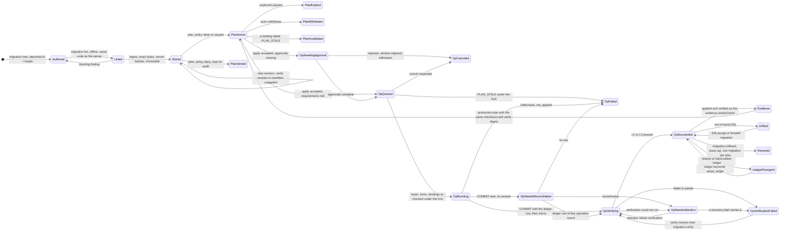

# Bundle contract: the bundle system as documented and as implemented

Block B, agent B1 (static analysis, no server). Tree under test `T` = `d51da5d0` (fix PR #46).
Every code citation is `path:line` at `T`. Nothing here is a verdict: the product's behaviour is read
from code and docs; the few runs that were possible are labelled **exploratory** (Bun 1.3.14 on the
lead's machine, outside the pinned toolchain). Checks that need a stack are written down as attack
plans (section 5) and listed as NOT RUN (section 8).

| Tag | Meaning |
|---|---|
| DOC-WRONG | the document says something the code does not do, and the code is the sensible side |
| CODE-WRONG | the document is the sensible side; the code does not do it (or does less) |
| UNDEFINED | neither document nor code decides the case |
| IMPLICIT | the code has a behaviour or a state that no document names |

Source classes: `[D]` document, `[S]` read from code, `[E]` exploratory run.
Findings cross-reference: `FB1-n` is the local label of an entry in `F/findings-B1.md` (index in section 9).

---

## 1. The lifecycle as documented

### 1.1 State diagram (documented)

Nothing in the docs draws this as one diagram; it is assembled from `migration-bundles.md`,
`planning-and-apply.md`, `ledger.md`, `verification.md`, `staging-production-policy.md`,
`failure-and-recovery.md`, `drift-detection.md` and `operations-engine.md` §3.4/§4.1.



The operation machine alone (`operations-engine.md` §4.1) is the `Op*` part. Plan states
(§3.4) are `PlanActive`, `PlanDenied`, `PlanExpired`, `PlanWithdrawn`, `PlanInvalidated` and
`consumed` (the arrow into `OpAwaitingApproval`/`OpQueued`).

### 1.2 Table of documented states and transitions

| # | State or transition | Trigger and guard as documented | Doc reference |
|---|---|---|---|
| D1 | Authored | `migration new` fills `dependsOn` with the heads of the local tree | `dependency-graph.md` §2; `authoring-and-ci.md` §4 |
| D2 | Linted | local and at plan time, same package; blocking by rule and tier | `analysis.md` §6; `authoring-and-ci.md` §4 |
| D3 | Stored (ingest) | server validates, hashes, stores bytes "content-addressed"; hashes of a client are no authority | `planning-and-apply.md` §1, §3 step 2; `migration-bundles.md` §3 "What a mismatch means" |
| D4 | Stored, new revision | same id: same checksum and new verify/rollback/comment bytes is a verify revision; new checksum allowed only if never applied (`rewritten_unapplied_migration`); else `MIGRATION_CHECKSUM_MISMATCH` | `migration-bundles.md` §3 table; `verification.md` §5 "Retrying verification" |
| D5 | Plan active / denied | 8-step algorithm; always stored; a denied plan can never be applied | `planning-and-apply.md` §3; `operations-engine.md` §3.4 |
| D6 | Plan expired / withdrawn / invalidated / consumed | expiry per class (high 15 min); actor withdraws; binding failure invalidates; first accepted apply consumes | `operations-engine.md` §3.3, §3.4 |
| D7 | Operation awaiting_approval → queued | approvals recorded for exactly this `planHash`; human, `plans.approve`, re-authentication | `operations-engine.md` §4.1, §6 |
| D8 | awaiting_approval → canceled | rejected, **window elapsed (default 4 h, max 24 h)**, withdrawn | `operations-engine.md` §3.3, §4.1 |
| D9 | queued → running | lease, exclusivity lock, advisory lock, bindings re-checked under the lock | `planning-and-apply.md` §4.2; `concurrency.md` §3 |
| D10 | running → verifying | per migration: execute, pre-commit gate (L0), ledger row, COMMIT; transactional bundle atomic with its ledger row | `planning-and-apply.md` §4.3 |
| D11 | running → needs_reconciliation → verifying / failed / needs_attention | COMMIT sent without answer; reconcile reads the ledger row of this operation; never re-executes | `planning-and-apply.md` §4.3; `failure-and-recovery.md` §4 |
| D12 | Non-transactional run | exactly one bundle per plan; events per statement; `partially_applied`; blocking finding until `migration.resume` | `planning-and-apply.md` §4.4; `failure-and-recovery.md` §2 |
| D13 | Mirror | worker reads the ledger back after the operation and upserts the mirror; periodic comparison every 10 minutes and on every plan | `planning-and-apply.md` §4.2 step 7; `ledger.md` §5 |
| D14 | verifying → succeeded / verification_failed / needs_attention | L1 structural, L2 `verify.sql`, L3 engine; `partial` is not evidence; error → needs_attention | `verification.md` §1, §2, §5 |
| D15 | needs_attention → verifying | `retry-verification` for an applied change; recovery plan (`migration.resume`, `migration.verify`) closes it | `verification.md` §5; `operations-engine.md` §4.1 |
| D16 | Evidence | the evidence target's live ledger has the id with the same checksum, not reverted; latest verification passed with the same verify digest; row produced by this installation; marker intact; no restore below it | `staging-production-policy.md` §1.2 |
| D17 | Promote | no state: the production gate is a rule evaluation at plan time (evidence, dependencies verified, lineage, approvals) | `staging-production-policy.md` §2 |
| D18 | Break-glass | human only, time-boxed, rule-specific; never for checksum consistency, dependencies, forbidden statements, identity, divergence, staleness | `staging-production-policy.md` §4 |
| D19 | Drift | kinds A to F; only kind C is resolved by `drift.accept` (human, prod: approval) | `drift-detection.md` §1, §5, §7 |
| D20 | Rollback | one migration per plan, `down.sql`, only the latest applied; ledger row gets `reverted_*`; id can never be applied again | `failure-and-recovery.md` §3 |
| D21 | Ledger divergence → reconcile | divergence blocks schema plans; `ledger.reconcile adopt_target` (human, class high, prod approval + re-auth) | `ledger.md` §5; `failure-and-recovery.md` E24, E25 |
| D22 | Restore | "restore re-stamps the identity (new generation) and reconciles the mirror" (ledger.md) **versus** "the operator plans `ledger.reconcile`" (E25) **versus** "placement move bumps the generation" (backup runbook, marked PLANNED) | `ledger.md` §4.5; `failure-and-recovery.md` E25; `backup-runbooks.md` §3.1 step 7 |
| D23 | Import and baseline | discover, replay on scratch, compare, classify, review, baseline (planned operation), verify, freeze | `legacy-import.md` §2 |
| D24 | Replay | CI "fresh replay on a disposable PostgreSQL" is PLANNED; "baseline materialization" of a target without history is described, not built | `authoring-and-ci.md` §5; `legacy-import.md` §4 |

---

## 2. The lifecycle as implemented

### 2.1 Entry points

| Phase | REST operation id (`packages/contracts/src/rest/routes.ts`) | CLI | MCP tool | Who (action registry, `packages/contracts/src/actions.ts`) |
|---|---|---|---|---|
| lint (server) | `lintMigrations` (:741) | `migration lint` is **local** (migration.ts:242), no server | `migration_lint` | read, project scope, `migrations.read` |
| ingest | `ingestBundles` (:2318) | **none**; only as a side effect of `migration plan` | none (inline bundles in `migration_plan`) | `migration.bundle.ingest`, scope **project**, permission `migrations.plan` (actions.ts:720); any client kind |
| plan | `planMigrations` (:2403) | `migration plan`, `migration apply` | `migration_plan` | `migrations.plan` (tiered scope), any client kind; MCP: no lint override, no break-glass |
| approve / reject | `approveOperation` (:1381) | none (Web App) | none (agent cannot approve) | human, `plans.approve`, re-authentication |
| apply | `applyPlan` (:1412) | `plan apply`, `migration apply` | `plan_apply` | the plan's own actor **and** client (accept.ts:159-169); permission of the plan kind; `critical` class humans only |
| cancel | `cancelOperation` (:800) | `operation cancel` | `operation_cancel` | applying actor only, state awaiting_approval or queued (application.ts:1960-2000) |
| verify again | `verifyMigration` (:2416), `retryOperationVerification` (:817) | `migration verify`, `operation retry-verification` | `migration_verify` | `migrations.apply`; retry: kind's apply permission |
| rollback | `planMigrationRollback` (:2436) | `migration rollback` | `migration_rollback_plan` | `migrations.plan` to plan, `migrations.apply` to apply |
| resume | `planMigrationResume` (:2453) | `migration resume` | none | same |
| import, baseline, reconcile | `planImportAnalysis` (:2508), `decideImportItem` (:2531), `planBaseline` (:2546), `planLedgerReconcile` (:2558) | `migration import …`, `migration ledger reconcile` | none | **human only** (`humanOnly: true`, actions.ts:726-780) |
| drift | `runDriftCheck` (:586), `planDriftAcceptance` (:2095) | `drift …` | `drift_check` (read) | accept: human only, `schema.manage` |
| break-glass | `activateBreakGlass` (:2465) | `break-glass …` | none | human only |

### 2.2 The operation state machine as implemented

`packages/operations/src/states.ts:36-48` (`TRANSITIONS`), `:50-75` (`ADMITS`: each state admits only
certain `(applyOutcome, verificationOutcome)` pairs). The same tables exist in the database
(`operations.transition_allowed`, `operations.state_admits`, trigger at
`packages/control-store/migrations/01M46KJ34887CQ6GFEX3SXMC2G_operations-engine/up.sql:160-190`;
the one recovery edge `needs_attention → verification_failed` in `…_operation-supersession`).
Exactly one transition function exists (`transitions.ts:113-221`): it checks the table, the row state,
the lease, the admitted outcome pair; releases the exclusivity locks **only when the new state is
terminal** (`:177-198`); appends the audit event in the same transaction.

```
awaiting_approval -> queued | canceled
queued            -> running | failed | canceled
running           -> verifying | failed | needs_reconciliation
needs_reconciliation -> verifying | failed | needs_attention
verifying         -> succeeded | verification_failed | needs_attention
needs_attention   -> verifying (retry) | verification_failed (recovery plan)      <- locks stay held
terminal: succeeded, failed, verification_failed, canceled
```

Same graph as the document. The differences are in **who can leave which state** (rows DF-01, DF-21).

### 2.3 Phase by phase

| Phase | What the code does | Failure behaviour | Cite |
|---|---|---|---|
| Ingest | `validateBundle` (directory regex, only the four file names, size limits, UTF-8, no BOM/NUL, strict YAML, manifest ↔ files agree) then `computeBundleDigests`. The server never trusts a client hash. Advisory xact lock per `(project, id)`; same `(checksum, bundleDigest)` → `unchanged` and the **stored** revision is returned; same checksum, other bundle digest → `verify_revision`; other checksum → `appliedElsewhere` (mirror of every target of the project) decides `MIGRATION_CHECKSUM_MISMATCH` or `rewritten_unapplied`. Table `migrations.bundle_revisions` is immutable by trigger. | one refusal aborts the whole submission (transaction). | `packages/migrations/src/format/bundle.ts:66-160`; `packages/migrations-engine/src/store.ts:149-270`; `…_migration-engine/up.sql:26-56` |
| Defaults | `defaults` (timeouts, role alias, search path) are taken **from the request**, validated, stored per revision, and **materialized into the apply checksum** | a changed `defaults` changes the checksum (exploratory, §6) | `store.ts:150`, `planner.ts:597`, `packages/migrations/src/format/projection.ts:125-185` |
| Plan | resolve target (active, placed) → ingest or read stored → open an observer session → one read-only snapshot: marker, ledger, `ls1`, `fp1`, extensions, sizes, execution-role facts, `verify.sql` catalog resolution, incomplete non-transactional starts → `assertLedgerAgrees` → order (`planOrder`) → lint and analyze **the stored revision** → evidence (prod) → facts → policy → `createPlan` (always stored). The whole of it runs inside one Control Store transaction. | any refusal is an error, never an empty plan; a denied plan is stored | `planner.ts:568-938`; `plans.ts:157-260` |
| Plan content | `content.migrations[]` (ids, revision, digests, role, timeouts, deps), `target`, `expectedState` (fp1, ls1, extensions, roles), `evidence`, `facts`. **Plan hash covers `id`, `createdAt`, `expiresAt`, `actor`, `policy`** | n/a | `plans.ts:168-190`; `operations-engine.md` §3.1 |
| Accept | plan row locked; same actor and client; state/expiry; `kind.checkBindings` (registry, **live** observer read, evidence live); policy re-evaluated; non-approval requirements; pending-approval cap; plan `consumed`; operation `awaiting_approval` or `queued` | stale → plan `invalidated` + `PLAN_STALE`; repeat by same caller returns the operation | `packages/operations/src/accept.ts:150-263` |
| Approve | human session, plan hash must equal; reject → `canceled`; cooling period for critical self-approval | n/a | `packages/auth/src/approvals.ts:150-215, 535-585` |
| Dispatch | worker claims `queued`; in one transaction: close superseded, take Control Store domains, `checkBindings` again, `admit` (policy/approval/authority) → `running`, or `failed` with `PLAN_STALE`/`GRANT_REVOKED` | nothing executed | `driver.ts:177-228` |
| Execute | migrator session → target lock (try + backoff, holders shown) → bindings again on that session (ledger, fp, version, extensions, roles) → per migration: authority and roles re-asked from the second migration on → transactional or non-transactional step → mirror → verify | see below | `kind.ts:279-388, 436-625` |
| Transactional step | `BEGIN`; `set_config` timeouts local; marker `FOR SHARE`; ledger tables `SHARE`-locked and **guard state read**; `SET LOCAL ROLE` execution role; **each reviewed statement as its own protocol message**; after each: pinned settings re-read, ledger guard compared, role re-set; deferred triggers drained; L0 structural gate; fingerprint; ledger row + `applied` event; lease re-checked; `COMMIT` | any error before COMMIT → `ROLLBACK`, `not_applied`; COMMIT sent without answer → `unknown` | `executor.ts:220-422` |
| Non-transactional step | exactly one autocommit statement, events committed per statement, then one transaction with gate, ledger row, `applied` event | `partially_applied` → operation `verifying`/needs resume; planner refuses all schema plans with `MIGRATION_INCOMPLETE` | `executor.ts:564-830`; `planner.ts:187-192, 629-632` |
| Mirror | after **each** migration (not once at the end): read ledger back, `writeMirror` inserts rows an operation **of this target** wrote, never rewrites a mirrored row, records `divergent` | lost lease → nothing written | `kind.ts:581-599`; `records.ts:170-210` |
| Verify | separate connection, read-only; `migration_verifications` row written by the migrator **after** the run; mirror; progress | `error` → needs_attention | `kind.ts:627-700, 736-802` |
| Reconcile | takes the target lock (up to 120 s), reads the ledger; row of this operation + planned checksum → applied; non-transactional started and unclosed → `unknown`; else not applied; then `writeMirror` (same "only rows an operation of this target wrote" filter) | lock not obtained or any exception → `unknown` → needs_attention | `kind.ts:853-951` |
| Drift baseline | after a passed verification the schema becomes the expected state only if the plan started from the baseline fingerprint; otherwise `drift_open` and the baseline stays (TC-006) | best effort, never changes the operation outcome | `kind.ts:810-835`; `drift-detection.md` §7 |
| Rollback, resume, verify, baseline, reconcile, drift.accept | own kinds with the same driver | see 2.5 | `rollback.ts:351`, `resume.ts`, `reverify.ts:361`, `legacy.ts:2718`, `reconcile.ts:248`, `drift-accept.ts:362` |

### 2.4 What is checked when

| Check | Plan | Accept (API call) | Dispatch (queued → running) | Under the lock (execute) | Before COMMIT | After COMMIT |
|---|---|---|---|---|---|---|
| ids, manifest, sizes, BOM/NUL, checksum | ingest/plan | — | revision bytes vs `bundleDigest`/`checksum` per migration (`kind.ts:489-502`) | same | — | — |
| lint, statement admission, forbidden classes | plan (`lintBundles`) | — | — | reviewed statements again (`statementsOf`, `executor.ts:124`) | per statement: engine settings, ledger guard | — |
| ledger `ls1`, fingerprint `fp1`, server version, db oid, extensions | read | live (`stateChanges`, `kind.ts:994`) | live | live, on the migrator session | fingerprint in tx | — |
| identity marker (installation, target, generation, system id) | read | read | read | `lockMarker` in every tx | `FOR SHARE` | — |
| ledger vs mirror (`LEDGER_DIVERGENCE`) | **yes** (`planner.ts:145`) | — | — | — | — | — |
| evidence (prod) | live read | live read of: ledger row, same checksum, not reverted, latest verification passed with the same digest (`kind.ts:225-260`); **not** the operation-id or divergence conditions | live (via `checkBindings`) | **not** re-read under the lock | — | — |
| policy, approvals, authority | evaluate | re-evaluate, compare | `admit` (policy + approvals + grant) | `readmit` before the first and each further migration | — | — |
| execution roles / exceptions | resolve + facts | registry bindings | — | facts on the session (`executionRolesChanged`) | `SET LOCAL ROLE` + `current_user` check | — |
| order vs dependencies | `planOrder` | — | — | **not re-validated** (`checkOrder` is exported and unused outside tests); relies on the immutable, body-hashed plan | — | — |
| verification | — | — | — | — | L0 gate | L1 to L3 |

### 2.5 Ledger, mirror, baseline, restore (the E25 case)

**Implemented.**

1. The target ledger (`exponetdb.schema_migrations`, events, verifications) is written by the migrator in the migration's own transaction (`executor.ts:360-388`). `ls1` hashes `id checksum A|R` plus the baseline id, sorted; it does **not** cover operation ids, timestamps, verify digests or the apply order (`ledger-state.ts:48-78`).
2. The mirror (`migrations.ledger_mirror`, key `(target, generation, migration_id)`; `ledger_state`) is written only by the worker after an operation (`records.ts:170`) and by `ledger.reconcile`. There is **no periodic comparison** (the worker task list, `apps/server/src/composition/worker-tasks.ts:186-314`, has none), no finding and no suspension. The comparison runs (a) on every `migration.apply` plan (`planner.ts:145`, `:397`), (b) on `migration status` (`reads.ts:191`), (c) inside `writeMirror`.
3. `compareLedger` (`divergence.ts:28-55`): mirrored row absent on the target (`missing`); checksum **or operation id** differs (`checksumDiffers`); target row not in the mirror whose `operation_id` belongs to **any operation planned for this target** is the crash case and is healed silently, otherwise `unrecorded`.
4. The mirror is looked up **by generation**; a different generation reads as "never mirrored": no comparison (`divergence.ts:79`, doc `ledger.md` §5 "a target never mirrored yet is not compared"). `registry.targets.generation` has **no writer** in `T` (insert at `register.ts:169` with 1; no `UPDATE`): the generation never changes, so every generation-based protection (plans stale after restore, evidence condition 4, marker mismatch of a restored marker) is inert today.
5. In-place PITR to an older state: the restored ledger lacks mirrored rows → `missing` → every `migration.apply` plan is `LEDGER_DIVERGENCE` → operator plans `ledger.reconcile` (`adopt_target`, human only, class high; prod approval + re-auth; marker and cluster identity re-checked). It moves the lost mirror rows to `migrations.ledger_mirror_history`, mirrors the live rows, writes **only the Control Store** (the target is untouched; no `ledger_reconciled` event is written in the target for this path). The lost migrations are then pending again, planned from the stored bundles with the same checksums.
6. Restore to a point before the target was stamped (no `exponetdb` schema): `LEDGER_NOT_INITIALIZED` for plans; `ledger.reconcile` needs a readable marker → the exit is `target.identity.stamp` / `ledger.initialize` first. **Untested path** (attack plan I9/I8).

**Latent hazard (FB1-7).** The day a restore or placement move bumps `generation` (documented in `ledger.md` §4.5 and `backup-runbooks.md` §3.1 step 7, not built), `readMirrorFacts` returns `undefined` for the new generation, `ledgerDivergence` returns `null`, and the next successful apply calls `writeMirror` with an empty mirror: every ledger row whose `operation_id` belongs to *any* operation of the target (`operationsOfTarget` is not generation-scoped) is inserted as the new generation's mirror. The restored (older, or tampered) ledger is **adopted without a human**. The E25 protection must not depend on the generation staying constant.

**Baseline after restore.** `ledger_meta.baseline_id` is part of `ls1`. A restore across the baseline moment changes it; same path as above. A baseline row is verified by the Control Store's *mirrored* runs (`planner.ts:542-566`), not the target's: a good property.

### 2.6 Promotion (the evidence rule) as implemented

There is no promote object. The production gate is evaluated at plan time (`collectEvidence`, `evidence.ts:137-247`) and bound into the plan (`content.evidence`: evidence target, its generation, a verification id per migration); acceptance and dispatch read the evidence target again (`kind.ts:225-260`), the lock-time step does not. Policy rules (`packages/policy/src/catalog/migrations.ts`): `migration.staging-evidence` (deny; break-glass can override; `unreachable` → `unknown` → fail closed), `…staging-verify-digest` (require break-glass), `…dependencies-verified` (version 2: baseline counts), `…fingerprint-lineage` (require approval; not overridable), `…agent-production` (agent + prod → human approval), `…verify-consumer-code`, `…rollback-production`, `…baseline-production`, `…ledger-reconcile-production`. Evidence conditions as coded:

| Doc condition (`staging-production-policy.md` §1.2) | Code | Cite |
|---|---|---|
| 1 ledger has the id with checksum C, not reverted | yes; a **different** checksum on the evidence target throws `MIGRATION_CHECKSUM_MISMATCH` | `evidence.ts:195-203` |
| 2 latest verification passed with verify digest V | yes, **from the evidence target's own `migration_verifications`** (the Control Store mirror of runs is not consulted) | `evidence.ts:204-216` |
| 3 produced by this installation (`operation_id` known) and marker intact, no `LEDGER_DIVERGENCE` open on S | marker (installation, target, generation) yes; "known" = the id exists in `operations.operations`: **any** operation of any kind/target/project; **no divergence check on S** | `evidence.ts:105-115, 181-190` |
| 4 not restored below M since (generation) | generation is inert (2.5); a restore below M removes the ledger row → `missing`, which does protect | — |
| live confirmation, unreachable = fail closed | yes (`TargetError` → `unreachable`) | `evidence.ts:165-178` |
| no evidence environment configured | `missing`, break-glass only | `evidence.ts:148-156` |

### 2.7 Where each invariant I1 to I15 is enforced, and where it is not

| Inv | Enforced at | NOT enforced / weak |
|---|---|---|
| I1 determinism | pure: `fmt/sql.ts` (frozen c1), `graph.ts:222-253`, `ledger-state.ts:48`, golden vectors | the **plan hash** contains `id`, `createdAt`, `expiresAt` (`plans.ts:168-190`): equal inputs never give an equal plan hash; `content` holds the installation-local `revision` number. Invariant as worded is not promised (DF-16). |
| I2 content identity | c1 (`sql.ts`, `digests.ts`, `projection.ts`); server re-hashes (`store.ts:161`); id bound to checksum project-wide (`store.ts:197-218`, `planner.ts:330-339`) | checksum depends on client-supplied `defaults` (FB1-3); adjacency/formatter/case sensitivity undocumented (FB1-10); an up.sql comment/metadata edit is **dropped** as `unchanged` (FB1-9) |
| I3 order is the DAG | `buildGraph` (cycle, unknown, self, cross-project via unknown), `selectionOrder`, `planOrder` | apply does not re-check order (`checkOrder` unused); file names/ULIDs never used for order (verified: min-heap tie-break only) |
| I4 atomicity | statement-at-a-time protocol messages, forbidden classes in the parser (`parser/migration.ts:98-113, 1436-1557`), `autocommitOnly` refused in a transaction, PG refuses `COMMIT` inside `DO`/`CALL` in a block, ledger guard + pinned-settings re-read per statement | non-transactional bundles by design (alone, event log); residual T38 outside the `exponetdb` schema |
| I5 parser = server | libpg_query of the target major splits statements; c1 scanner follows `scan.l` (golden `c1-sql-*`, 118 vectors) | no differential fuzz against a server or against libpg_query's scanner exists in the tree |
| I6 truth | DB trigger `state_admits`; `verifies = true` kinds cannot reach `succeeded` without `verificationOutcome ∈ {passed, not_applicable}` (`transitions.ts:140`); `aggregate()` (`kind.ts:1041`) | state names mislead after a later migration fails (FB1-14); `needs_attention` dead ends (FB1-1) |
| I7 no silent adoption | `drift.accept` human only; `ledger.reconcile` human only; TC-006 `drift_open`; mirror "never adopts" | weak attribution by operation id alone (FB1-2, 2.5.3); generation hazard (FB1-7); open critical drift does not gate a plan (DF-23) |
| I8 single writer | two locks (`operation_locks` + session advisory lock, `ledger.ts:376-422`); keepalives; fenced mirror writes | `operation.force_release`, `lock-key` unbuilt (DF-02); key derivation includes `targetId`, so two **targets** on one database would not exclude each other (prevented only by the single marker) |
| I9 every state has an exit | `retry-verification` (4 kinds), recovery plans, reject, cancel | `needs_attention` for rollback / ledger.reconcile / drift.accept / import.replay / unknown outcome (FB1-1); `awaiting_approval` never expires (FB1-5) |
| I10 replay equivalence | legacy import compares `F_replay` with `F_target` (`legacy-import.md` §2 steps 2-3) | no replay of **bundles** onto an empty database exists (DF-25) |
| I11 portability | `migration lint/checksum/graph/new` are local (`migration.ts:130-408`); ledger is plain SQL | `plan`/`apply` need the server by design (`authoring-and-ci.md` §4 table) |
| I12 promotion | evidence rule, `agent-production`, `plan.apply` actor binding | evidence weaker than documented (FB1-2); lowered lint profile per request (FB1-8) |
| I13 immutability | `bundle_revisions_immutable` trigger; id ↔ checksum via mirror of all targets | decided from the **mirror**, so a commit-to-mirror gap or a `ledger.reconcile` that archives rows re-opens an id; ingest is project-scoped, not tier-scoped |
| I14 containment | body size limits, token bound (200 000), forbidden classes, trusted extensions, `COPY … PROGRAM` refused, CLI refuses links, execution role is NOLOGIN owner | CLI reads whole oversized file (FB1-11); `dynamic_sql` / `dblink_exec` only *classified* procedural (needs approval for agents) |
| I15 limits announced | file sizes (`BUNDLE_FILE_LIMITS`), 50 bundles / 200 ids per request, 4 MiB/8 MiB/200 000/1 000 000 tokens, 500 drift items, 20 pending approvals | no limit on the number of migrations in one plan; CLI local limit 5 000 ≠ request limit 50 (FB1-4); several limits are documented only outside `04-migrations/` |

---

## 3. Differences between document and code

| ID | Area | Documents say | Code does | Tag | Finding |
|---|---|---|---|---|---|
| DF-01 | approval window | awaiting_approval → canceled on "window elapsed"; default 4 h, max 24 h (`operations-engine.md` §3.3, §4.1) | no expiry anywhere; exits are reject (approver, `approvals.ts:562`) and cancel (applying actor only, `application.ts:1993`); cap of 20 pending per actor+client (`accept.ts:129`) | CODE-WRONG | FB1-5 |
| DF-02 | `operation.force_release`, `lock-key` | `concurrency.md` §2 and §4: decided, with a permission and a CLI command | action name registered (`actions.ts:1052`); no route, no kind, no CLI; `operations-engine.md:378` says "remains planned"; `authoring-and-ci.md` says `lock-key` not built | DOC-WRONG (concurrency.md) | FB1-1 |
| DF-03 | mirror timing | once after all migrations (`planning-and-apply.md` §4.2 step 7) | after each migration (`kind.ts:581-599`) | DOC-WRONG (benign) | — |
| DF-04 | already applied | "no-op for plans that include it" (`migration-bundles.md` §3 table) | all-applied selection throws `MIGRATION_ALREADY_APPLIED` (`planner.ts:350-352`); partially applied selection silently drops the applied ones | DOC-WRONG | — |
| DF-05 | bundle store key | "store bytes content-addressed" (`planning-and-apply.md` §3 step 2) | keyed `(project, id, revision)`, unique `(checksum, bundleDigest)`; no GC, no tombstone, no listing of orphans | DOC-WRONG + IMPLICIT | FB1-13 |
| DF-06 | ingest status | `verify_revision`: "new verify, rollback **or comment** bytes" (`BundleIngestResultSchema`, `store.ts:22-24`) | comment/whitespace/metadata edits that leave checksum and bundle digest unchanged return `unchanged` and are **not stored** (`store.ts:184-190`); `description`, `name`, `compatibility.notes`, `source` edits vanish | CODE-WRONG | FB1-9 |
| DF-07 | lints | `comment_only_change`, `renamed_applied_migration`, `rewritten_unapplied_migration` (`migration-bundles.md` §7, `analysis.md` §6) | planner lints the **stored** revision (`planner.ts:656`), so the first two cannot fire after DF-06; `ingested` is never passed to `lintBundles` (`lint.ts:70, 828`), so the third never fires | CODE-WRONG | FB1-9 |
| DF-08 | evidence condition 3 | "no `LEDGER_DIVERGENCE` open on S"; produced by this installation | no divergence check; "known" = any `operations.operations` row | CODE-WRONG | FB1-2 |
| DF-09 | evidence source | Control Store record "for display, never a substitute for the live read" | consistent, but the mirror (which exists to catch a forged target row) is not used as a cross-check either | UNDEFINED | FB1-2 |
| DF-10 | generation | plans bound to the generation; restore re-stamps (new generation) | nothing changes `generation` | IMPLICIT | FB1-7 |
| DF-11 | periodic reconcile | every 10 min per active target, divergence → target suspended, finding raised (`ledger.md` §1, §5 table) | only at plan time / status read / mirror write; no finding; no suspension | CODE-WRONG | FB1-6 |
| DF-12 | `ledger.mirror_healed` | audit event named in the §5 table | `ledger.md` §5 (a few lines below) says "still not built (the heal needs none)" | DOC-WRONG (self-contradiction) | — |
| DF-13 | restore and ledger | `ledger.md` §4.5 restore re-stamps + reconciles + records `ledger_reconciled`; E25 operator plans `ledger.reconcile`; runbook step 7 placement move bumps generation (PLANNED) | restore does nothing to the ledger/mirror; `ledger.reconcile` writes only the Control Store; no event in the target | DOC-WRONG + UNDEFINED (order of operator steps) | FB1-7 |
| DF-14 | project defaults | "materialized at ingest time, recorded in the stored manifest" (`migration-bundles.md` §3 item 2, N7) | the **client** supplies `defaults` with each request (`store.ts:150`); no authoritative project record; same bundle + other defaults = other checksum | UNDEFINED | FB1-3 |
| DF-15 | lint settings | "a project may lower a rule in `exponetdb.project.yaml`", shown in plans (`analysis.md` §6) | `lint`, `lintProfile`, `invariants` are fields of the **plan request** (`rest/migrations.ts:197-208`); no registry copy, no policy rule on lowering | UNDEFINED | FB1-8 |
| DF-16 | plan hash | "the plan I reviewed is the plan that ran"; golden-pinned construction | hash includes `id`, `createdAt`, `expiresAt`: two plans of identical input differ; brief invariant I1 as worded is not a document promise | UNDEFINED (I1 ill-posed) | D-2 |
| DF-17 | CLI default | `migration plan`: ids "default: what is pending" (`authoring-and-ci.md` §4, CLI reference) | submits **every** local bundle (`migration.ts:487-508`); request limit 50 (`rest/migrations.ts:68`, documented in `06-rest-api/resources.md:103` only); CLI local limit 5 000 (`local/project.ts:25`) | CODE-WRONG | FB1-4 |
| DF-18 | CLI file read | comment: oversized file "read only up to limit + 1 byte" (`local/project.ts:127`) | `readFile` reads the whole file, then slices (`:131`) | CODE-WRONG | FB1-11 |
| DF-19 | needs_attention exit | diagram: `needs_attention → verifying` "operator retries" (no kind restriction) | retry only for `migration.apply/resume/baseline/verify` with apply outcome applied/partially_applied (`views.ts:270-297`); the worker claims only those (`leases.ts:56-60`) | CODE-WRONG | FB1-1 |
| DF-20 | multi-migration failure | "second fails … operation `failed` with per-migration outcomes" (`planning-and-apply.md` §9) | ends `verification_failed`, apply `partially_applied`, verification `partial`, `errorCode VERIFICATION_FAILED` (`kind.ts:618-619`, `driver.ts:412-422`, test `failures.int.test.ts:786`); `failure-and-recovery.md` E27 already says `verification_failed` | DOC-WRONG (planning §9); naming issue | FB1-14 |
| DF-21 | non-transactional alone | "exactly that one bundle" | also refused when a pending **ancestor** exists: "plan its dependencies first" (`planner.ts:635-645`) | IMPLICIT (unstated consequence) | — |
| DF-22 | drift kinds | A source↔ledger, B ledger↔mirror as findings, D env↔env, E, F (`drift-detection.md` §1) | only C is a finding; B is a plan-time refusal; `applied_not_in_source`, `pending_in_source`, `checksum_differs_from_source` do not exist (E18 waived) | CODE-WRONG (unbuilt) | — |
| DF-23 | drift as a gate | silent | an apply on top of open critical drift is allowed; the baseline stays `drift_open` | UNDEFINED | D-6 |
| DF-24 | promote | lifecycle verb | no state, no command, no record; evidence is recomputed per plan | IMPLICIT | — |
| DF-25 | replay | CI fresh replay [PLANNED]; baseline materialization (`legacy-import.md` §4) | neither exists; only the legacy-import replay on a scratch target | UNDEFINED | — |
| DF-26 | hotfix follow-up | break-glass apply marks the ledger row `evidence: break_glass` and raises `hotfix_without_evidence` until staging has it (`staging-production-policy.md` §3) | neither exists (grep finds neither name) | CODE-WRONG (unbuilt) | FB1-12 |
| DF-27 | `nontransactional_migration_incomplete` | a blocking *finding* on the target | a refusal at plan time (`planner.ts:629-632`), no finding | DOC-WRONG | — |
| DF-28 | evidence under the lock | "all live bindings re-checked when execution starts" (`operations-engine.md` §3.3) | evidence is re-read at acceptance and dispatch, **not** under the schema lock (`kind.ts:336-380`) | IMPLICIT (small window) | — |
| DF-29 | order at apply | "the plan stores the order"; `checkOrder` documented for stored plans (`graph.ts:495-499`) | executor does not call it | IMPLICIT | — |

---

## 4. Observations for other blocks (not findings)

- `acceptPlan` runs `kind.checkBindings` (a live TLS connection to the target and to the evidence target, statement timeout up to 60 s) inside the Control Store transaction that holds `FOR UPDATE` on the plan row (`accept.ts:155, 194`); `planMigrationApply` does the same for the whole planning (`planner.ts:575-638`). Pool exhaustion under a hung target is plausible (Block C).
- `operation.force_release` appears in the Web App's plan-title map (`apps/web/src/features/plans/plan-title.ts:75`) with no backing route (Block E vocabulary).
- The `verification_mirror` and the target's `migration_verifications` can disagree; nothing compares them except the baseline rule (`planner.ts:542`).

---

## 5. Attack plans, I1 to I15

Harness classes: **P** pure function (Node 24.22.1 and Bun 1.4.4, no database); **PG** needs PostgreSQL 16/17/18
(the engine test world `packages/migrations-engine/test/world.ts`, `packages/postgres/test/targets.ts`); **CS** Control Store
on PostgreSQL only; **S** full stack (serve, worker, Control Store, target PostgreSQL, a second target as evidence
environment, CLI, an MCP client with an OAuth grant, a service account, a Web App session driven through REST).
"Docs promise?" quotes the document; "expected" is what the document says should happen.

### I1 Determinism
- **Test** `EV/B/conformance/I01-determinism.test.ts` (P) and `I01-plan-content.int.test.ts` (S).
- **P part.** For a corpus of ≥ 30 bundles (the golden bundles plus generated): `computeBundleDigests`, `validateBundle`, `buildGraph().order()`, `ledgerStateHash`, `analyzeMigrationSql` statement lists under (a) shuffled `Map` insertion order, (b) `TZ` ∈ {UTC, Pacific/Kiritimati, America/St_Johns}, (c) `LANG`/`LC_ALL` ∈ {C, tr_TR.UTF-8, de_DE.UTF-8}, (d) Node 24.22.1, Bun 1.4.4, Node 26 as a control, (e) the Go conformance binary. Compare bytes.
- **S part.** Plan the same bundles twice against an unchanged target; compare `contentChecksum`, `content` JSON, `analysis`; compare `planHash`.
- **Expected.** Pure digests, order, `ls1`: byte-identical everywhere. `contentChecksum` equal within one installation (same revisions). `planHash` **differs** (it contains `id` and times).
- **Docs promise?** Frozen c1/ls1/fp1: yes (`CLAUDE.md`, `migration-bundles.md` N-series, `dependency-graph.md` §4 "a pure function of the graph"). "Same plan hash": **no**; the construction includes `id`, `createdAt`, `expiresAt` (`operations-engine.md` §3.1). The invariant needs rewording (owner decision D-2).

### I2 Content identity
- **Test** `I02-content-identity.test.ts` (P, fast-check) + `I02-semantics.int.test.ts` (PG).
- **P.** Edit-class table (the rows of `exploratory/c1-pairs.out` and `c1-matrix.out` as seed): comment only, whitespace run, CRLF/LF/CR (also inside literals and dollar bodies), BOM, NUL, invalid UTF-8, trailing newline, keyword and identifier case, quoted vs unquoted, `;` vs `;;`, statement order, string literal, NFC vs NFD (identifier and literal), comment inside a dollar body, nested block comment, U+2028, NBSP, manifest execution vs metadata fields, `dependsOn` order and duplicates, duration spellings (`1m` = `60s`), engine-default vs explicit timeout, **project defaults**, key order and quoting in YAML. Metamorphic generators: (m1) insert a comment or extra whitespace where ≥ 1 whitespace already exists ⇒ equal; (m2) insert it between two adjacent tokens ⇒ differ (N5); (m3) any change inside a literal/quoted identifier/dollar body ⇒ differ.
- **PG.** Soundness: for every pair with equal checksum, run both on an empty database of the same major and compare `fp1` and `pg_get_functiondef`. Completeness is *not* promised (case and spacing differ by design).
- **Expected.** m1 equal; m2/m3 differ; CRLF everywhere equal and **executed text is the N2-normalized text** (`executor.ts:135`), so equal checksum means equal execution; project defaults must not change the checksum of an unchanged bundle (today they do: FB1-3 → the test fails).
- **Docs promise?** Partly. `migration-bundles.md` §3 N1-N7 and the golden vectors are exact; the summary sentences ("comment-only edits are not drift", "collapse whitespace") are looser than N5 (FB1-10). "iff executable text changes" is stronger than the spec: keyword case and whitespace presence change the checksum on purpose.

### I3 Order is the DAG
- **Test** `I03-dag.test.ts` (P) + `I03-apply-order.int.test.ts` (PG).
- **P.** Diamond; 1,000-deep chain; 5,000-wide fan-out; cycle (2-, 3-, 1000-node); self-dependency; unknown id; baseline as dependency; a dependency naming another project's id (unknown in this stream); equal DAGs fed in 20 permutations; ULIDs whose timestamps are the reverse of the dependency order; `selectionOrder` with 200 selected ids; time and heap for each (budget: 5,000 nodes < 1 s).
- **PG.** Apply 20 bundles from a random DAG with the engine; assert `applied_seq` order equals `content.migrations` order equals `pendingOrder`; assert a dependency that failed verification stops the rest.
- **Expected.** Deterministic order, cycle named by `details.cycle`, unknown → `MIGRATION_DEPENDENCY_UNKNOWN`, cross-project → unknown.
- **Docs promise?** Yes (`dependency-graph.md` §3, §4, §7; `graph.properties.test.ts` already holds five properties; large shapes and the server path are new).

### I4 Atomicity
- **Test** `I04-atomicity.int.test.ts` (PG, engine `runTransactional` and the stack).
- **Matrix.** One bundle per row: `COMMIT`, `ROLLBACK`, `SAVEPOINT x`, `RELEASE x`, `BEGIN`, `START TRANSACTION`, `PREPARE TRANSACTION`, `SET SESSION AUTHORIZATION`, `RESET ROLE`, `SET ROLE`, `SET search_path`, `SET LOCAL search_path`, `RESET ALL`, `DISCARD ALL`, a `DO` block with `COMMIT`, a procedure with `COMMIT` called by `CALL`, `\i x`, `CREATE INDEX CONCURRENTLY` (transactional: true), `VACUUM`, `ALTER SYSTEM`, `CREATE DATABASE`, `ALTER TYPE … ADD VALUE` then use, `CREATE TABLE` followed by a failing statement, `kill -9` of the worker between statements, `pg_terminate_backend` of the apply backend, `pg_ctl restart -m immediate`.
- **Expected.** First 16 rows: refusal at lint/plan (`MIGRATION_STATEMENT_FORBIDDEN`, rule `forbidden_statement` or `nontransactional_statement_in_transactional`); `DO … COMMIT` / `CALL … COMMIT`: PostgreSQL's own error inside the block → `MIGRATION_EXECUTION_FAILED`, `not_applied`; kills: no ledger row and no DDL, or a ledger row and all DDL; never one without the other.
- **Docs promise?** Yes (`migration-bundles.md` §4/§5; `planning-and-apply.md` §4.3).

### I5 Parser equals server
- **Test** `I05-parser-oracle.test.ts` (P, libpg_query scanner as oracle) and `I05-server-oracle.int.test.ts` (PG).
- **P.** Generate texts from a grammar of lexical hazards (dollar tags incl. non-ASCII, `E''`, `U&''`, nested comments, `;` and `--` inside quoted identifiers, continuations, `$1`, `1$$x$$`, 100,000 tiny statements, 10,000 nested parentheses, a 3.9 MiB file). Compare the c1 scanner's token boundaries (comments, literals, identifiers) with `libpg_query` `scan()` and the statement split of `analyzeMigrationSql` with `pg_query_split`.
- **PG.** For each generated multi-statement text: execute it as one simple query in a rolled-back transaction and as the engine's statement-at-a-time sequence; compare statement counts (`pg_stat_statements` or `log_statement=all`) and the resulting `fp1`. Include `standard_conforming_strings = off` (must be refused: `SET` of an engine setting) and single-quoted `DO` bodies (the first campaign's P1).
- **Expected.** Zero differences; texts PostgreSQL rejects lexically must be refused identically (golden `c1-sql-067` pins one known divergence class).
- **Docs promise?** Yes (`migration-bundles.md` N5 last paragraph; `planning-and-apply.md` §7).

### I6 Truth
- **Test** `I06-truth.int.test.ts` (CS for the trigger, S for the kill matrix).
- **CS.** Try to `UPDATE operations.operations` to `succeeded` with verification `pending`/`failed`/`partial`/`error`, to `verifying` with apply `not_started`, to every state from every state: only the `TRANSITIONS` pairs and `ADMITS` outcome pairs pass.
- **S.** Kill points × phases (before plan, between plan and apply, after the lock, mid-statement, after COMMIT before mirror, during verify) for `kill -9` serve/worker/node agent, Control Store restart, target `pg_ctl restart -m immediate`, `pg_terminate_backend`, `iptables` drop, disk full, clock jump, client retry. After each: poll `operation_get` every 100 ms and assert `applyOutcome = applied` is never visible with state `succeeded` unless `verificationOutcome = passed`; `verify.sql` that fails, hangs (statement timeout), writes (must be refused at admission), is missing (lint `missing_verify_sql`).
- **Expected.** Never `succeeded` before a passed verification; unknown → `needs_reconciliation`/`needs_attention`, fail closed.
- **Docs promise?** Yes (`README.md` invariant 6; C-13).

### I7 No silent adoption
- **Test** `I07-adoption.int.test.ts` (S).
- **Steps.** On staging after apply #1: `GRANT … TO PUBLIC`; create a trigger; create a policy; `ALTER DEFAULT PRIVILEGES`; `ALTER EXTENSION … UPDATE`. Then plan and apply bundle #2; read `drift_checks`, findings, baseline. Then: write a ledger row by hand with (a) an unknown operation id, (b) a **real operation id of this target**, (c) a real operation id of another target, as the superuser; run a plan, an apply, `migration status`; read the mirror.
- **Expected.** Baseline stays at the pre-drift fingerprint (`drift_open`); critical findings stay open until a human runs `drift.accept` (reason required); (a) `LEDGER_DIVERGENCE unrecorded`; (b) and (c) **should** be `unrecorded`; today (b) is silently healed into the mirror (`divergence.ts:46-48`, `records.ts:188-191`).
- **Docs promise?** Yes for drift (`drift-detection.md` §7 TC-006) and for hand-written rows (`ledger.md` §5 "unknown operation_id"); (b) is a gap (FB1-2).

### I8 Single writer
- **Test** `I08-single-writer.int.test.ts` (PG for locks, S for the rest).
- **Steps.** Two applies, same target (one waits, `waitingFor` shown, `MIGRATION_LOCK_TIMEOUT` after `lockWaitSeconds`); same cluster, different targets (no interaction, `concurrency.md` §7); a test session holding `pg_advisory_lock(1163412546, key2)`; `SIGSTOP` the worker past the lease and `SIGCONT` (the second worker must not execute; the resumed worker stops before the next migration); `pg_ctl restart -m immediate` during apply; crashed session; two `serve` instances accepting the same plan (exactly one operation); a pooler endpoint for the migrator (refused). Also: register one database as two targets (must be refused), and clone the database (`CREATE DATABASE … TEMPLATE`, `pg_dump | pg_restore`) and try to apply against the clone (marker copied; `databaseOid` binding must refuse).
- **Expected.** One schema change at a time; no lost update; clone refused (`database` binding or marker).
- **Docs promise?** Yes (`concurrency.md` §8 lists these tests; `verify-locks.int.test.ts` covers the key classes).

### I9 Every state has an exit
- **Test** `I09-exits.test.ts` (P, derived from code) and `I09-exits.int.test.ts` (S).
- **P.** Build the graph from `TRANSITIONS`, `VERIFICATION_RETRY_KINDS`, `claimNextOperation`'s predicate and each kind's `supersedes`; for every kind with `verifies = true` and every non-terminal state × outcome pair reachable by the driver, assert there is a path to a terminal state that an authorised human can trigger from REST/CLI. **Expected to fail today** for `migration.rollback`, `ledger.reconcile`, `drift.accept`, `migration.import.replay` in `needs_attention`, and for any kind with `applyOutcome = unknown` (FB1-1).
- **S.** Drive each state (stop the target during verification; kill the worker during reconcile; leave an approval pending 25 h; fill 20 pending approvals); try every documented exit in CLI and Web App; assert audit events; assert the schema domain is released. Restore to before the stamp: confirm the exit (`target.identity.stamp`).
- **Docs promise?** The brief promises it; the docs promise exits for retry/supersede only (`operations-engine.md` §4.1); `awaiting_approval` expiry is promised and unbuilt (FB1-5).

### I10 Replay equivalence
- **Test** `I10-replay.int.test.ts` (PG; no stack).
- **Steps.** Empty database per major; (a) bundles only, (b) baseline dump + bundles; apply each bundle through `runTransactional` in DAG order (stub the ledger insert), compute `fp1` with `snapshotWithin`, compare to a database that went through the real flow (plans, apply, out-of-band-free). List differences by class (roles, extension schemas, date-dependent partitions, default privileges).
- **Expected.** Equal, or every difference explained by a documented class (`legacy-import.md` §6).
- **Docs promise?** Only for the legacy import (`legacy-import.md` §2 steps 2 and 3). A bundle replay feature is PLANNED (`authoring-and-ci.md` §5); the test is new harness code, not a product check.

### I11 Portability
- **Test** `I11-offline.test.sh` (CLI, no server) and `I11-ledger-sql.int.test.ts` (PG).
- **Steps.** `unshare -n` (no network) with the Control Store stopped: `migration new/lint/checksum/graph`, `project validate`; assert exit codes and byte-identical checksums with the server's. Read the ledger with `psql` only and recompute `ls1` from the SQL result with a 10-line script (formula in `ledger.md` §3); compare with the Control Store's value. Run the same from the Go conformance code.
- **Expected.** Offline commands pass; `plan`/`apply` fail with a clear "needs a server" error; `ls1` recomputed from psql equals the stored one.
- **Docs promise?** Lint, checksum, graph offline: yes (`authoring-and-ci.md` §4). Plan/apply offline: **no** (they talk to the server). Ledger readable without ExponetDB: yes (C-35, `ledger.md` §1).

### I12 Promotion
- **Test** `I12-promotion.int.test.ts` (S, staging + production targets, `evidence_from` configured).
- **Matrix.** {present, missing, other checksum, unverified, `applied` but not verified, verified with other digest, staging unreachable, staging restored below M, staging restored then reconciled, evidence row forged by a superuser with an unknown / a known / another target's operation id, `evidence_from` re-pointed, environment label swap, bundle re-uploaded under the same id with other bytes, verify-revision swap} × {human, agent via MCP, OAuth client, service account, REST, CLI, old plan after a policy change, self-approval}.
- **Expected.** Prod accepts only checksum+digest applied **and verified** on the evidence target by this installation, or break-glass (human only). Forged rows with an unknown id are not evidence; **a forged row with a real operation id should not be** (today it is, FB1-2).
- **Docs promise?** Yes (`staging-production-policy.md` §1.2, §6 "Evidence spoofing"). The test list there is not matched by a test in the tree for known-id spoofing.

### I13 Immutability
- **Test** `I13-immutability.int.test.ts` (CS for the trigger, S for the interfaces).
- **Steps.** `UPDATE/DELETE/TRUNCATE` on `migrations.bundle_revisions` as owner and as `exdb_serve` (must fail); same id other bytes through REST ingest, MCP `migration_plan`, CLI, `--stored`, legacy import ids; concurrent uploads of the same id with different bytes (advisory lock serialises; exactly one revision per bytes); the dangling stored bundle (TC-008): ingest a bundle depending on an unknown id, then plan unrelated bundles; the commit-to-mirror gap (failpoint after COMMIT, before `writeMirror`), then ingest other bytes under the id; `ledger.reconcile` archiving a row, then ingest other bytes.
- **Expected.** After apply the id is bound to its checksum for every project target; other bytes are `MIGRATION_CHECKSUM_MISMATCH`; the gap and the archive cases are the risk (decided from the mirror only).
- **Docs promise?** Yes (`migration-bundles.md` §3 table; README invariant 1).

### I14 Containment
- **Test** `I14-hostile.int.test.ts` (S, measuring RSS/CPU of serve and worker).
- **Corpus.** 4 MiB `up.sql` of `SELECT 1;`; 200,001-token files; deeply nested `DO` bodies; `COPY … TO PROGRAM`; `COPY … FROM '/etc/passwd'`; `SELECT pg_read_server_files`-style calls; `CREATE EXTENSION plpython3u`/`dblink`/`postgres_fdw` (untrusted); `ALTER SYSTEM`; `\connect`; a bundle directory with a symlink, a nested directory, `..` and absolute names (CLI and REST); a 10 GB sparse `up.sql` through the CLI; `dblink_exec` in a function body; `pg_terminate_backend`; `lo_import`.
- **Expected.** Refusal with a stable code and an audit event; no host or cross-target reach; bounded memory (`deployment.md` §2a numbers); the CLI must not read an oversized file whole (FB1-11).
- **Docs promise?** Yes (`migration-bundles.md` §1, §4; `deployment.md` §2a).

### I15 Limits are announced
- **Test** `I15-limits.test.ts` (P for schema limits) + `I15-limits.int.test.ts` (S).
- **Steps.** Hit each: file sizes (4 MiB/512 KiB/4 MiB/64 KiB), 50 bundles, 200 ids, 16 MiB body, 200 000 tokens, 1 000 000 tokens per request, 500 drift items, 1 000 undecided items, 20 pending approvals, plan lifetime, lock wait 600 s, lockTimeout 60 s lint, statementTimeout 6 h, `MAX_BUNDLES` 5 000 (CLI), directory length 91, `description` 2 000, `dependsOn` size, **migrations per plan** (none). Compare the error code and the documented value in `04-migrations/` for each.
- **Expected.** Each limit has a named error and a document value. Known gaps: 50/200 not in `04-migrations/`; CLI 5 000 vs 50; no limit on plan size.
- **Docs promise?** `migration-bundles.md` §1 (sizes), `deployment.md` §2a (tokens), `06-rest-api/resources.md:103` (50/200); the rest unannounced.

---

## 6. Exploratory results (c1 and limits), not verdicts

Run on the lead's machine (Bun 1.3.14), tree `T`, scripts in `EV/B/conformance/exploratory/`.

| Probe (pair compared) | Apply checksum |
|---|---|
| comment appended / own line / block comment after existing space / line-end comment | equal |
| `(a int,b text)` → `(a int,/*c*/b text)` (comment between adjacent tokens) | **different** |
| `SELECT 1;SELECT 2;` → `SELECT 1;--c\nSELECT 2;` | **different** |
| `;INSERT` → `;\nINSERT` (whitespace appears where none was) | **different** |
| `( a int )` → `(a int)` (formatter) | **different** |
| `a  b` → `a b`, tabs, blank lines, indentation reflow, leading/trailing newline, no trailing newline | equal |
| CRLF, lone CR, in a literal, in a dollar body | equal (and the executed text is normalized, `executor.ts:135`) |
| BOM, NUL, invalid UTF-8 | refused (`bom`, `nul`, `invalid_utf8`) |
| keyword case, unquoted identifier case, quoted vs unquoted identifier, `;` vs `;;`, missing last `;` | **different** |
| NFC vs NFD in an identifier | **different**; in a line comment equal (comment dropped) |
| NBSP between tokens | different (identifier character) |
| manifest: description, name, `compatibility.notes`, `source.*`, key order, `1m` vs `60s`, explicit role = default, explicit `5s` lock timeout = engine default | equal |
| manifest: `compatibility.declared`, `transactional`, `searchPath`, `requires.*`, `lockTimeout 10s` | different |
| `dependsOn` order, duplicate entry | equal |
| `verification.expectations`, `rollback` block | apply checksum equal, **bundle digest different** |
| **project default** `lockTimeout` absent → `10s`, manifest silent | **different** |
| **project default** `searchPath` changed, manifest silent | **different** |
| plan request with 51 bundles (contract schema) | `bundles: Too big: expected array to have <=50 items` |

---

## 7. Restore and clone traps (reading only)

| Trap | What the code does | Verdict basis |
|---|---|---|
| PITR in place to before the last bundle | mirror ahead of ledger → `missing` → all migration plans `LEDGER_DIVERGENCE` → `ledger.reconcile adopt_target` (human, note; prod approval + re-auth) | read; reconcile.int.test.ts:124 exercises it |
| PITR across the baseline | `baseline_id` changes `ls1`; same path | read |
| restore before the stamp | `LEDGER_NOT_INITIALIZED`; reconcile needs a marker | read; no test |
| restore into a new cluster (physical, same `system_identifier`) | indistinguishable by system id; `databaseOid` binding differs only if the oid changed; registry must be re-pointed by a person | read |
| clone with `CREATE DATABASE … TEMPLATE` / `pg_dump \| pg_restore` | marker copied; registry points elsewhere; `databaseOid` differs → `database` binding (`kind.ts:1026`) | read; stack test I8 |
| promote a replica | `system_identifier` same, new timeline; no ExponetDB concept | UNDEFINED |
| generation bump (future) | FB1-7 | read |
| restore of the evidence target | below M: evidence `missing`; at or above M: valid | read |

---

## 8. NOT RUN

| Item | Reason |
|---|---|
| every attack plan in section 5 | needs PostgreSQL 16/17/18 or the full stack; B1 is static and has no server. Plans name the harness. |
| pinned-toolchain run of the c1 probes | exploratory run was on Bun 1.3.14 / Node 26.5; verdicts need Node 24.22.1 and Bun 1.4.4 |
| Go conformance cross-check | no Go toolchain run |
| existence of `FB1-1` in a live stack | derived from code and the tables in 2.2/2.7; the acceptance test is written in the finding |

## 9. Finding index (local labels)

The findings (required format) and the open decisions (D-1 to D-14) are delivered as text in B1's hand-back; the harness refused B1 a write of `F/findings-B1.md` and `F/decisions-B1.md`, so the lead files them. The labels below are stable.

| Label | Title in `F/findings-B1.md` |
|---|---|
| FB1-1 | `needs_attention` without an exit |
| FB1-2 | Evidence rule weaker than documented |
| FB1-3 | Apply checksum depends on client-supplied project defaults |
| FB1-4 | Default `migration plan` breaks above 50 bundles |
| FB1-5 | Approval window not implemented |
| FB1-6 | Ledger divergence only noticed when someone plans |
| FB1-7 | Generation never changes; documented restore protections inert, latent re-adoption |
| FB1-8 | Lint overrides come from the plan request |
| FB1-9 | Edits that do not change the checksum are dropped; three lints cannot fire |
| FB1-10 | c1 summary sentences are looser than c1 |
| FB1-11 | CLI reads a whole oversized file |
| FB1-12 | Hotfix follow-up unbuilt |
| FB1-13 | Bundle store has no way to retire a bundle |
| FB1-14 | Later migration fails to execute: operation ends `verification_failed` |
