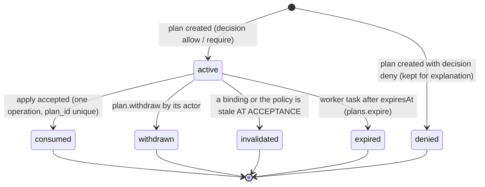
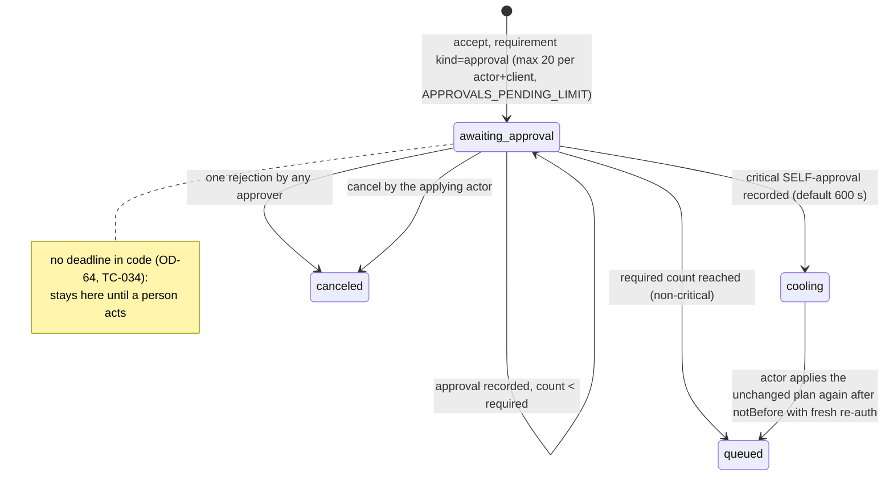
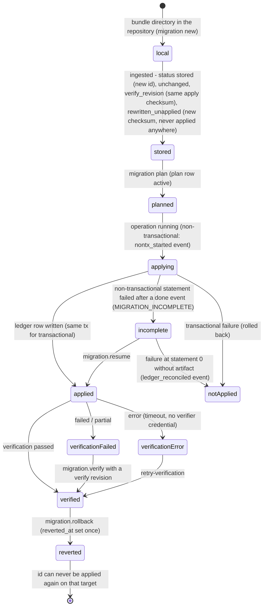
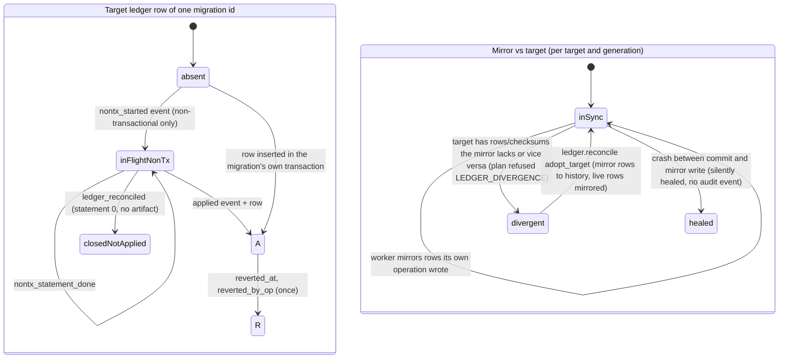
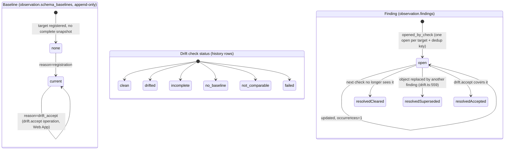

# E1: state machines, extracted from code at `d51da5d0`

Block E, static part (tester E1). Every diagram was drawn from the code, not from the
docs: state enums (SQL `CHECK`s in `packages/control-store/migrations`, TypeScript
tables), the guard triggers that decide which transitions exist, and the code that
performs each transition. Documents were compared afterwards. `T` = the tree at
`d51da5d0`. Paths are relative to `T`.

How to read the verdicts: **UNREACHABLE** (the enum value exists, no code path writes
it), **DEAD END** (a non-terminal state with no exit for an authorised person using only
the CLI, or only the CLI and the browser where the product demands it), **TWO MEANINGS**
(one stored value, different situations), **NOT SHOWN** (a UI or CLI cannot show or act
on it), **DOC≠CODE** (docs and code differ).

What was run (everything else is a static reading): a pure-code probe of
`verificationRetryable()` and `isErrorCode()` in a copy of the tree with the CLI
dependencies installed (Bun 1.3.14, not the pinned 1.4.4; the functions are
toolchain-free); `exponetdb commands` and a regeneration of `15-cli/reference.md` (178
commands, identical to the committed file). Probe script and output are summarised in
`recoverability.md` and `../F/findings-E1.md`.

Findings referenced as **SM-n** are listed with their reproduction in
`../F/findings-E1.md`.

---

## 1. Operations (`operations.operations.state`)

Source of truth: `packages/control-store/migrations/01M46KJ34887CQ6GFEX3SXMC2G_operations-engine/up.sql`
(state `CHECK` line 102, `state_admits` 125-139, `transition_allowed` 143-153, guard
trigger 160-205); TypeScript twin `packages/operations/src/states.ts:36-47`; the extra edge
`packages/control-store/migrations/01M61AGQKSBZ9VN71DHYFVCQHT_operation-supersession/up.sql:8-11`
(`recovery_transition_allowed`, guard replaced at 20-60).

```mermaid
stateDiagram-v2
  [*] --> awaiting_approval: accept (plan has an approval requirement)\naccept.ts:219
  [*] --> queued: accept (requirements met)
  awaiting_approval --> queued: enough approvals / cooled self-approval\nauth/approvals.ts:334
  awaiting_approval --> canceled: reject (approver) OR cancel (applying actor)\napprovals.ts:562, application.ts:1943-2000
  queued --> running: worker claims, locks taken, bindings re-checked\ndriver.ts:212
  queued --> failed: binding / admission stale under lock (PLAN_STALE)
  queued --> canceled: cancel (applying actor)
  running --> verifying: execute returned applied / partially_applied
  running --> failed: execute returned not_applied
  running --> needs_reconciliation: outcome unknown, or lease lost\ndriver.ts:293
  needs_reconciliation --> verifying: reconcile says applied
  needs_reconciliation --> failed: reconcile says not applied
  needs_reconciliation --> needs_attention: reconcile says unknown (target unreachable, lock not taken, contradictory)\ndriver.ts:346
  verifying --> succeeded: verification passed / not_applicable
  verifying --> verification_failed: failed / partial
  verifying --> needs_attention: verification ERROR (any exception in kind.verify)\ndriver.ts:400-406
  needs_attention --> verifying: retry-verification (4 migration kinds, applied/partially_applied only)\nleases.ts:57,132; views.ts:270-297
  needs_attention --> verification_failed: a RECOVERY PLAN that names it (migration.resume / migration.verify only)\nsupersede.ts:49-66
  succeeded --> [*]
  failed --> [*]
  verification_failed --> [*]
  canceled --> [*]
```

Outcome pairs (`state_admits`): `awaiting_approval/queued/running` = not_started with
verification pending|not_applicable; `verifying` = applied|partially_applied + pending;
`needs_reconciliation` = unknown; `needs_attention` = applied|partially_applied|unknown
with pending|error; `succeeded` = applied + passed|not_applicable; `failed` =
not_started|not_applied + not_applicable; `verification_failed` = applied|partially_applied
+ failed|partial; `canceled` = not_started + not_applicable.

### Code against docs (`02-control-plane/operations-engine.md` §3.3, §4.1)

| Item | Docs | Code | Verdict |
|---|---|---|---|
| `awaiting_approval → canceled` "window elapsed" | "rejected / window elapsed / withdrawn" (4.1, line 308) and "approval window (default 4 h, maximum 24 h)" (3.3, line 276), both `[DECIDED]` | no approval window anywhere: no setting, no sweeper; `grep` for `approvalWindow`/`APPROVAL_WINDOW` over `packages` and `apps` finds nothing. OD-64 (open) says "no deadline (today)" | **DOC≠CODE** (SM-3) |
| "withdrawn" edge from `awaiting_approval` | listed | withdrawal is a *plan* action (`plan.withdraw`, only while the plan is `active`); an operation is canceled by the applying actor (`application.ts:1943-2000`), not withdrawn | docs wording |
| `needs_attention → verifying` "operator retries verification" | any operation | only `migration.apply`, `migration.resume`, `migration.baseline`, `migration.verify` with apply `applied\|partially_applied` (`views.ts:270-297`); `verification.md:497` still says "only `migration.apply` and `migration.resume`" two paragraphs before it amends itself | **DOC≠CODE** inside the docs; **DEAD END** for everything else (SM-1) |
| `needs_attention → verification_failed` | "a recovery plan that names it supersedes it" | implemented, but only a `migration.resume` plan (names `originalOperationId`) or a `migration.verify` plan whose content carries a `migrationId` that is *applied on the target* can name an operation (`kind.ts:131`, `reverify.ts:131-134`, `recovery.ts:14-33`) | works for 2 of ~60 kinds |
| `operation.force_release` | registered in `contracts/src/actions.ts:1052`, documented in `concurrency.md:131` as the way out of a stuck lock "(Web App or CLI)" | no kind, no CLI command, no Web App page; `operations/README.md:44` and `locks.ts:14` say there is none | **UNREACHABLE** action (SM-1) |
| `OperationKind.reconcile` "reconciliation never re-executes" | yes | holds in `driver.ts:304-356` | OK |
| `canceled` | "rejected / window elapsed / withdrawn" | the same stored state and the same error code `OPERATION_CANCELLED` for a rejection by an approver and a cancel by the applying actor; only `detail.rejectedBy` vs `detail.canceledBy` differs (`approvals.ts:562-580`, `application.ts:1943-2000-2000`) | **TWO MEANINGS** (SM-7) |
| `verification_failed` | "verification failed or partial" | also the closing state of a superseded `needs_attention` operation whose verification **never ran**: `supersede.ts:56-62` writes `verificationOutcome: 'failed'` and turns `unknown` into `partially_applied`, although nothing failed and nothing was partial | **TWO MEANINGS**, one of them a false label (SM-2) |
| `failed` | "execution failed ... rolled back or not started" | also: stale under lock, grant revoked before anything ran, reconciled as not applied; told apart only by `errorCode` | several causes, one state (acceptable if the code is shown; CLI shows `The operation ended failed.` when `errorCode` is null, `apps/cli/src/cli/watch.ts:73`) |

### Exits for a person, state by state (CLI only; "Web" where the product forces a browser)

| State | Exit for an authorised human | Steps | Gap |
|---|---|---|---|
| `awaiting_approval` | approve or reject in the **Web App** (passkey/TOTP re-auth, ADR-0026; `exponetdb approval approve` only opens the page); cancel by the *applying* actor: `operation cancel` | 1 + browser | no deadline (SM-3); another person with the same permission cannot cancel someone else's request, only reject it in the Web App |
| `queued` | wait; `operation cancel` | 1 | none |
| `running` | wait (statement/lock timeouts bound it); a dead worker is taken over after the 30 s lease | 0 | **no way to stop** a running operation (documented: "a running operation is never interrupted"); `operation.force_release` absent |
| `needs_reconciliation` | wait for the worker (automatic) | 0 | if no worker ever runs, no exit; none is documented |
| `needs_attention` | migration kinds with an applied change: `operation retry-verification`; migration kinds: a recovery plan; **all other kinds: none** | 1-4 or ∞ | **DEAD END** (SM-1, SM-2) |
| `verification_failed` | terminal; forward-fix migration, `migration verify` after a verify revision, or `migration rollback` plan | 3-6 | the verify revision cannot be stored by the CLI (SM-4) |
| `succeeded`, `failed`, `canceled` | terminal | | |

---

## 2. Plans (`operations.plans.state`)

`up.sql` line 16 (`CHECK`), guard 35-63. Written by `packages/operations/src/plans.ts:348-373`
(`endPlan`), `accept.ts:119-135` (`invalidate`), `plans.ts:412-438` (`expirePlans`, a worker
task `plans.expire`, `apps/server/src/composition/worker-tasks.ts:209-213`).

* **Reachable, no dead end.** A plan is never stuck: every non-`active` state is terminal
  and a new plan is the answer (`PLAN_STALE`, `PLAN_EXPIRED`).
* **DOC≠CODE (small).** `operations-engine.md:3.4` draws `active → invalidated` as
  "binding failure detected" without saying when. Only `acceptPlan` writes `invalidated`
  (`accept.ts:111-135`); a plan whose binding changed but that nobody applies stays
  `active` until it expires. The Web App check list says "A binding changed after the
  plan was made" only after an apply attempt.
* **TWO MEANINGS (derived).** A plan can be `active` in the table and past `expiresAt`
  until the worker task runs. `acceptPlan` checks the clock itself (`accept.ts:179-184`),
  so this is safe, but `plan list --state active` can list plans that can no longer be
  applied while the worker is down (P3).
* The state list is complete in the CLI (`apps/cli/src/commands/plan.ts:81`) and the Web
  App (`apps/web/src/lib/i18n/messages/plans.ts:229-231`).

---

## 3. Approvals

Approvals are rows (`approvals.plan_approvals`, decision `approved|rejected`, append-only
evidence) plus the operation state `awaiting_approval`. There is no approval state column.
Code: `packages/auth/src/approvals.ts`.

* "cooling" is not a stored state: it is `awaiting_approval` plus an approval row with
  `cooling_seconds > 0` (`approvals.ts:coolingOperationOfPlan`, ~615). **TWO MEANINGS** of
  `awaiting_approval` for a reader of `operation show`: "waits for an approver" and
  "approved, waiting for you to apply again". The CLI sets `nextAction` from the server
  (`operationNext`, `apps/cli/src/output/views.ts:365-395`); the cooling case is covered by
  `APPROVAL_COOLING_PERIOD` details (`notBefore`) only when the apply is tried.
* An approval of a plan that was meanwhile made stale ends in `PLAN_STALE` when the worker
  starts it (`driver.ts` admission, `operations-engine.md` §4.2): nothing executes. Fine.
* **No expiry of the operation** (SM-3): `awaiting_approval` never leaves on its own. The
  `plan` is already `consumed`, so `plan list` shows the plan as consumed and `approval list`
  is the only place that shows the wait.
* **Exits via CLI:** none for the approver (browser required by design), `operation cancel`
  for the applying actor. A person who lost the applying identity (disabled account) cannot
  cancel; an approver can still reject.

---

## 4. Migration bundles, "as stored and used"

A bundle has no state column. What exists is an immutable revision store plus states
that are *derived* from the target ledger. Code: `packages/control-store/migrations/01M4QEE7JX03XAZJKZ2MRT8JJT_migration-engine/up.sql:26-57`
(`migrations.bundle_revisions`, immutable by trigger), `packages/migrations-engine/src/store.ts:56`
(`IngestStatus`), `planner.ts:595` (ingest inside the plan transaction).

* **No withdrawn/deleted state for a stored revision.** `bundle_revisions` rejects UPDATE,
  DELETE and TRUNCATE (`up.sql:49-52`). A revision ingested by a plan that is then denied
  is committed with the denied plan (a denied plan is stored on purpose, `planning-and-apply.md`
  §3 step 8) and stays in the project stream for ever. There is **no CLI command that lists
  stored revisions** and none that ingests them (`exponetdb commands`: no `ingest`, no
  `bundle`); `migration status` shows the ledger and the pending set only. Candidate:
  bundle store doctor (see `../E/proposals.md`, owned by another tester).
* **NOT SHOWN / NOT REACHABLE FROM THE CLI (SM-4).** The verify-revision step of the
  documented recovery (`verification.md:419-433`: "The new bundle revision is ingested")
  has no CLI command. `migration plan` ingests inside the plan transaction and then refuses
  with `MIGRATION_ALREADY_APPLIED` when nothing is pending (`planner.ts:350-352`), which
  rolls the ingest back with the transaction (static reading of `#h.plan`; the stack run is
  requested from block C). `migration.bundle.ingest` exists in REST (`packages/application/src/migrations.ts:93-113`)
  and in the SDK; MCP and the CLI have no tool for it.
* **"Applied anywhere" is read from the mirror** (`store.ts:132`, `appliedElsewhere` reads
  `migrations.ledger_mirror`), so after `ledger.reconcile` moved rows to
  `ledger_mirror_history` a bundle id that is applied on a target can be re-ingested with
  different bytes (`rewritten_unapplied`). The planner still catches it against the live
  ledger (`planner.ts:331-338`, `MIGRATION_CHECKSUM_MISMATCH`), so this is defence in depth
  that is weaker than documented, not an exploit (P3).
* **Reverted is terminal per target and per id.** `MIGRATION_REVERTED` (`planner.ts:342`).
  Docs say so (`failure-and-recovery.md` §3); the CLI/Web do not warn at rollback time that
  the id is burnt for this target.

---

## 5. The ledger (target ledger + Control Store mirror)

Target: schema `exponetdb` (`ledger.md` §2): `schema_migrations` (row = applied; `reverted_at`
set once), `migration_verifications` (append-only), `migration_events`
(`nontx_started`, `nontx_statement_done`, `nontx_failed`, `applied`, `reverted`, `imported`,
`baselined`, `ledger_reconciled`). Control Store: `migrations.ledger_mirror`,
`migrations.ledger_state` (`divergent`, `divergence`), `migrations.verification_mirror`,
`migrations.operation_migrations` (per-migration outcomes), `migrations.ledger_mirror_history`
(`01M61C90YHV706H2B8EW39TBAF_ledger-reconcile`).

* **UNREACHABLE (docs).** `ledger.md` §5 documents an audit event `ledger.mirror_healed`; the
  text itself says it is "still not built (the heal needs none)". `LEDGER_DIVERGENCE`
  "target suspended for schema changes" in the table of §5 is **not** a target state: the gate
  is the live comparison on every plan (`divergence.ts`), the `divergent` flag is
  "information, not a gate" (§5 later). Two different statements in one section (P3).
* **TWO MEANINGS of "baseline"** (SM-6): ledger row `origin='baseline'`, `baseline:<slug>`
  DAG node and `ledger_meta.baseline_id` (legacy import) against `observation.schema_baselines`
  (the drift reference, ids `smp_…`). `migration verify baseline:<slug>` and
  `drift.accept` both "make a schema the drift reference". See `vocabulary.md`.
* **Reverted rows are one-way.** `R` has no exit; the only repair is a new migration id.
* **DOC≠CODE:** `flag_untrusted` of `ledger.reconcile` is refused `not_built` (OD-59), docs
  say so.
* **Verification per migration** (`migration_verifications.status`): `passed|failed|partial|error`;
  current status = latest row, or `pending`. A superseded `needs_attention` operation (SM-2)
  has *no* verification row at all although its operation says `verificationOutcome: failed`.

---

## 6. Drift: checks, baselines, findings

Code: `packages/control-store/migrations/01M48WRFNGYF5WH0884N169FNH_observation/up.sql:62-118`
(+ `01M4R66846BD63S51NS15EZKB1_migration-baselines`, `01M4V4DA2W7HK9QB5NZ3XT6RME_drift-acceptance`),
`packages/diagnostics/src/drift.ts`, `drift-accept.ts`, `findings.ts`.

* **DOC≠CODE / CLI gap (SM-5).** `drift-detection.md` §5: `drift.accept` is planned "by a person
  through the Web App **or the CLI**"; `operations-engine.md` §2 repeats it. The CLI has
  `finding list|show|summary` and `drift check`, **no** accept (178 commands, none matching
  `accept`; the plan route `drift.accept.plan` is in `contracts` and the SDK only). Accepting drift
  therefore needs the Web App.
* A resolved finding never re-opens: a recurrence is a new `fnd_` id (partial unique index
  `findings_one_open`). The history of one object's drift is split across ids.
* `no_baseline` with an empty baseline floods `object_added` findings (OD-61, open).
* `accepted` exists as a resolution but no CLI/MCP read says *which* operation accepted
  it (the finding view carries `resolution` only).
* Two statuses with "no result" meaning: `incomplete` (snapshot lacked visibility) and
  `not_comparable` (canonicalizer or PG major differs, e.g. after a major upgrade). Neither
  changes a finding; a target can be stuck in `not_comparable` after a PG major upgrade until a
  new baseline is accepted (not tested; the runbook for major upgrades is `[PLANNED]`, `upgrades.md` §4).

---

## 7. Smaller machines (brief)

| Machine | States (source) | Exits / notes |
|---|---|---|
| **Step-up receipts** (`stepup.step_ups`) | `pending, confirmed, redeemed, expired, refused, canceled` (`01M4QT02MQ05WZ8J29C134Y45A_step-up/up.sql:24-25`, guard 54-73) | `pending → confirmed\|expired\|refused\|canceled`, `confirmed → redeemed\|expired\|refused\|canceled`. **UNREACHABLE value:** `expired` is never written (no `SET state = 'expired'` in `packages/auth/src/stepup.ts`; `stepup.ts:92-93` derives it on read), so a stored `pending`/`confirmed` row can be past its time: **TWO MEANINGS** (P3). The user code lockout (`refused`, 5 attempts, `code_attempts`) has no unlock; the person starts a new step-up (`auth reauth`). |
| **Enrollment tokens** (`nodes.enrollment_tokens`) | `created, issued, used, expired` (`01M49K5NQ8ZB4W2T6Y3H7RXJMD_nodes/up.sql:66`, guard 280-322) | `created → issued` (reveal, within `reveal_until`; issued token valid 30 min) `→ used` (node redeems). **UNREACHABLE value:** `expired` is allowed by the guard but nothing writes it (`nodes/src/tokens.ts` only writes `issued`). An unrevealed or unused token past its time stays `created`/`issued`. A new `node enrollment create` is the exit (1 step + step-up). |
| **Nodes** (`nodes.nodes.state`) | `pending_binding, active, degraded, binding_failed, revoked, decommissioned` | `pending_binding → active\|binding_failed`; `active ⇄ degraded`; `* → revoked → decommissioned`. CLI text mentions `offline` (`node status`), which is **not** a stored state (derived from heartbeat age). `binding_failed` is terminal: enroll again. |
| **Node jobs** (`nodes.jobs.state`) | `pending, dispatched, running, completed, expired, canceled, outcome_unknown` | a dispatched job not started within 60 s returns to `pending` (ADR-0024 §4). `outcome_unknown` is terminal; the owning operation goes to `needs_reconciliation`/`needs_attention`. |
| **Backup runs** (`backups.runs.state`) | `starting, running, succeeded, failed, canceled, lost, unknown` (`01M5X840BK55NGFGQ5G3Z1C5NH_backup-catalog/up.sql:87`, guard 391-422; transitions `backups/src/kinds.ts:657-745`) | `unknown` is non-terminal (the run guard freezes only `succeeded\|failed\|canceled\|lost`) and is left by the owning operation's reconcile (`kinds.ts:709-745`). A run record in `unknown` whose operation is itself in `needs_attention` has the SM-1 problem: no `retry-verification` for `backup.*`, no recovery plan. `not_found` from the node is stored as `lost`. |
| **Restores** (`backups.restores.state`) | `planned, preparing, restoring, recovering, verifying, ready, failed, discarded, promoted, needs_attention` (`up.sql:166`, guard 476-509) | `* (not discarded/promoted) → discarded` via `restore discard` (a plan, `kinds.ts:1556`). **UNREACHABLE:** `promoted` (the guard raises `no operation promotes a restore yet`, `up.sql:494-497`; the Web App has the label `wave9.restoreState.promoted`). A recovery restore in `ready` has no product exit except `discard`; the placement move that would promote it is `[PLANNED]` (RB-08 step 7). A restore in `needs_attention` exits only by `discard`. |
| **Drills** (`backups.drills.outcome`) | `pending, passed, failed, aborted, attested` | `attested` only for `mode=offline_runbook` (CHECK); a measured RTO only on `passed`. `pending` for a `control_plane` drill whose restore died in `needs_attention` has no sweeper (not read in code; stack test). |
| **Break-glass** (`bgl_`) | `breakglass.activate` is refused when no notification channel exists (OD-21, `BREAK_GLASS_UNAVAILABLE`/`notification_channel_not_configured`) | the *state machine is unreachable in this installation*: no grant can be activated, so `hotfix_without_evidence` and `--break-glass` can never be exercised. The CLI has no activate command at all (`migration plan --break-glass <bgl_>` only consumes one), contrary to `staging-production-policy.md:178` "in the Web App or the CLI". |
| **Legacy import report** (`migrations.import_reports.state`) | `pending, incomplete, open, baselined, superseded` (`01M4QPP4T3E31ANKDVSR7T3YHS_legacy-import/up.sql:15`) | `open → baselined` by `migration import baseline` (plan + apply); `superseded` when a newer report replaces it (`legacy.ts:1304`); `incomplete` exits only by a new `analyze` (the report is immutable). Not exhaustively traced. |

---

## 8. Summary of defects found by this pass

| Id | Severity | One line |
|---|---|---|
| SM-1 | P1 | `needs_attention` has no exit for any kind outside `migration.{apply,resume,baseline,verify}`; it keeps its exclusivity domains; `operation.force_release` is registered but unbuilt |
| SM-2 | P1 | `needs_attention` with apply outcome `unknown` has no exit when the migration turned out not to be applied; a supersession rewrites a never-run verification as `failed` |
| SM-3 | P2 | `awaiting_approval` has no deadline although §3.3/§4.1 (`[DECIDED]`) document a 4 h window and a "window elapsed" cancel |
| SM-4 | P2 | no CLI step stores a verify revision, so the documented repair of a broken `verify.sql` is not completable with the CLI alone |
| SM-5 | P2 | `drift.accept` is documented for "the Web App or the CLI"; the CLI has no command |
| SM-6 | P3 | "baseline" names two unrelated things (ledger baseline vs drift baseline) |
| SM-7 | P3 | `canceled` conflates "rejected by an approver" and "canceled by the applier" |
| SM-8 | P3 | stored-but-never-written enum values (`step_up expired`, `enrollment token expired`, `restore promoted`) and derived states shown as stored |
