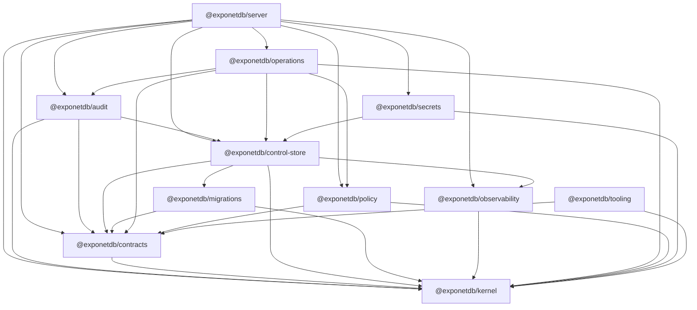

# Package graph

Generated by `bun run boundaries -- --write` from the workspace manifests;
checked in CI against the allowed graph in `graph.json`
([package-architecture.md §2](../../exponetdb-docs/01-architecture/package-architecture.md#2-dependency-rules)).

